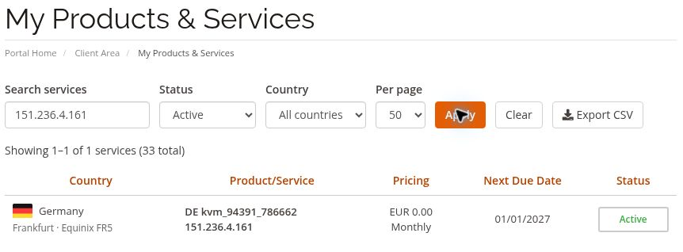
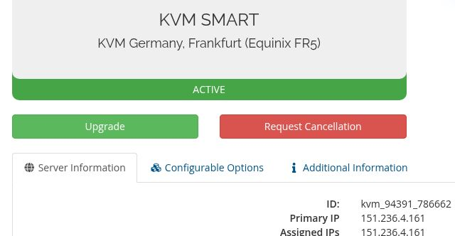
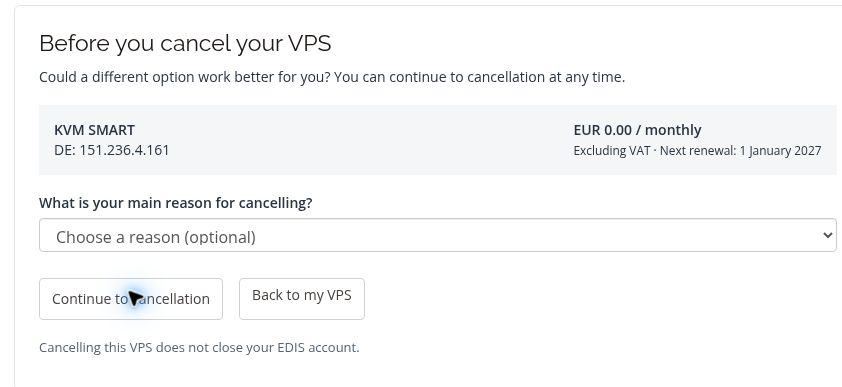
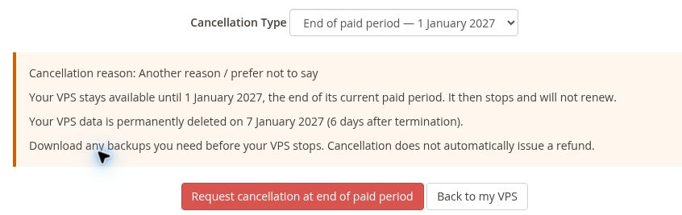

Cancel your EDIS Global VPS in the [VPS Management Portal](https://manage.edisglobal.com/clientarea.php).

**Back up your data first.**

<Steps>
  <Step title="Open your VPS">
    Go to **Services** and select your VPS. Check its hostname and IP address.

    
  </Step>
  <Step title="Request cancellation">
    Click **Request Cancellation**.

    
  </Step>
  <Step title="Continue">
    You may choose a reason, then click **Continue to cancellation**.

    
  </Step>
  <Step title="Choose when to stop and confirm">
    - **End of paid period:** keep using your VPS until the displayed date.
    - **Immediate:** stop the VPS now.

    Check the stop and deletion dates, then click the red **Request cancellation…** button.

    
  </Step>
</Steps>

Your VPS data is permanently deleted **six days after termination**, not six days after an end-of-term request. Keep your own backup.

Cancellation removes this VPS's renewal charges from outstanding pro-forma invoices. Charges for other services remain. Unused time already paid for is not refunded.

<Tip>
  **Already requested cancellation and want to keep your VPS?** You can withdraw an immediate or end-of-term cancellation before the server is deleted, for up to **six days after termination**. Open **Portal Home → VPS Cancellation Requests → Manage Cancellations → Revoke Cancellation**. See [**Manage VPS cancellation requests**](/faq/billing-lifecycle/manage-cancellation-requests) for screenshots and instructions.
</Tip>
