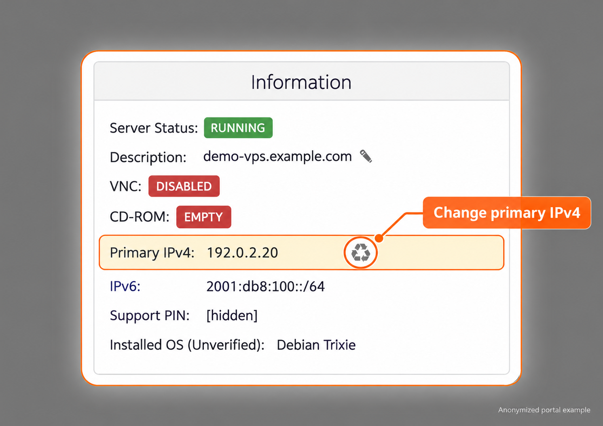
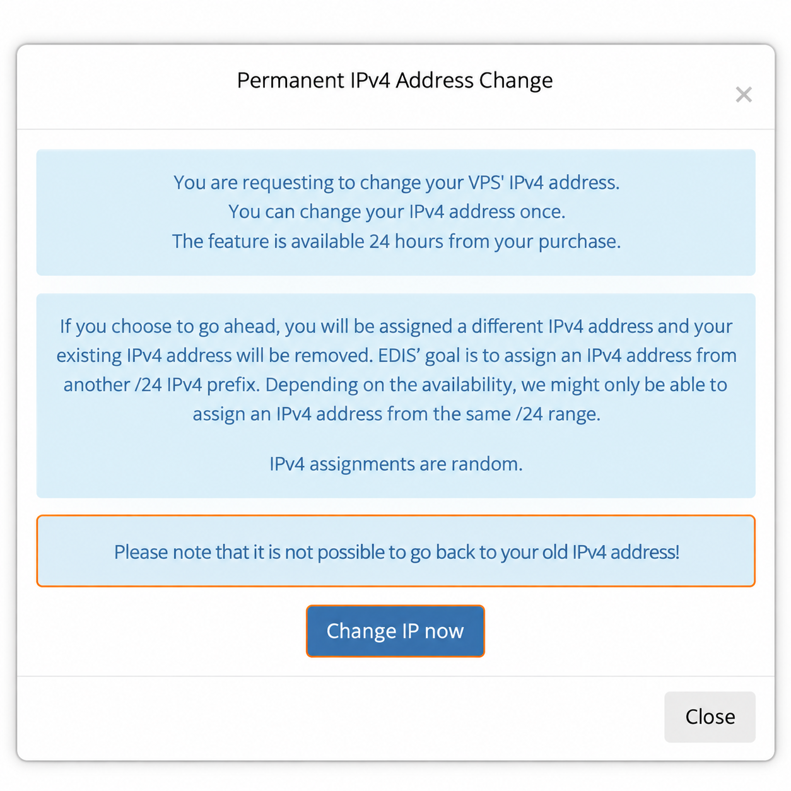

import { CtaButton } from "/snippets/cta-button.mdx";

## How to change your IP address

### Free IP change within 24 hours

You are eligible for one **free change of your primary IPv4 address** if you request it within the first 24 hours after the VPS is delivered.

Changing the IP address keeps the same VPS service, server location, plan, and billing cycle.

<Info>
  **The portal shows the recycle icon beside Primary IPv4 only during the first 24 hours after service delivery.** It normally disappears when this free-change window ends. This is different from the refresh icon in the paid Bespoke selector described below. After that, use the [paid IP change options below](#ip-change-after-24-hours).
</Info>

<Steps>
  <Step title="Open your VPS">
    Log in to the [VPS Management Portal](https://manage.edisglobal.com/clientarea.php), open **Services**, and select your VPS.
  </Step>

  <Step title="Request the IP change">
    In the **Information** panel, find **Primary IPv4** and click the small **♻ recycle icon** beside the address.
  </Step>

  <Step title="Review and confirm">
    Read the **Permanent IPv4 Address Change** dialog. Clicking **Change IP now** replaces the address; clicking **Close** leaves it unchanged. The dialog warns that the old address cannot be restored through this action and that allocation is random.
  </Step>

  <Step title="Configure the new IP">
    Reinstall the VPS or configure the new IP manually through VNC. The old address stops working immediately when the new IP is assigned.
  </Step>
</Steps>

<Frame caption="Eligible VPS within the first 24 hours. The recycle icon beside Primary IPv4 normally disappears 24 hours after service delivery. Cropped and anonymized.">
  
</Frame>

<Frame caption="Read the confirmation before replacing the IP address.">
  
</Frame>

<Info>
  A free primary IPv4 change does **not** remove your refund eligibility. You may still request a refund within the original 24-hour window if all other [refund conditions](/faq/billing-lifecycle/cancellation-and-refund-policy) are met.
</Info>

If you receive a free [location replacement](/faq/server-locations/change-server-location), the replacement VPS also includes the option of one additional free primary IPv4 change if required. Because the location has already changed, the replacement service is not eligible for a refund.

The free change applies only to the primary IPv4 address. Use the paid **Standard** or **Bespoke IP Change** service to change additional IPv4 addresses.

## IP change after 24 hours

Paid IP changes are available at any time, including after the first 24 hours from service delivery:

| Option | Price | Description |
| --- | --- | --- |
| **Standard IP Change** | **EUR 5** | EDIS Global assigns an available IP automatically. You cannot select or guarantee a particular subnet. |
| **Bespoke IP Change** | **EUR 10** | You select an IP from a list of available addresses and prefixes. |

### Standard IP change

EDIS Global processes standard paid primary-IP replacements automatically in real time once you complete the request and payment. Allocation is random; you cannot influence the subnet selection or guarantee a different prefix.

<CtaButton label="Order Standard IP Change" link="https://manage.edisglobal.com/cart.php?gid=addons" />

### Bespoke IP change

Choose your replacement address before completing checkout:

<Steps>
  <Step title="Open the IP-change page">
    Open [Change IP Address](https://manage.edisglobal.com/cart.php?gid=addons) and sign in if prompted. In the **Bespoke IP Change** card, select the VPS whose IP you want to replace.

    This first dropdown shows your existing VPS and its current IP; it is **not** the list of replacement addresses.
  </Step>
  <Step title="Click Order Now">
    Click **Order Now** in the **Bespoke IP Change** card to open **Review & Checkout**.
  </Step>
  <Step title="Select New IP">
    Check **Select Old IP**, then open **Select New IP** to see and choose an available replacement address.

    The **recycle/refresh icon** beside or below **Select New IP** refreshes the available-address list. If you need a different subnet, inspect the displayed addresses before choosing.
  </Step>
</Steps>

Opening the page, clicking **Order Now** to reach the selector, or refreshing the list does not itself complete checkout or replace your IP. Complete **Checkout** and payment only when you decide to purchase. Availability can change; a particular address or prefix is not guaranteed.

<Info>
  The Bespoke list refresh icon is separate from the free primary-IP-change icon in VPS Information. The list refresh is not restricted to the first 24 hours.
</Info>

### Can I test a candidate IP before purchase?

You can screen a candidate IP against a public blocking database such as [Cheburcheck](https://cheburcheck.ru/). This is a database lookup, not a live connection test; no listing does not prove that the IP or your VPN protocol will be reachable.

The selector contains unassigned addresses, not working test endpoints. EDIS Global cannot temporarily assign or configure these addresses for pre-purchase ping tests. A timeout from an unassigned address does not establish whether it is filtered.

A public location test IP is a separate endpoint and cannot verify a specific candidate. Successful ping also does not prove VPN or application access: Roskomnadzor (RKN) can filter protocols or ports, including HTTPS/443 and SSH. Neither current nor future connectivity from Russia is guaranteed.

<CtaButton label="Order Bespoke IP Change" link="https://manage.edisglobal.com/cart.php?gid=addons" />

## Configure the new IP after any change

<Warning>
  Once EDIS Global assigns the new IP, the old IP stops working immediately. Configure the new address manually through VNC to preserve your operating system and data. Reinstallation is an alternative, but **deletes the existing operating system and all data**; back up anything needed first.
</Warning>

<CtaButton label="Reinstall Linux or Windows" link="/vps-management/autoinstall-reinstall-install-vps-linux-windows" />

<CtaButton label="Enable VNC" link="/vps-management/enable-vnc-server" />

To keep the installed operating system, follow the manual configuration guide for [Ubuntu](/vps-management/manually-change-the-ip-address-in-ubuntu-versions-1804-to-2404) or [Windows Server](/vps-management/how-to-change-ip-address-in-windows-server). Read the new address, mask or prefix, and gateway from **Network Info**.

## Connectivity and repeated changes

An IP change cannot guarantee access from a particular country or ISP, access to a particular website, or a particular IP-reputation or blocklist status. External filtering may affect an entire prefix or protocol. EDIS Global prefixes may already be blocked in Russia, and an address that works today may become inaccessible later.

Repeated changes remain subject to address inventory, account review, and the [Acceptable Use Policy](/getting-started/acceptable-use-policy). Update VPN endpoint settings and any relevant DNS records after the change. For address and prefix selection, see [Bespoke IP change](#bespoke-ip-change).

## Summary

- During the first 24 hours after service delivery, you may change the primary IPv4 address once free of charge.
- A primary IPv4 change does not remove refund eligibility during the original 24-hour window.
- A free location replacement includes the option of one additional free primary IPv4 change if required.
- After 24 hours, select a Standard or Bespoke paid IP change.
- Reinstall the VPS or configure the new IP manually after every IP change.
- A [server location change](/faq/server-locations/change-server-location) is a direct VPS replacement and follows different refund rules.
