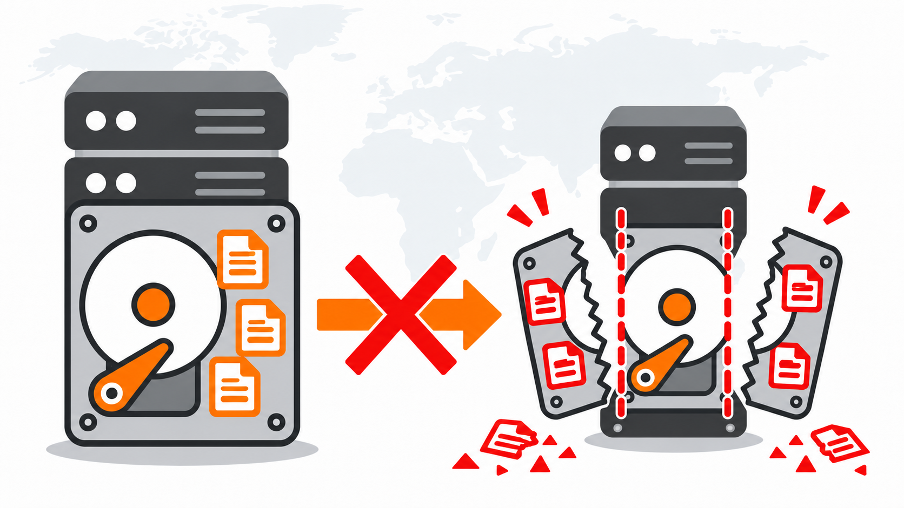

## Downgrades are technically unavailable {#we-only-support-upgrades-on-our-vps-plans}

**You cannot downgrade an existing EDIS Global VPS to a smaller plan.** This is a technical limitation of our platform, not an approval decision. Human support cannot override it, including at renewal.

## Why a larger virtual disk cannot fit into a smaller VPS

Your KVM VPS has an allocated virtual disk. A smaller plan may provide less disk capacity than that existing disk. The larger disk cannot simply be placed into the smaller allocation, and EDIS Global does not provide an in-place disk-shrinking or downgrade operation. Deleting files or using only a small part of the disk does not make a downgrade available.

_Cutting off parts of a virtual disk would destroy data. The severed sides illustrate that risk; we do not perform this operation. This is a metaphor for allocated storage capacity, not the physical size of a drive._

## How to move to a smaller plan

A smaller plan requires a **separate new VPS**, not a change to your existing VPS:

1. Back up your data and check that your applications and files will fit the smaller plan.
2. Order the smaller VPS you want.
3. Set it up, migrate your applications and data, and update any configuration that uses the old IP address.
4. Verify that the new VPS works before [cancelling the old service](/faq/billing-lifecycle/cancel-a-service).

<Warning>
  **The new VPS receives a different, randomly selected IP address.** Cancelling and re-ordering does not preserve or reassign your previous IP, even in the same location. Your data and applications are not transferred automatically.
</Warning>

If keeping your current IP address is essential, keep the existing VPS. Do not cancel it expecting to receive the same IP on a new order.

<Note>
  Requesting a downgrade does not change your current service, renewal price or invoice. A human can help explain cancellation and a separate new order, but cannot approve an in-place downgrade.
</Note>
