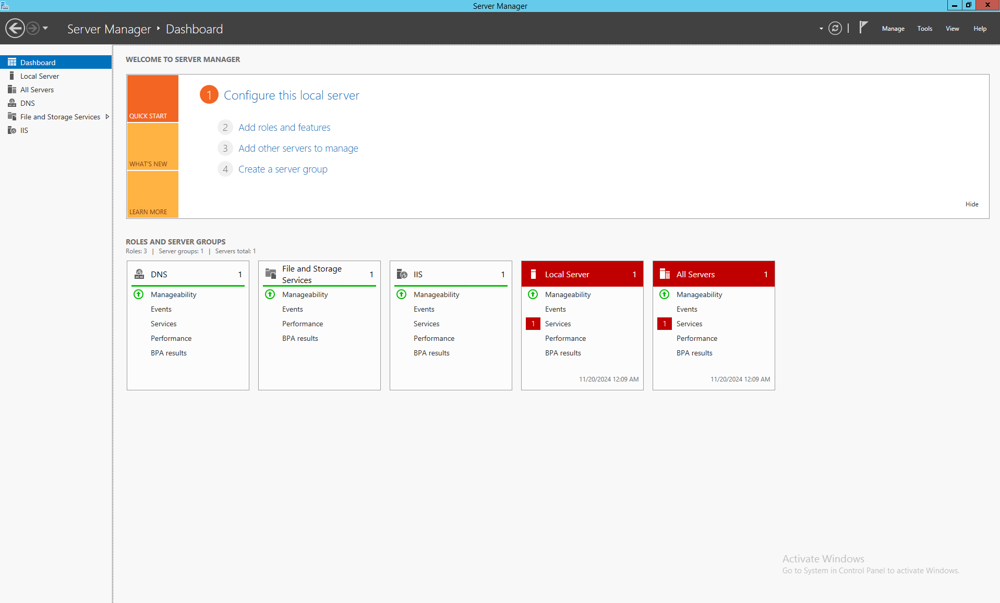
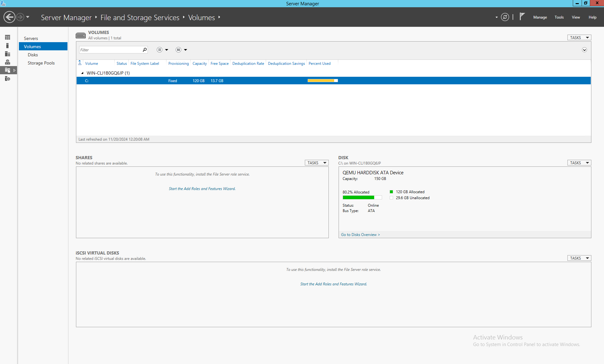
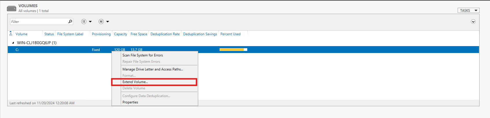
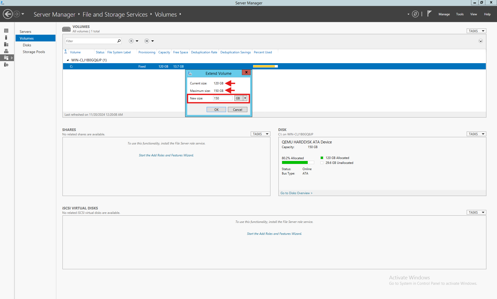
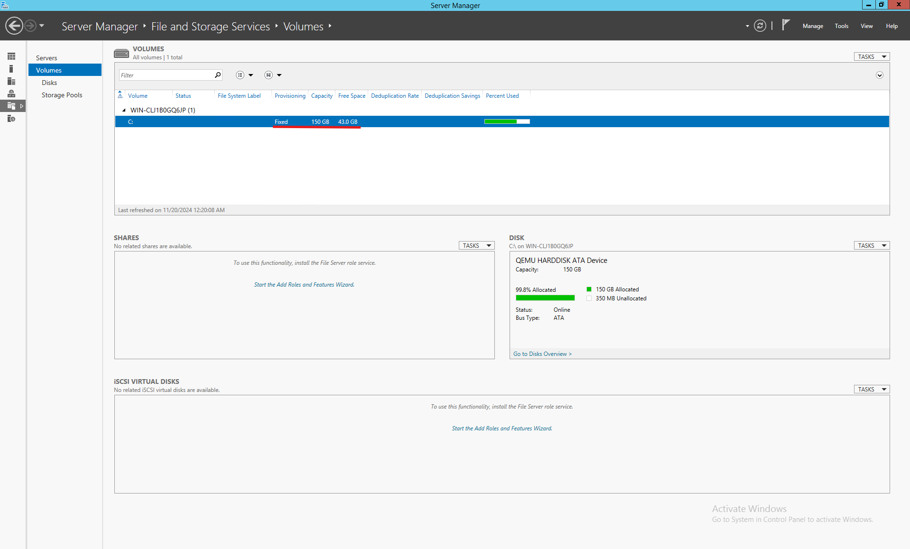

## Введение {#introduction}

Управление дисковым пространством — важная задача в Windows Server. Раздел **File and Storage Services** в **Server Manager** позволяет удобно увеличивать и уменьшать тома. Ниже описана процедура.

Используйте руководство после повышения тарифа VPS или добавления до **400 GB** через Drive Size Boost. EDIS Global увеличивает виртуальный диск, но Windows не расширяет существующий раздел автоматически.

<Note>
  Для полного применения расширения сначала завершите работу ОС, выключите сервер в портале и включите его оттуда снова. Так система распознает новые параметры диска.

  Дополнительное место останется недоступным, пока вы не расширите диск или раздел. Форматирование нужно только при создании нового раздела.
</Note>

---

## Как изменить размер диска {#how-to-resize-a-hard-drive}

## Шаг 1. Откройте Server Manager {#step-1-access-server-manager}

1. **Войдите на сервер:** подключитесь через удалённый рабочий стол или локальную консоль.
2. **Откройте Server Manager:** нажмите **Start** и выберите **Server Manager**. Если он не открылся автоматически, найдите и запустите `ServerManager.exe`.

---

## Шаг 2. Перейдите в File and Storage Services {#step-2-navigate-to-file-and-storage-services}

1. В Server Manager выберите **File and Storage Services** слева.
2. Нажмите **Volumes**, чтобы увидеть настроенные диски сервера.

---

## Шаг 3. Выберите нужный том {#step-3-select-the-target-volume}

1. В **Volumes** найдите диск, размер которого нужно изменить.
2. Нажмите правой кнопкой и выберите **Extend Volume** для увеличения или **Shrink Volume** для уменьшения.

---

## Шаг 4. Расширьте том {#step-4-extend-a-volume}

1. Если на диске есть нераспределённое место, **Extend Volume** откроет мастер его добавления к тому.
2. Укажите добавляемый объём.
3. Нажмите **OK** для применения.

---

## Шаг 5. Уменьшите том {#step-5-shrink-a-volume}

1. Нажмите правой кнопкой на нужный диск и выберите **Shrink Volume**.
2. Укажите, сколько места нужно освободить.
3. Нажмите **OK**.
4. Освободившееся место появится как **Unallocated Space**.

---

## Шаг 6. Проверьте изменения {#step-6-verify-changes}

1. Вернитесь в **Volumes** в Server Manager и проверьте новый размер.
2. Для более подробного просмотра используйте **Disk Management**.

---

## Важные замечания {#important-notes}

- **Резервная копия:** перед любыми изменениями диска сохраните важные данные.
- **Требования к свободному месту:** для базового тома оно должно быть на том же диске сразу **после** расширяемого тома. Промежуточный восстановительный или другой раздел мешает обычному расширению.
- **Используемые тома:** если том занят активными службами или приложениями, может потребоваться перезапуск.

---

## Частые проблемы и решения {#common-issues-and-solutions}

1. **Extend Volume недоступен:** рядом с томом нет непрерывного нераспределённого места. Проверьте схему в **Disk Management** (`diskmgmt.msc`). Не удаляйте восстановительный, EFI-раздел или раздел данных только ради активации кнопки. Сначала сделайте копию и выберите процедуру для своей схемы. Поддерживаемые варианты описаны Microsoft в [Extend a volume](https://learn.microsoft.com/en-us/windows-server/storage/disk-management/extend-a-basic-volume?tabs=disk-management).
2. **Ограничено уменьшение тома:** системные файлы или зарезервированные разделы могут ограничивать доступное уменьшение. Для дополнительного управления используйте инструменты вроде **Diskpart**.

---

## Альтернативные инструменты {#alternative-tools}

Если File and Storage Services недостаточно:

- **Disk Management** — базовые операции с дисками.
- **Diskpart** или **PowerShell** — расширенное управление.
- Сторонние программы, например **MiniTool Partition Wizard** или **EaseUS Partition Master**.
