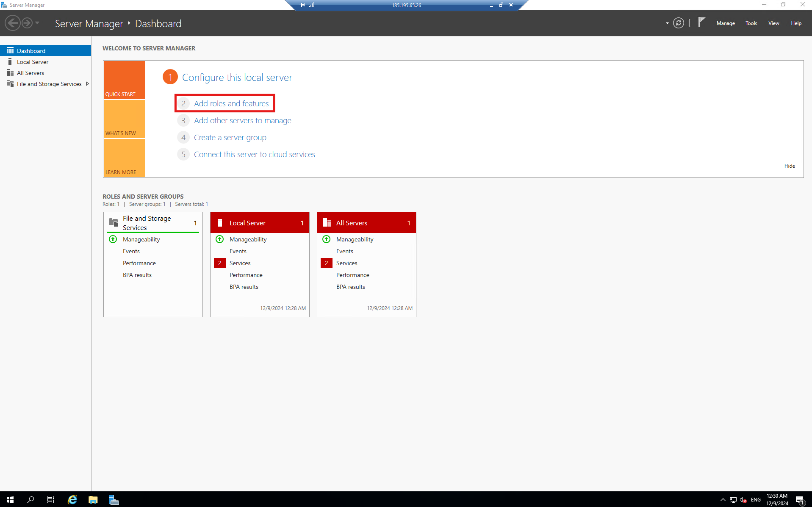
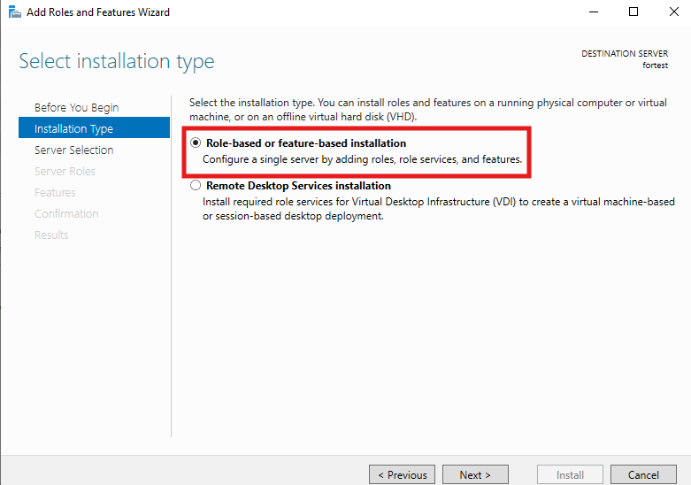
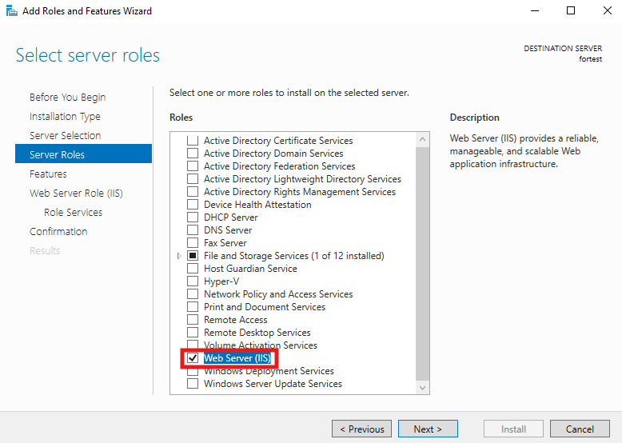
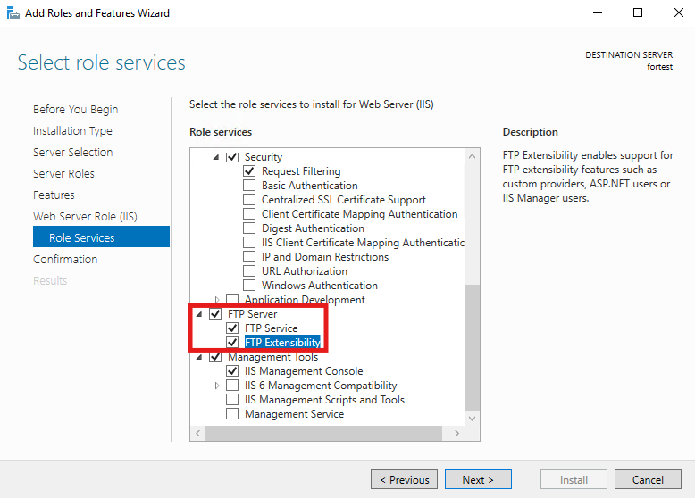
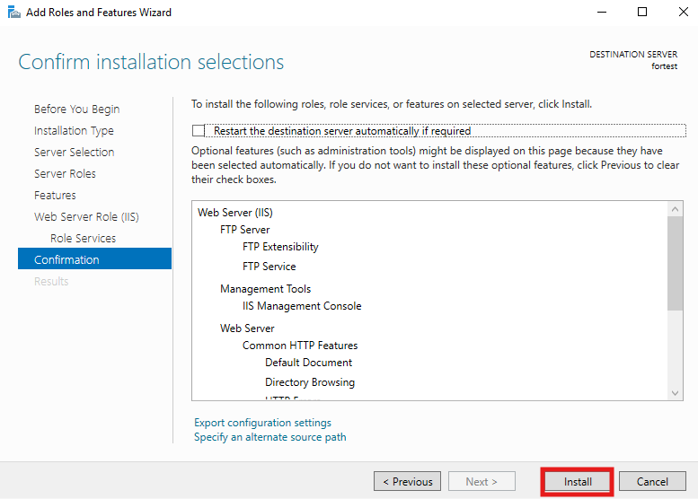
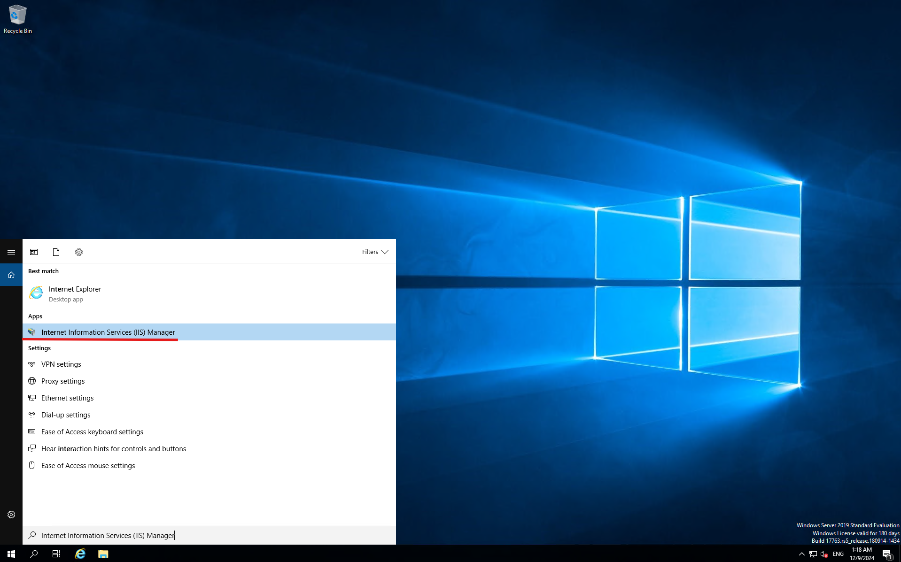
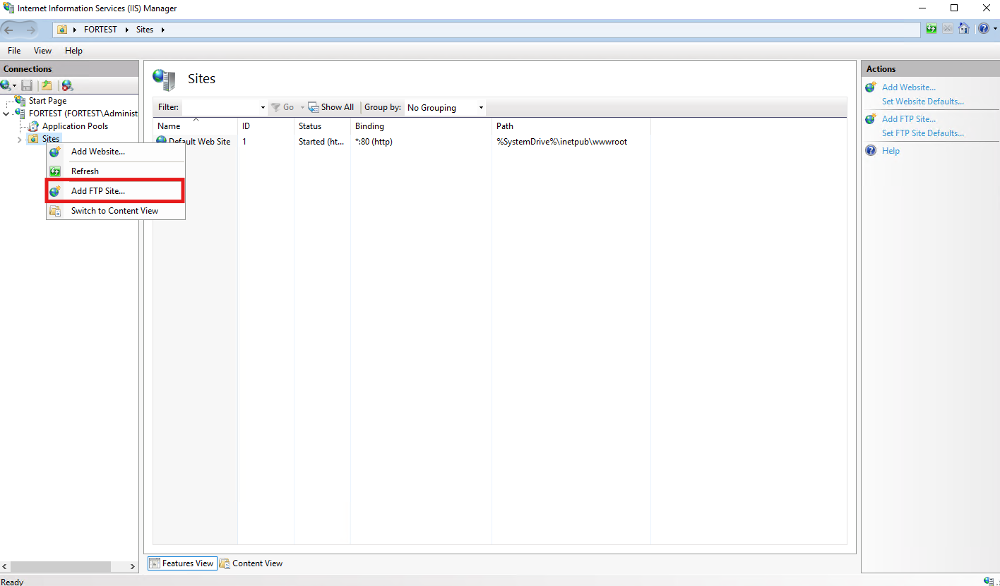
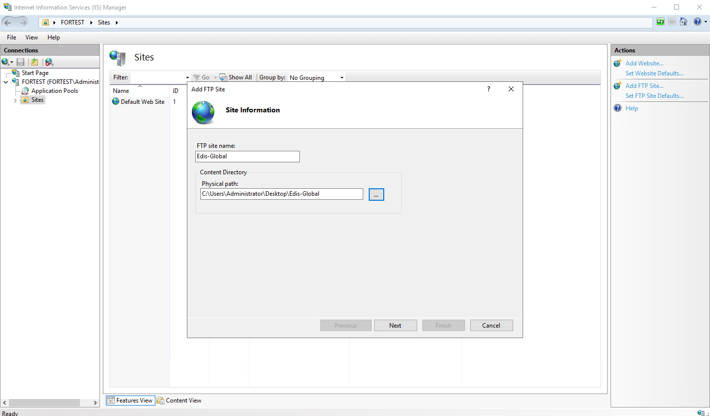
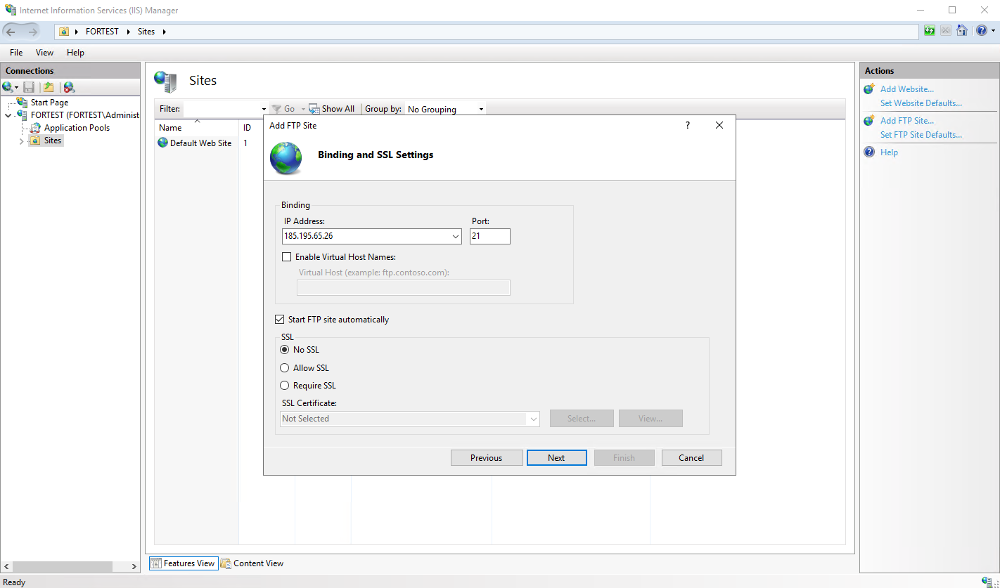
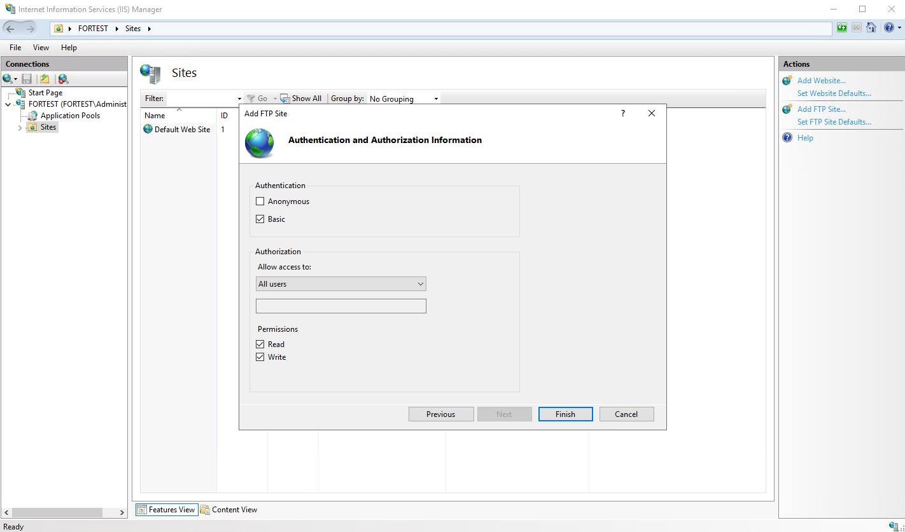

## Установите FTP для удобной загрузки и скачивания {#install-ftp-for-easy-file-uploads-and-downloads}

FTP-сервер (File Transfer Protocol) в Windows Server позволяет удобно загружать и скачивать файлы. Руководство описывает включение и настройку FTP через встроенную службу IIS (Internet Information Services).

## Предварительные требования {#prerequisites}

- Windows Server 2019, 2022, 2025 или новее — пробная версия на 180 дней.
- Права администратора.

## Установка FTP-сервера {#installation-of-ftp-server}

Сначала установите роль FTP-сервера и компоненты через **Server Manager**.

**Откройте Server Manager** в меню «Пуск».

В меню **Manage** нажмите **Add Roles and Features**.

Перейдите к **Role-based or feature-based installation** и выберите сервер.

В разделе **Roles** найдите и разверните **Web Server (IIS)**.

В **Web server role (IIS)** и **Role Services** отметьте **FTP Service** и **FTP Extensibility**.

Нажмите **Next**, затем **Install**.

## Настройка FTP-сервера {#configuration-of-ftp-server}

Откройте **Internet Information Services (IIS) Manager**, найдя `IIS` в меню «Пуск».

Слева разверните узел сервера, нажмите правой кнопкой на **Sites** и выберите **Add FTP Site**.

В **FTP site name** укажите имя FTP-сайта.

В **Physical path** выберите папку для файлов. Можно создать отдельный каталог FTP.

Нажмите **Next**.

Далее настройте подключение пользователей.

В **IP address** выберите IP сервера или **All Unassigned**.

В **Port** используйте стандартный порт FTP 21. Для защищённого соединения FTPS можно выбрать 990, но потребуются SSL-сертификаты.

В **SSL** доступны варианты:

- **No SSL:** обычный FTP без защиты.
- **Allow SSL:** SSL используется при наличии, но необязателен.
- **Require SSL:** все соединения обязаны использовать SSL-шифрование — рекомендуется для безопасности.

Нажмите **Next**.

Настройте аутентификацию и доступ.

В **Authentication** выберите **Basic Authentication**. Для входа на FTP пользователям потребуется имя и пароль.

В **Authorization** выберите, кому разрешён доступ:

- **All users:** подключаться могут все пользователи.
- **Specified users:** только указанные пользователи.
- **Anonymous users:** без аутентификации; не рекомендуется для конфиденциальных данных.

Выберите права **Read** или **Read/Write** в зависимости от того, разрешена ли загрузка файлов на сервер или только скачивание.

Нажмите **Finish**.

**Проверьте настройку подключением через FTP-клиент или Проводник.**

1. Откройте Проводник и введите адрес `ftp://<server-ip>` или `ftp://<hostname>`.
2. При необходимости введите учётные данные FTP и убедитесь, что подключение и просмотр файлов работают.

**Для удалённого доступа откройте необходимые порты межсетевого экрана: 21 для FTP и 20 для передачи данных.**

1. Перейдите в **Control Panel → Windows Defender Firewall → Advanced Settings**.
2. Выберите **Inbound Rules** и нажмите **New Rule**.
3. Выберите **Port**, укажите порт 21 для FTP и разрешите входящий трафик по шагам мастера.
4. При использовании FTPS (SSL) убедитесь, что открыт порт 990 или диапазон пассивных портов.

**Для доступа через Интернет может потребоваться пассивный режим, улучшающий работу через межсетевые экраны.**

1. В **IIS Manager** выберите FTP-сайт и нажмите **FTP Firewall Support**.
2. Включите **Passive Mode** и задайте диапазон портов передачи данных, например 1025-65535.
3. Убедитесь, что эти порты открыты в межсетевом экране.
