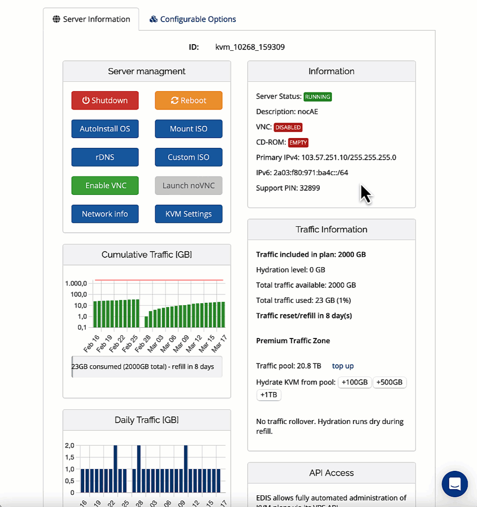
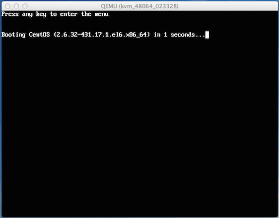
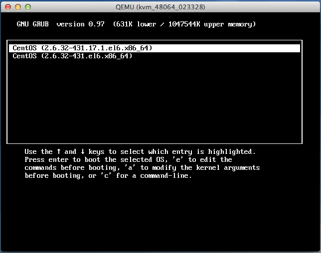
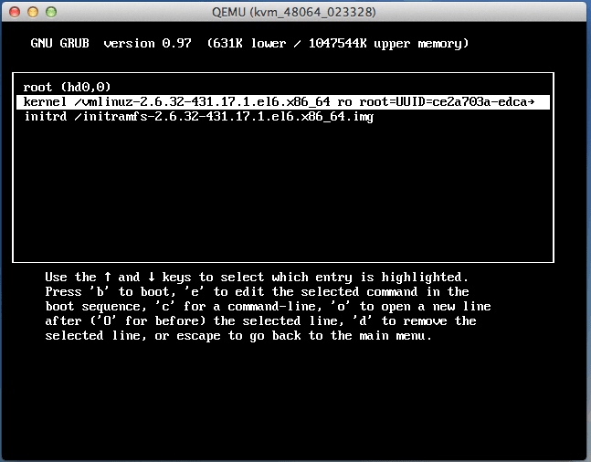
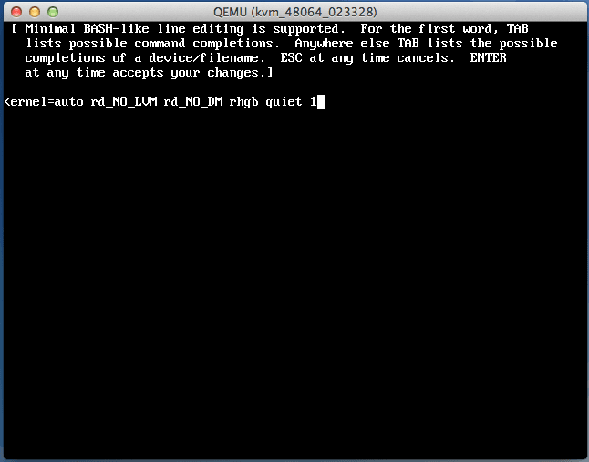

import { CtaButton } from "/snippets/cta-button.mdx";

<Info>
  Для современных установок VPS EDIS Global начните со статьи [Сброс пароля root Linux](/ru/vps-management/reset-root-password-linux). Скриншоты и последовательность `e` → `e` → `b` ниже относятся к **старому GRUB**, а не к GRUB 2 многих современных дистрибутивов. Аутентификация в режиме восстановления также различается: однопользовательский режим не всегда позволяет обойти запрос пароля.
</Info>

## Новый пароль через однопользовательский режим Linux VPS {#set-a-new-password-by-booting-your-linux-vps-in-single-user-mode}

Смена пароля внутри Linux не связана со входом в портал управления VPS. При использовании этого устаревшего способа восстановления соблюдайте процедуру своего дистрибутива и загрузчика.

Если доступ к Linux потерян и нужно задать новый пароль root на KVM, выполните следующие шаги.

<Steps>
  <Step title='Включите VNC'>
    [Панель KVM](https://manage.edisglobal.com/clientarea.php)

    VNC предоставляет удалённый доступ к клавиатуре и экрану сервера.

    
  </Step>
  <Step title='Запустите сеанс noVNC' />
  <Step title='Перезагрузите VPS' />
  <Step title='Откройте меню загрузчика GRUB'>
    Когда появится следующий экран, нажмите любую клавишу для входа в меню GRUB.

    
  </Step>
  <Step title='Нажмите e для изменения параметров загрузки ядра'>
    
  </Step>
  <Step title='Выберите вторую строку и снова нажмите e'>
    
  </Step>
  <Step title='Измените выбранную строку'>
    Добавьте `1` в конец строки, как на скриншоте, и подтвердите клавишей `Enter`.

    В Debian вместо `1` добавьте `init=/bin/bash`.

    
  </Step>
  <Step title='Вы снова увидите строки GRUB, как на шаге 5'>
    Нажмите `b` для загрузки с изменённой конфигурацией. Linux запустится в однопользовательском режиме для специальных административных задач. Перед сменой пароля оболочка восстановления должна иметь доступ к корневой файловой системе и право её изменять. После запуска выполните:

    ```shell
    passwd root
    ```

    Система предложит ввести новый пароль root.
  </Step>
  <Step title='Перезагрузите VPS и используйте новый пароль root' />
</Steps>

Дополнительное объяснение сброса забытого пароля root:

<CtaButton label='Внешняя статья Wiki' link='https://en.wikibooks.org/wiki/Linux_Guide/Reset_a_forgotten_root_password' openInNewTab={true} />
