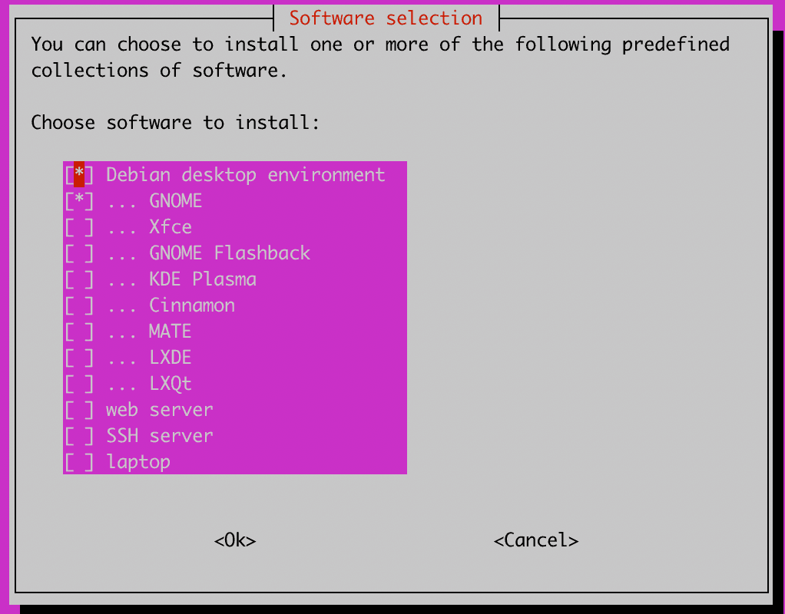

## Образы ОС с графическим рабочим столом {#os-images-with-graphical-desktop-enabled}

**Асиф из Лахора, Пакистан, спросил:**

Предоставляете ли вы Ubuntu или Debian с графическим интерфейсом?

**Ответ EDIS:**

Готового образа Debian или Ubuntu с GUI у нас нет, но **вы можете** установить Ubuntu 22.04 и **добавить графический интерфейс несколькими командами**.

1. Обновите индекс пакетов apt и установите `tasksel`:

```shell
   $ sudo apt update
   $ sudo apt install tasksel
   ```

2. Выполните команду `tasksel` для установки рабочего стола Kubuntu:

```shell
   $ sudo tasksel install kubuntu-desktop
   ```

3. Перезагрузите систему:

```shell
   $ reboot
   ```

4. Графический интерфейс должен запуститься. В зависимости от системы может потребоваться выбрать рабочее окружение на экране входа. Если GUI совсем не запускается, назначьте графическую цель загрузки:

```shell
   $ sudo systemctl set-default graphical.target
   ```

**Дополнительный вариант шага 2:** запустите `tasksel` **без** `install kubuntu-desktop`, чтобы выбрать компоненты в диалоге:

```shell
$ sudo tasksel
```


