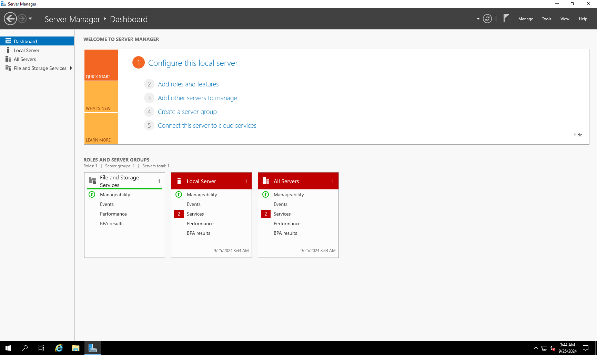
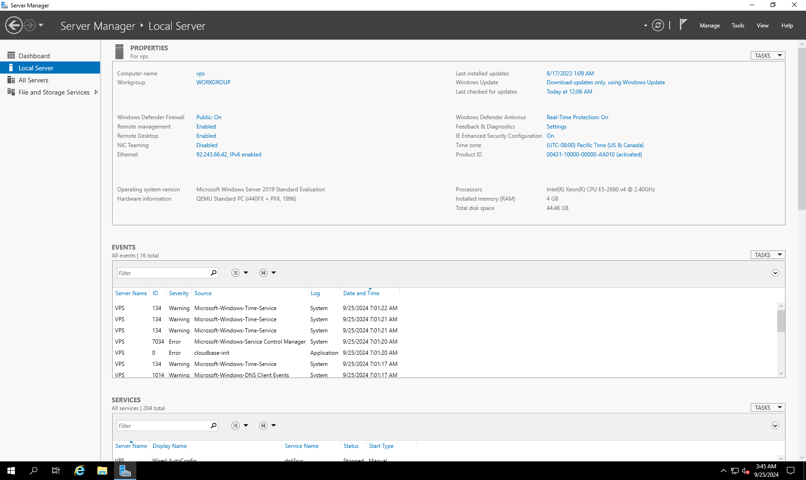
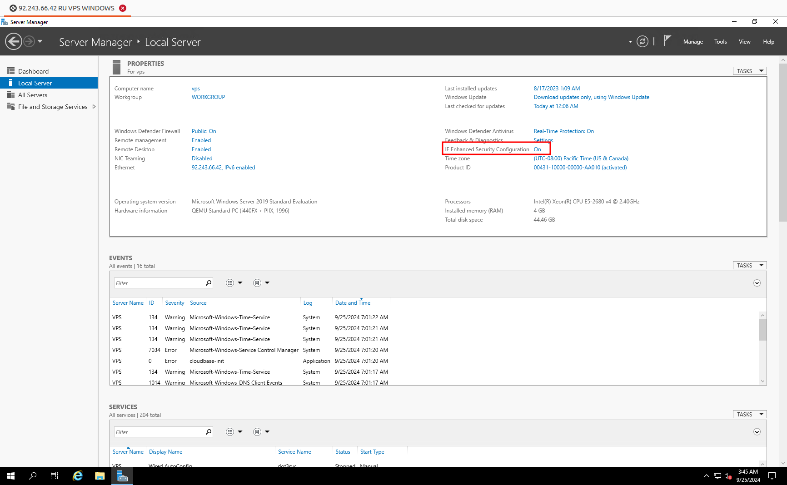
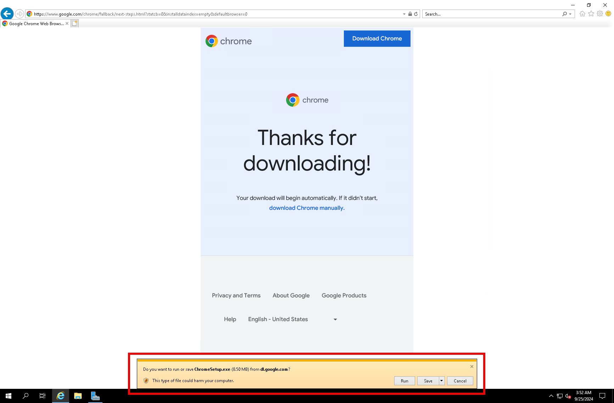
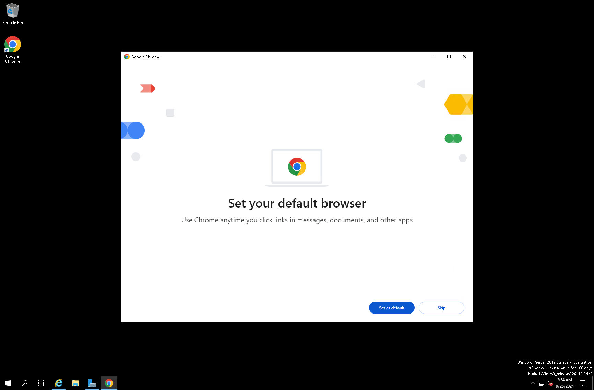
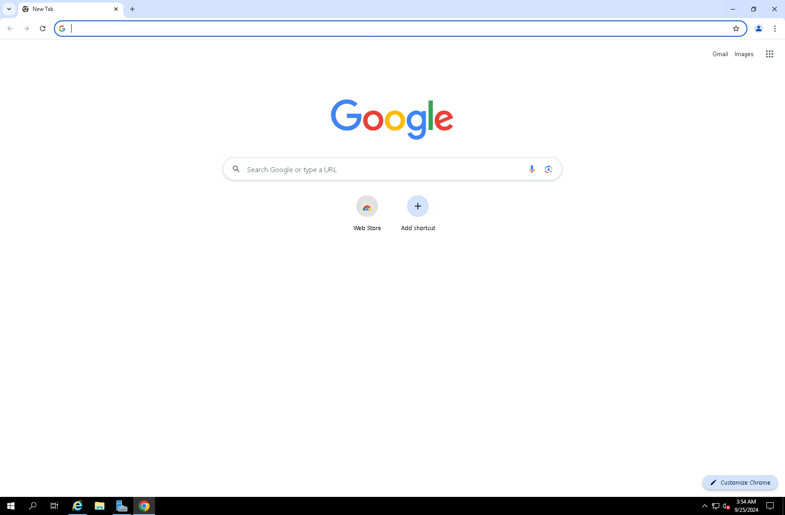

После активации VPS с Windows одной из первых задач часто становится установка браузера, например Google Chrome. Это руководство описывает установку Chrome на арендованный Windows Server VPS для безопасной и удобной работы с веб-сайтами.

## Начало работы {#how-to-get-going}

1. [Закажите VPS](https://www.edisglobal.com/) с предустановленной Windows Server.
2. [Подключитесь по RDP](/ru/getting-started/windows-remote-desktop) через порт 3389.
3. Откройте **Server Manager**. Обычно он запускается вместе с ОС. Если этого не произошло, нажмите **Start** и выберите **Server Manager** — при установке Windows Server он обычно закреплён в меню.

4. Выберите **Local Server**.

5. Отключите **IE Enhanced Security Configuration**, нажав **On**:

6. Нажмите **Run** в новом всплывающем окне внизу экрана.

7. Назначьте Chrome браузером по умолчанию.

8. Google Chrome установлен на Windows Server. Теперь на сервере доступен быстрый защищённый браузер.

