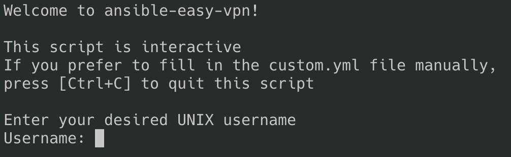
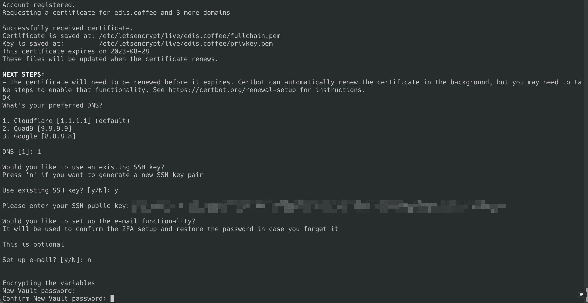
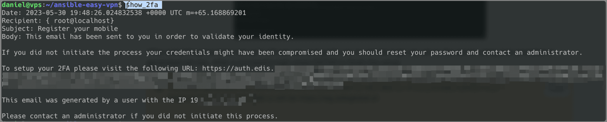
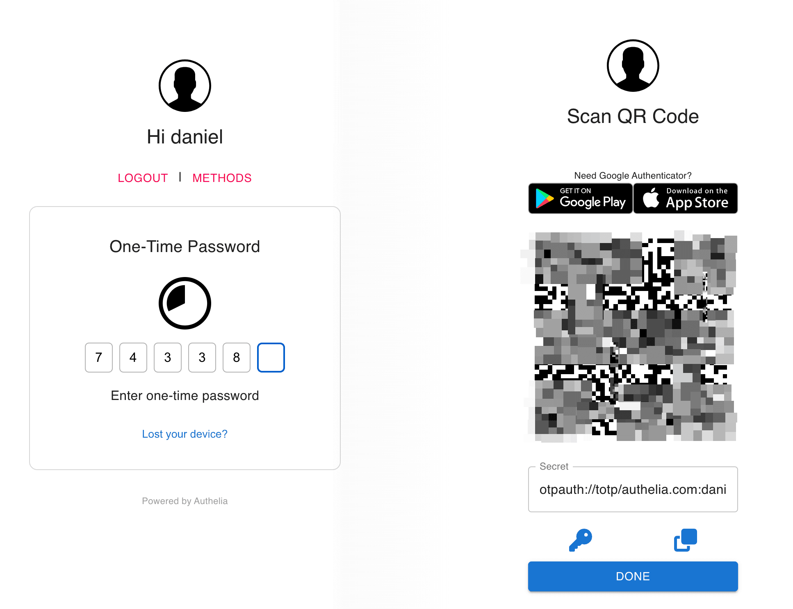
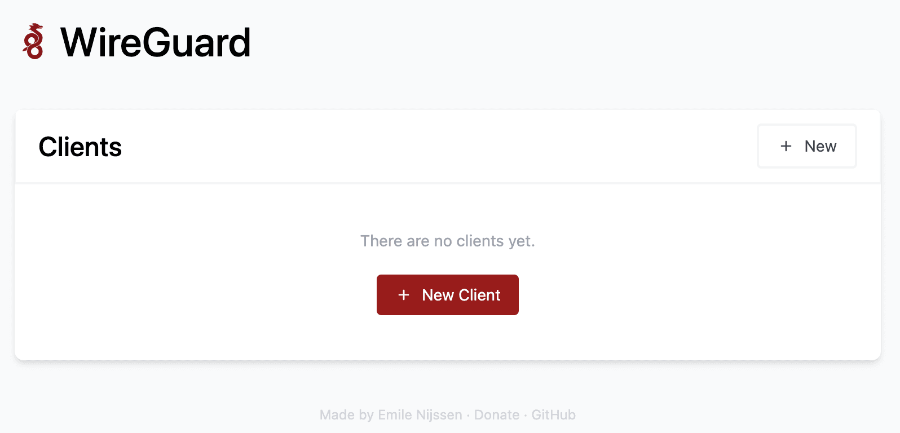

import { CtaButton } from "/snippets/cta-button.mdx";

<Note>
  **Ограничение поддержки:** EDIS Global не предоставляет и не будет предоставлять поддержку этой конфигурации. Мы проверили её: при соблюдении инструкции она работает надёжно. За поддержкой обращайтесь к автору автоматического установщика на [GitHub](https://github.com/notthebee/ansible-easy-vpn).
</Note>

## Автоматическая настройка WireGuard VPN {#automated-wireguard-vpn-setup}

Статья описывает простой интерактивный скрипт установки [WireGuard](https://www.wireguard.com/) с [Adguard](https://adguard.com/en/adguard-home/overview.html), [Unbound](https://www.nlnetlabs.nl/projects/unbound/about/) и [DNSCrypt-Proxy](https://github.com/DNSCrypt/dnscrypt-proxy) на выбранный VPS. Конфигурациями можно управлять в удобном веб-интерфейсе с двухфакторной аутентификацией.

### Возможности {#features}

- Веб-интерфейс WireGuard через wg-easy.
- Двухфакторная аутентификация веб-интерфейса через Authelia.
- Усиленная защита веб-сервера Bunkerweb.
- Зашифрованные DNS-запросы и необязательная блокировка рекламы: Adguard Home, DNSCrypt и Unbound.
- UFW и Fail2Ban.
- Автоматические обновления без участия пользователя.
- Усиление защиты SSH и генерация пары ключей — необязательно, можно использовать свои.
- Email-уведомления через внешний SMTP, например Gmail.

### Требования {#requirements}

- KVM VPS с выделенным IPv4.
- Один из поддерживаемых дистрибутивов: Ubuntu Server 22.04, Ubuntu Server 20.04 или Debian 11.

### Начало работы {#getting-started}

Когда новый VPS EDIS Global запущен, подключитесь из удобного терминала. В Windows можно использовать [PuTTY](https://www.putty.org/). Выполните:

```shell
ssh root@server-ipv4
```

После подключения запустите скрипт автоматической установки:

```shell
wget https://notthebe.ee/vpn -O bootstrap.sh && bash bootstrap.sh
```

Он обновит систему, установит необходимые пакеты и остановится на следующем экране:



Ответьте на вопросы о SSH-ключе, DNS и других настройках. На запрос запуска playbook ответьте **YES**:



После настройки скрипт предложит подключиться к серверу по `ssh` с вашим или созданным `ssh key`. Выполнив вход, нажмите `ENTER` для завершения.

<Note>
  Скрипт создаёт SSL-сертификаты и поддомен веб-интерфейса. Если указан `mydomain.com`, управление пользователями WireGuard будет доступно по `https://wg.mydomain.com`.
</Note>

Для входа используйте нового пользователя и пароль из настройки. Если необязательный email не настроен, получите код входа в терминале VPS:

```shell
show_2fa
```

Появится ссылка для настройки 2FA:



Откройте QR-код, отсканируйте его и добавьте в приложение 2FA. После входа веб-интерфейс позволит добавлять пользователей WireGuard.





Теперь можно добавлять пользователей и передавать им реквизиты.

Приятной работы с новым VPS! По вопросам поддержки обращайтесь к автору скрипта.

<CtaButton label='Статья в блоге: протокол WireGuard' link='https://www.edisglobal.com/blog/wireguard' openInNewTab={true} />
