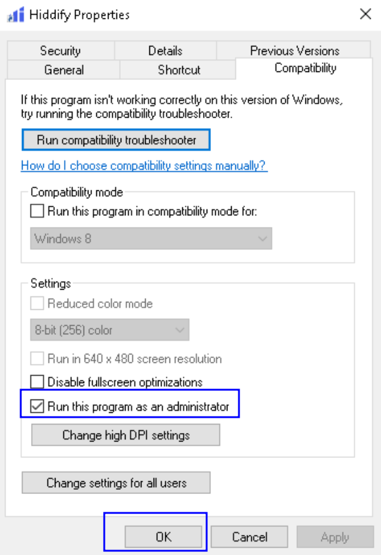
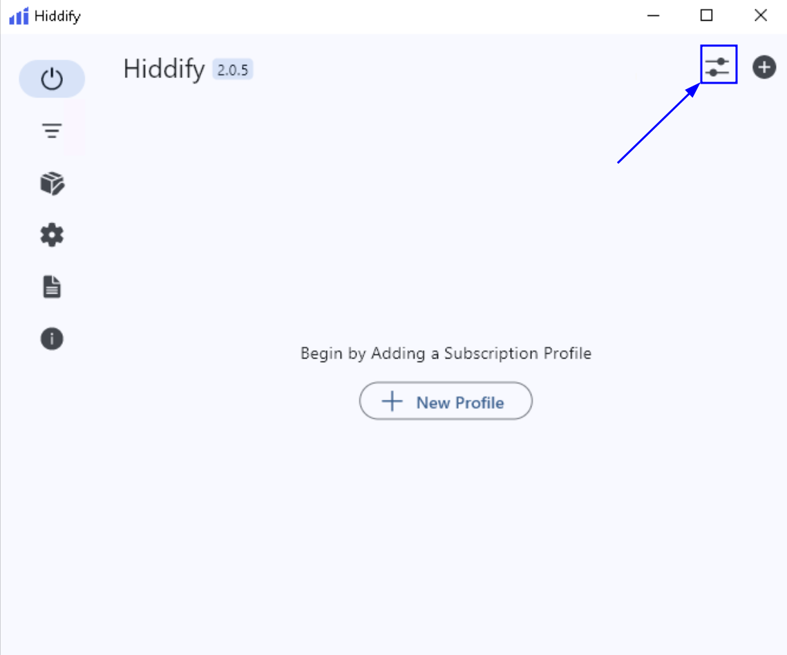
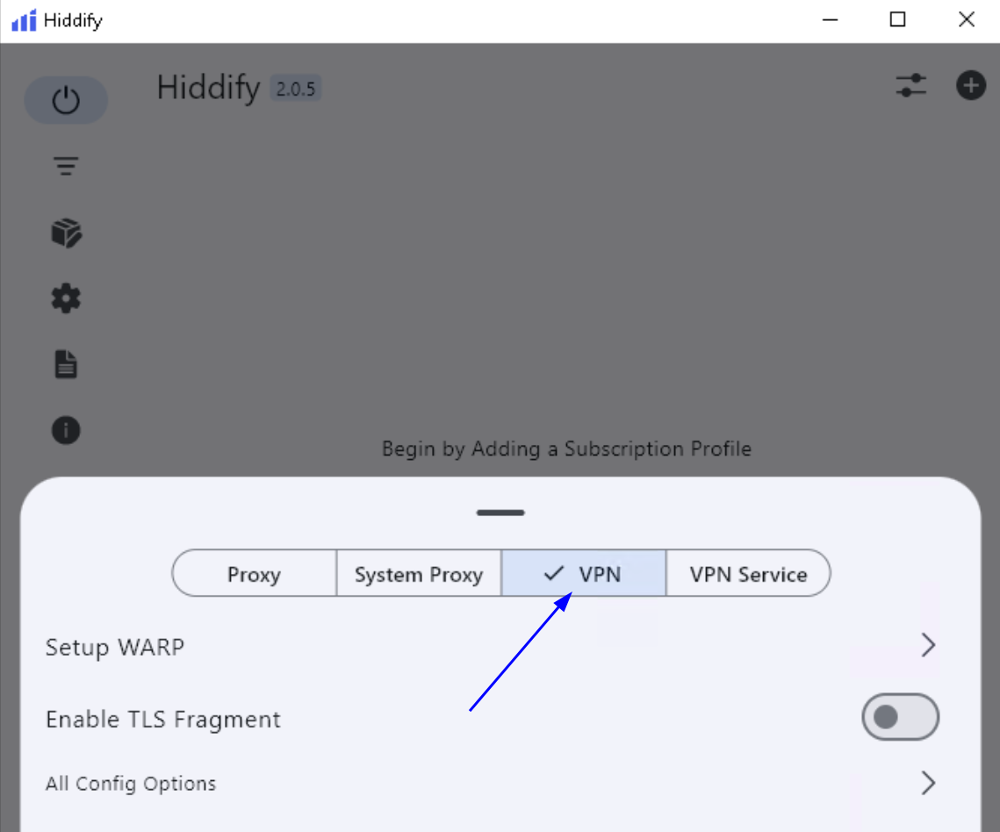
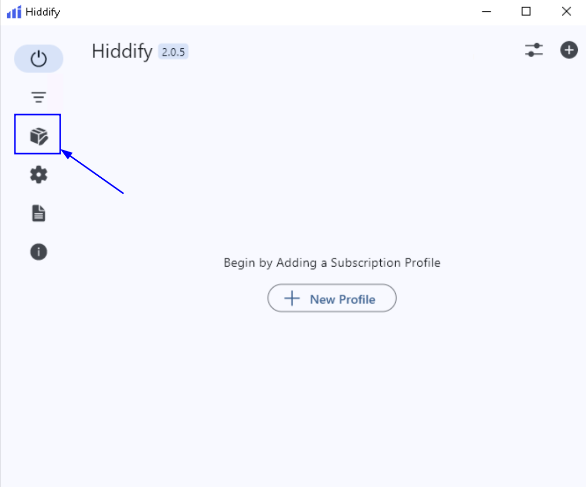
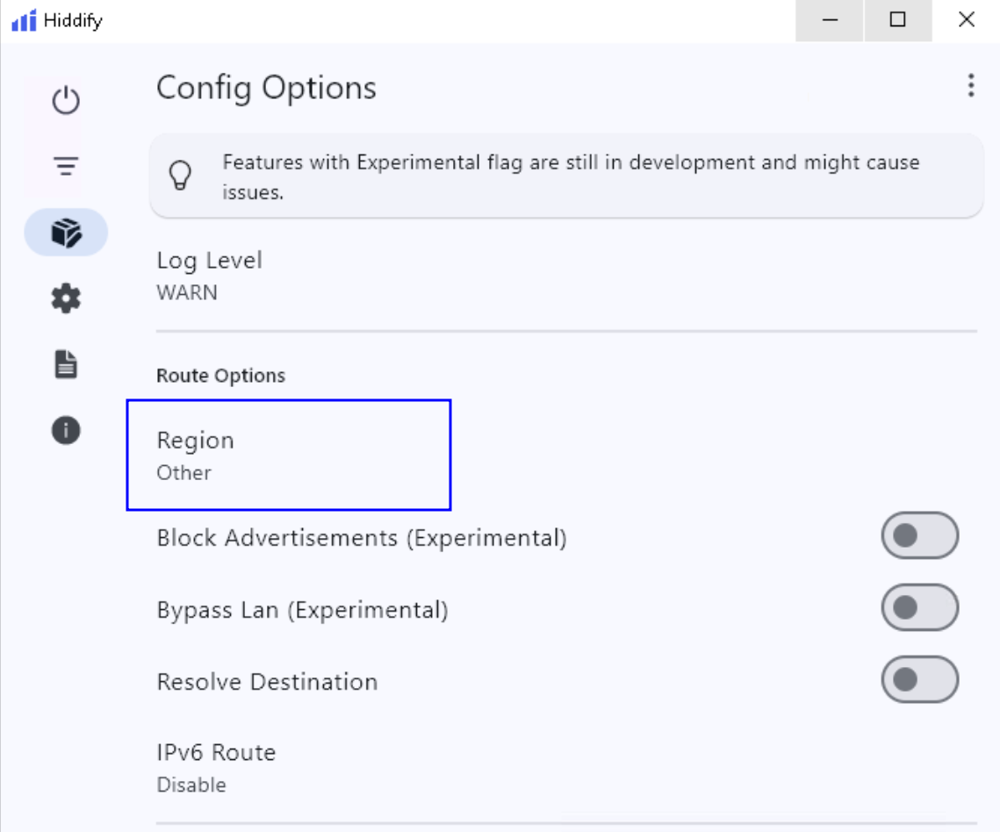
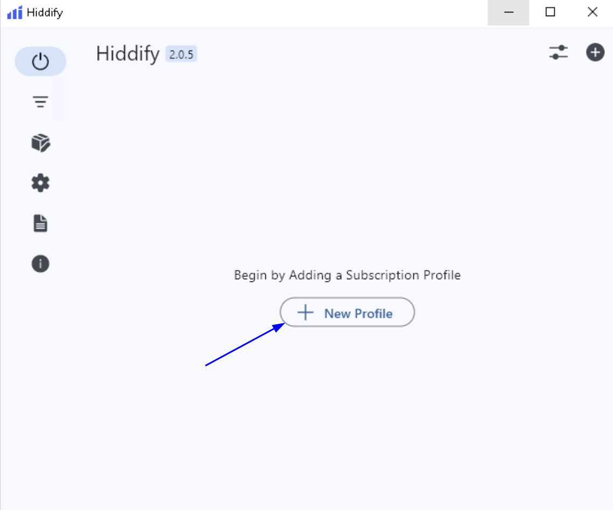
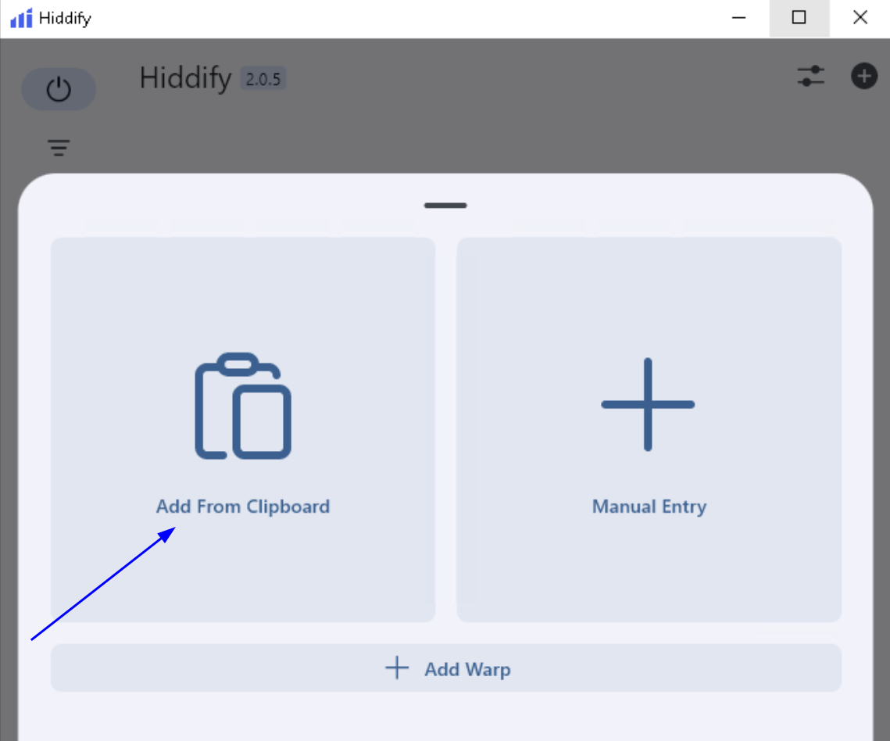
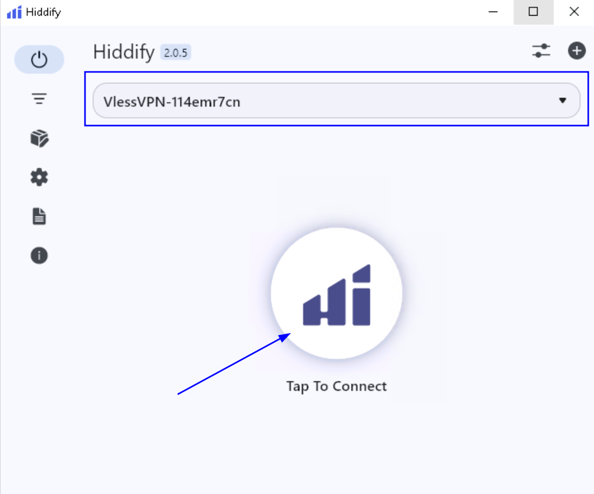
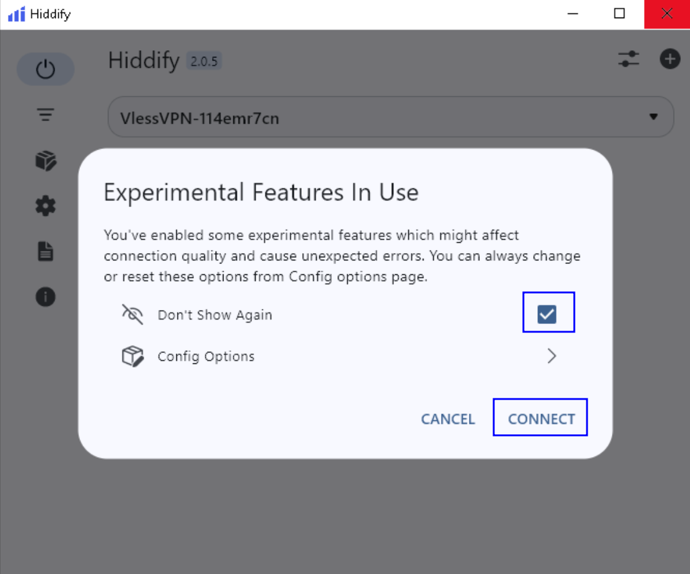
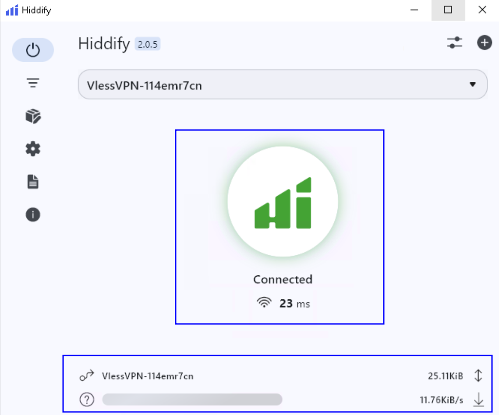

## Клиент Hiddify для Windows {#hiddify-client-for-windows}

Для подключения к 3x-ui через Hiddify с компьютера:

1. [Скачайте](https://github.com/hiddify/hiddify-app/releases/) выпуск с отметкой `Latest` и подходящий для вашей ОС пакет или файл.
2. Запустите установщик и завершите установку.
3. Откройте каталог Hiddify, обычно `C:\Program Files\Hiddify\`. Нажмите правой кнопкой на **Hiddify.exe**, выберите **Properties** и вкладку **Compatibility**. Отметьте **Run this program as administrator** и нажмите **OK**.
   
4. На главном экране нажмите значок настроек справа вверху:
   
5. Выберите настройку VPN:
   
6. Вернитесь на главный экран и нажмите **Profiles** слева для управления профилями:
   
7. В **Config Options → Route Options** откройте **Region** и выберите **Other**, как на скриншоте:
   
8. На главном экране нажмите **New Profile**:
   
9. В окне нажмите **Add From Clipboard**, чтобы создать профиль из ссылки VLESS/подписки, ранее скопированной нажатием QR-кода в 3x-ui.
   
10. При успешном импорте вверху появится имя VPN-профиля. Для подключения и проверки нажмите **Tap to Connect**:
    
11. При первом подключении появится **Experimental Features In Use**. При желании отметьте **Don’t Show Again**, затем нажмите **CONNECT**.
    
12. Зелёная кнопка 🟢 со статусом **Connected** ✅ означает установленное VPN-соединение 🌐. Внизу появятся текущие показатели передачи и приёма трафика ⬇️↕️, подтверждающие использование VPN.
    
13. Официальная документация Hiddify:
    - https://hiddify.com/app/How-to-install-Hiddify-app/
    - https://hiddify.com/app/How-to-use-Hiddify-app/
