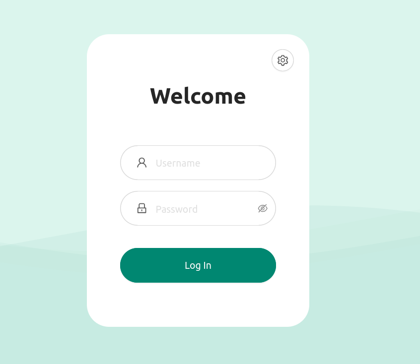
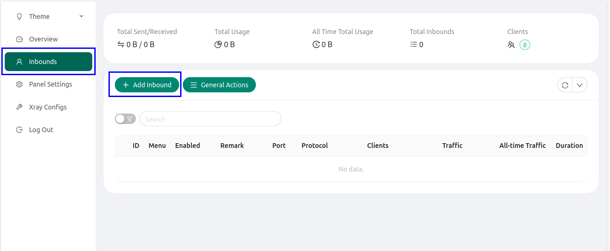
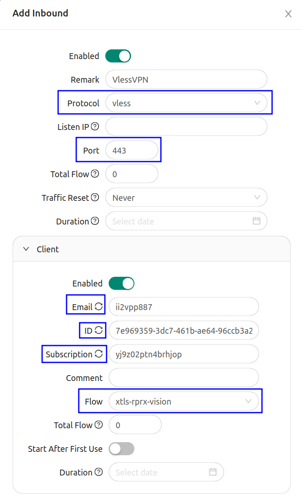
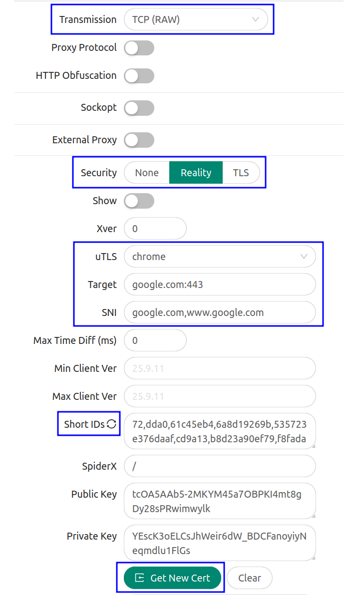
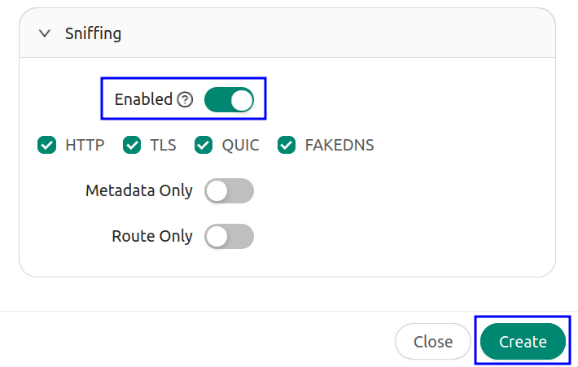
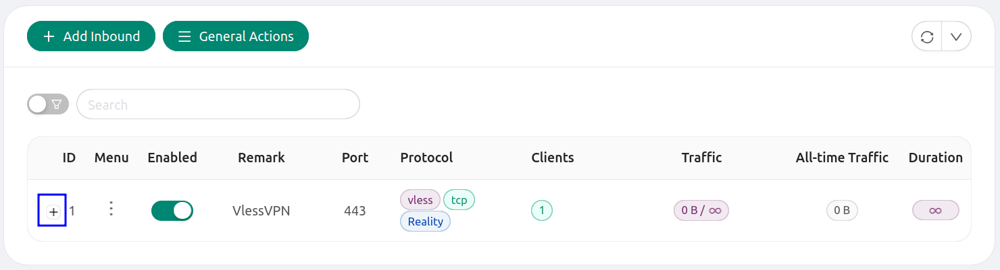
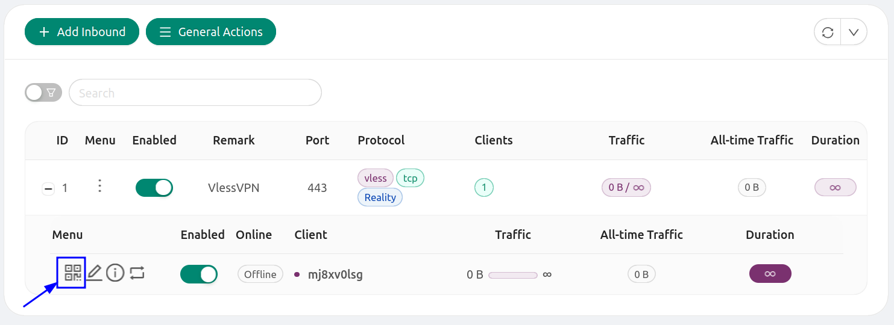
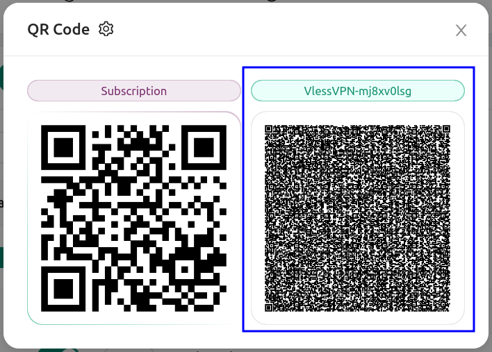

## Что такое VLESS? {#what-is-vless}

VLESS — современный лёгкий протокол для быстрых гибких соединений, похожих на VPN. Это усовершенствованный VMess с более простой архитектурой и без встроенного шифрования: вместо него используется TLS. Такой подход эффективен, подходит для сетей доставки содержимого (CDN) и помогает обходить цензуру и сетевые ограничения в сочетании с Xray на VPS.

## Что такое 3x-ui? {#what-is-3x-ui}

3x-ui — веб-панель управления Xray-core. Она позволяет создавать и администрировать VLESS VPN-аккаунты без редактирования сложных конфигурационных файлов: добавлять пользователей, генерировать ссылки и QR-коды VLESS и просматривать расход трафика. Поддерживаются также Trojan, Shadowsocks и другие протоколы. Многие задачи терминала превращаются в кнопки и формы, что удобнее для начинающих.

## Выберите VPS для 3x-ui {#choose-a-vps-for-3x-ui}

Нужен **KVM Linux VPS с Ubuntu 22.04**, root-доступом и публичным IPv4. Вы самостоятельно устанавливаете и администрируете 3x-ui.

**KVM Starter с 2 GB RAM** — практичный вариант для небольшого личного сервиса. Для нескольких активных пользователей или коммерческой услуги сравните vCPU, месячный трафик и RAM, затем проверьте ожидаемую нагрузку. Объём RAM сам по себе не определяет фиксированное число пользователей или гарантированную скорость.

Выбирайте локацию ближе к пользователям или с подходящим маршрутом до их сетей. Перед заказом проверьте Looking Glass. Сравнение тарифов показывает CPU, диски, трафик, внешнее подключение хоста и актуальную цену каждой локации. Скорость канала хоста не является гарантией скорости отдельного VPS.

<CardGroup cols={2}>
  <Card title="Сравнить VPS с 2 GB RAM" icon="server" href="https://www.edisglobal.com/vps-hosting/2gb-vps?utm_source=edis-docs&utm_medium=referral&utm_campaign=vpn-guides&utm_content=3x-ui-prerequisites">
    Выберите локацию и сравните текущие тарифы KVM Starter.
  </Card>
  <Card title="Все локации VPS" icon="globe" href="https://www.edisglobal.com/vps-hosting?utm_source=edis-docs&utm_medium=referral&utm_campaign=vpn-guides&utm_content=3x-ui-locations">
    Найдите другие локации и более высокие тарифы для развёртывания.
  </Card>
</CardGroup>

## Установка 3x-ui на VPS {#install-3x-ui-on-a-vps}

<Steps>
  <Step title="Установите Ubuntu 22.04 на VPS EDIS Global">
    Выберите локацию и тариф выше, затем Ubuntu 22.04 в качестве ОС.
  </Step>
  <Step title="Подключитесь к VPS по SSH">
    ```bash
        ssh root@VPS_IP_address
        Enter root password:
    ```
  </Step>
  <Step title="Обновите пакеты">
    ```bash
        apt update && apt upgrade -y 
    ```
  </Step>
  <Step title="Установите curl">
    ```bash
        apt install curl -y
    ```
  </Step>
  <Step title="Отключите IPv6 в Ubuntu 22.04">
    ```bash
        #Create file 99-disable-ipv6.conf
        sudo nano /etc/sysctl.d/99-disable-ipv6.conf
    
        #Put this inside the file:
        net.ipv6.conf.all.disable_ipv6 = 1
        net.ipv6.conf.default.disable_ipv6 = 1
        net.ipv6.conf.lo.disable_ipv6 = 1
        #Save file and exit, then apply:
    
        sudo sysctl --system
        #Check network settings:
        ip a
        ip a | grep inet6
    ```

    Эти настройки отключают IPv6 на всех интерфейсах, оставляя только IPv4. После `sysctl --system` команда `ip a | grep inet6` не выводит результатов.

    <Note>
      Если SSH-сеанс использует IPv6 VPS, он оборвётся с `client_loop: send disconnect: Connection reset`. Подключитесь заново через IPv4 (`ssh root@VPS_IPv4_address`) и продолжайте.
    </Note>
  </Step>
  <Step title="Установите панель 3x-ui">
    ```bash
        bash <(curl -Ls https://raw.githubusercontent.com/mhsanaei/3x-ui/master/install.sh)
    ```

    Выполняйте от `root` в оболочке `bash`. Ошибка `bash: /dev/fd/63: No such file or directory` означает, что оболочка не может использовать подстановку процесса. Это бывает, например, при добавлении `sudo` перед командой или запуске через `sh`. Сначала скачайте скрипт, затем запустите:

    ```bash
        curl -Ls https://raw.githubusercontent.com/mhsanaei/3x-ui/master/install.sh -o install.sh
        bash install.sh
    ```
  </Step>
  <Step title="Задайте порт панели">
    Во время установки скрипт спросит, хотите ли вы изменить порт:

    ```bash
        Would you like to customize the Panel Port settings? (If not, a random port will be applied) [y/n]: 
    ```

    Введите **y** для собственного порта в диапазоне 41000-65000, например 46522.

    В конце появится примерно такой результат:

    <Card>
      ###############################################\
       Username: ajYbrazcyO \
       Password: HPty32FVU7 \
       Port: 46522 \
       WebBasePath: ZtvraBUmNK9NQj43ks \
       Access URL: http://YOUR_SERVER_IP:46522/ZtvraBUmNK9NQj43ks ###############################################
    </Card>
    <Callout icon="key" iconType="regular" color="#FFC107">
      Сохраните эти реквизиты в заметках.
    </Callout>
  </Step>
</Steps>

## Подключение к панели 3x-ui {#connect-to-the-3x-ui-panel}

Не подключайтесь к 3x-ui по обычному HTTP: это небезопасно. Используйте HTTPS или SSH-туннель. Настройте как минимум один из вариантов:

- Создайте и назначьте самоподписанный сертификат.
- Используйте переадресацию портов SSH для доступа через туннель.
- При наличии зарегистрированного домена используйте сертификат Let's Encrypt.

<Tabs>
  <Tab title="Самоподписанный сертификат" icon="expeditedssl">
    Самоподписанный сертификат включает HTTPS: данные между браузером и панелью шифруются. Браузер может показать предупреждение, поскольку сертификат не выдан публичным центром сертификации, но соединение остаётся защищённым. Это помогает предотвращать атаки посредника (MITM) и значительно безопаснее HTTP, особенно при вводе пароля и изменении VPN-настроек.

    Создайте сертификат и примените его:

    1. Создайте каталог:

    ```bash
      # Create cert directory
      sudo mkdir -p /root/cert/
    ```

    2. Сгенерируйте самоподписанный сертификат:

    ```bash
      sudo openssl req -x509 -nodes -newkey rsa:2048 -days 365 \
        -keyout /root/cert/private.key \
        -out /root/cert/cert.crt \
        -subj "/C=EE/ST=Harjumaa/L=Tallinn/O=Org/OU=site/CN=localhost"
    ```

    `-subj` задаёт сведения о владельце: `C` — двухбуквенный код страны, `ST` — регион, `L` — город, `O` — организация, `OU` — подразделение, `CN` — общее имя. Значения примера — заполнители; замените их своими. Они не влияют на работу самоподписанного сертификата.

    3. Назначьте сертификат веб-панели:

    ```bash
      sudo /usr/local/x-ui/x-ui cert \
        -webCert "/root/cert/cert.crt" \
        -webCertKey "/root/cert/private.key"
    ```

    4. Перезапустите 3x-ui для применения:

    ```bash
    sudo x-ui
    ```

    Выберите пункт **13** для перезапуска. После этого веб-интерфейс работает по HTTPS с вашим сертификатом.
  </Tab>
  <Tab title="Переадресация портов SSH" icon="left-right">
    SSH-туннель позволяет безопасно открыть службу VPS, например 3x-ui, не выставляя её порт в Интернет. Компьютер слушает локальный порт, например `2222`, и передаёт трафик через зашифрованное SSH-соединение на порт панели сервера, например `46522`. Открывая `http://127.0.0.1:2222/` в браузере, вы обращаетесь к панели через SSH.

    Настройте переадресацию на VPS:

    ```bash
       #Execute 3x-ui cli
       x-ui
    
       #Select an item 22. SSH Port Forwarding Management 
       Please enter your selection [0-25]: 22
    
       #Choose setting Set listen IP
       Choose an option: 1
       #Use default IP (127.0.0.1)
       Select an option (1 or 2): 1
    ```

    После выбора пункта 1 панель покажет примеры команд для туннеля с локального компьютера.

    <b>Создайте SSH-туннель со своего компьютера:</b>

    ```bash
       SSH Port Forwarding Configuration:
       Standard SSH command:
       ssh -L 2222:127.0.0.1:46522 root@134.255.210.100
    
       If using SSH key:
       ssh -i <sshkeypath> -L 2222:127.0.0.1:46522 root@YOUR_SERVER_IP
    
       After connecting, access the panel at:
       http://localhost:2222/ZtvraBUmNK9NQj43ks/
    ```

    Также можно использовать этот пример для порта 3x-ui 46522:

    ```bash
       ssh -L 127.0.0.1:2222:127.0.0.1:46522 root@YOUR_SERVER_IP
    ```

    Откройте URL в браузере локального компьютера:

    ```text
       http://127.0.0.1:2222/ZtvraBUmNK9NQj43ks
    ```
  </Tab>
  <Tab title="Сертификат Let's Encrypt" icon="certificate">
    Для доверенного HTTPS-сертификата Let's Encrypt нужны:

    - Домен, например vpn.example.com.
    - Его A-запись, направленная на IP VPS в настройках провайдера DNS.
    - Доступный из Интернета порт 80 VPS для HTTP-проверки.

    Подключитесь по SSH и выполните:

    ```bash
       #Execute 3x-ui cli
       x-ui
    
       #Select SSL Certificate Management
       Please enter your selection [0-25]: 18
    
       #Choose “Get SSL”
       Choose an option: 1
    
       Select Get SSL, then enter:
       Your domain name (e.g. vpn.example.com)
       Your email address (used by Let’s Encrypt)
    
       #Set the certificate for the 3x-ui panel
       In the same SSL Certificate Management menu, select Set Certificate Paths for the Panel, then select the certificate for your domain so the panel uses it for HTTPS.
    
       #Restart the 3x-ui panel to apply changes:
       sudo x-ui
       Select option **13** to restart the panel.
       #After that, you can use URLs with valid Let’s Encrypt certificate:
       https://vpn.example.com:PORT/ 
    ```
  </Tab>
</Tabs>

<Check>
  Вы подключились и вошли в панель 3x-ui через защищённое соединение. Далее создайте inbound и подключите клиентские приложения.
</Check>

## Создание inbound в 3x-ui {#create-an-inbound-in-the-3x-ui-panel}

Войдите в панель:



Откройте **Inbounds** и нажмите **Add Inbound**:



Заполните поля:

- **Remark:** имя соединения.
- **Protocol:** <b>vless</b>.
- **Listen IP:** оставьте пустым.
- **Port:** <b>443</b>.
- Разверните **Client**, затем по очереди нажмите **Email**, **ID** и **Subscription** для обновления значений.
- В **Flow** выберите <b>xtls-rprx-vision</b>. Поле появляется после выбора **Security → Reality**.



- **Transmission:** TCP(RAW).
- **Security:** Reality.
- **uTLS:** chrome или firefox.
- **Target:** google.com:443.
- **SNI:** google.com,[www.google.com](http://www.google.com).
- **Short IDs:** нажмите для обновления.
- Нажмите **Generate New Cert**.



Включите переключатель **Sniffing**:



После ввода нажмите **Create**.

При правильной настройке inbound появится в списке. Нажмите <b>+</b>, чтобы открыть настройки клиента для экспорта:



В раскрытом меню нажмите изображение QR-кода:



Во всплывающем окне показаны два QR-кода. Нажмите правый, VLESS: конфигурация клиента скопируется в буфер обмена. Вставьте её в VPN-клиент компьютера или мобильного устройства.



## Подключение к 3x-ui с ПК, Android и iOS {#how-to-connect-to-3x-ui-pc-android-ios}

Совместимые клиенты: **Hiddify**, **v2rayN**, **v2RayTun**, **v2RayNG**, **Nekoray** и другие.

| Клиент | Мобильные устройства | ПК | Примечания |
| --- | --- | --- | --- |
| **v2rayNG** | <Icon icon="android" iconType="solid" /> Android | – | Популярный клиент V2Ray/Xray для Android; импорт ссылок и QR. |
| **v2RayTun** | <Icon icon="android" iconType="solid" /> Android, <Icon icon="apple" iconType="solid" /> iOS | <Icon icon="windows" iconType="solid" /> Windows | Клиент на Xray для конфигураций VLESS/Trojan. |
| **Streisand** | <Icon icon="android" iconType="solid" /> Android, <Icon icon="apple" iconType="solid" /> iOS | <Icon icon="windows" iconType="solid" /> Windows <br /> <Icon icon="apple" iconType="solid" /> macOS | Поддерживает VLESS, VMess, Trojan и Shadowsocks. |
| **Hiddify** | <Icon icon="android" iconType="solid" /> Android, <Icon icon="apple" iconType="solid" /> iOS | <Icon icon="windows" iconType="solid" /> Windows <br /> <Icon icon="apple" iconType="solid" /> macOS <br /> <Icon icon="linux" iconType="solid" /> Linux | Мультиплатформенный клиент, удобный для ссылок и подписок 3x-ui. |
| **v2rayN** | – | <Icon icon="windows" iconType="solid" /> Windows <br /> <Icon icon="linux" iconType="solid" /> Linux <br /> <Icon icon="apple" iconType="solid" /> macOS | Классический графический клиент для VLESS/VMess/Trojan/Xray. |
| **Nekoray** | – | <Icon icon="windows" iconType="solid" /> Windows <br /> <Icon icon="linux" iconType="solid" /> Linux | Кроссплатформенный графический прокси-клиент для настольных компьютеров и ноутбуков. |

Ссылки:

- https://github.com/MHSanaei/3x-ui
- https://github.com/MHSanaei/3x-ui/wiki
- https://github.com/MHSanaei/3x-ui/wiki/Installation#docker-recommended
- https://github.com/XTLS/Xray-core
- https://xtls.github.io/en/config/inbounds/vless.html

## Планирование следующего развёртывания {#plan-your-next-deployment}

[Выберите локацию и тариф VPS для 3x-ui](https://www.edisglobal.com/vps-hosting/2gb-vps?utm_source=edis-docs&utm_medium=referral&utm_campaign=vpn-guides&utm_content=3x-ui-next-steps). Если продаёте доступ абонентам, прочитайте [руководство по коммерческому VPN](/ru/commercial-vpn-hosting): развёртывание, планирование трафика и обязанности по обработке жалоб.
