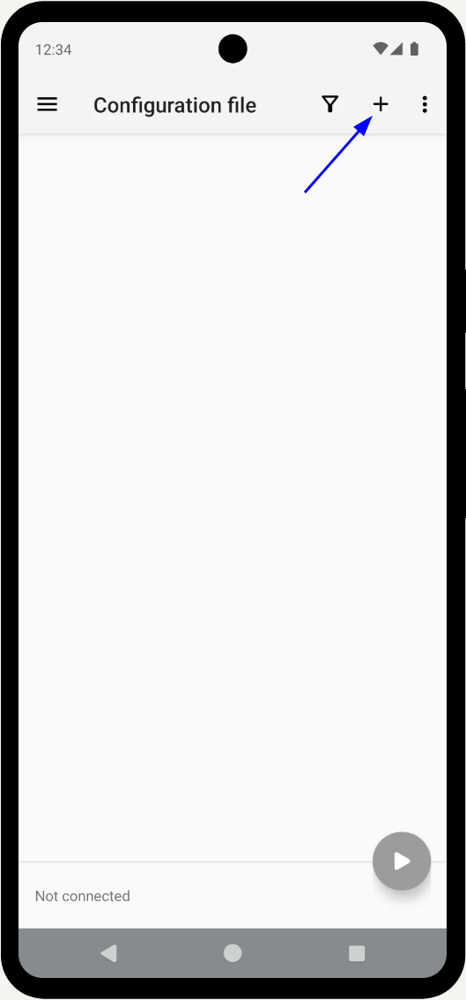
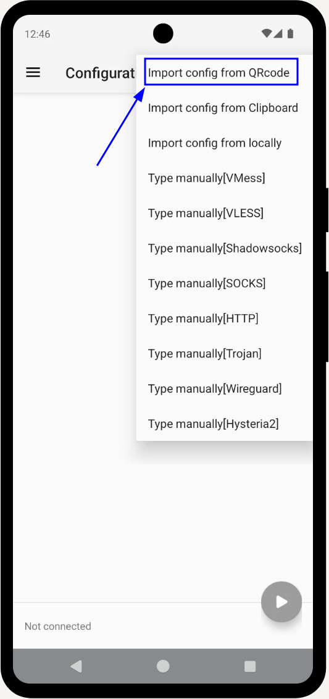
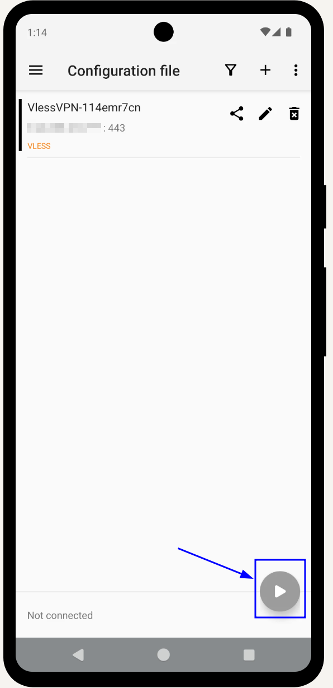
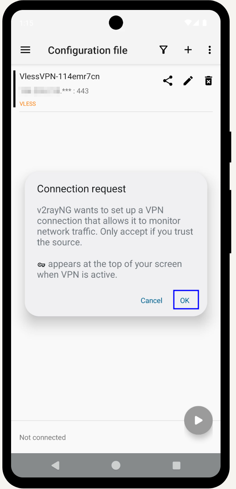
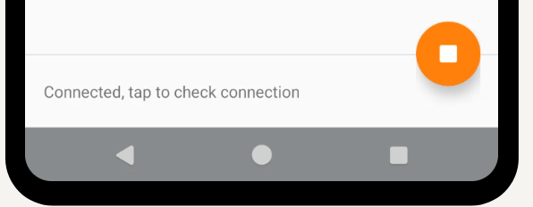
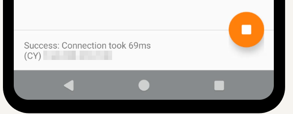

## Подключение к VLESS VPN на Android {#connect-to-vless-vpn-in-android}

1. **Установите v2rayNG.** Откройте **Google Play**, найдите **v2rayNG**, скачайте и установите приложение.
   - Сайт: https://en.v2rayng.org/download/
   - Официальные выпуски GitHub: https://github.com/2dust/v2rayNG/releases/
2. **Откройте v2rayNG и добавьте подключение.** Нажмите **➕**, обычно справа вверху, чтобы добавить сервер.
   
3. **Добавьте конфигурацию из 3x-ui.** Выберите **Scan QR code** и направьте камеру на QR-код панели 3x-ui. Новый профиль появится в списке.
   
4. **Подключитесь и проверьте статус.** Выберите новый профиль, затем нажмите кнопку с бумажным самолётом / подключения ▶️.
   

   Android покажет **Connection request** от v2rayNG. Нажмите **OK**, разрешив создание VPN-соединения.
   

   Статус **Connected** ✅ означает, что Android-устройство 📱 использует VPN. Нажмите **Connected, tap to check connection**.
   

   Сообщение **Success: Connection took *ms** подтверждает установленное соединение.
   
