Установка **amneziawg** на Keenetic помогает обходить ограничения интернет-провайдера, скрывая работу WireGuard. **amneziawg** маскирует протокол, затрудняя обнаружение использования VPN. Это мешает провайдеру определять и блокировать VPN-трафик и обеспечивает свободный доступ даже там, где VPN отслеживается или ограничивается государственными межсетевыми экранами.

Создадим WireGuard-соединение с дополнительными параметрами asc в обновлённом интерфейсе Keenetic OS 4.2.

Шаг 1

Откройте в браузере страницу управления роутером: [http://192.168.0.1](http://192.168.0.1/).
Войдите со своим именем пользователя и паролем.

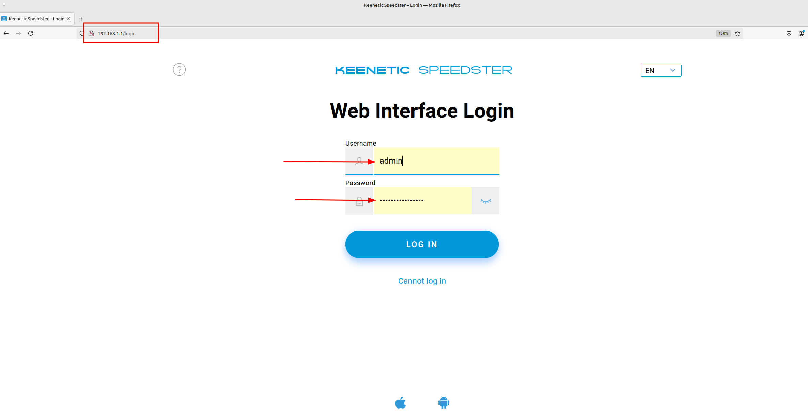

Шаг 2

Перейдите в **Management → System settings**.
Разверните **startup-config** и сохраните резервную копию текущих настроек.

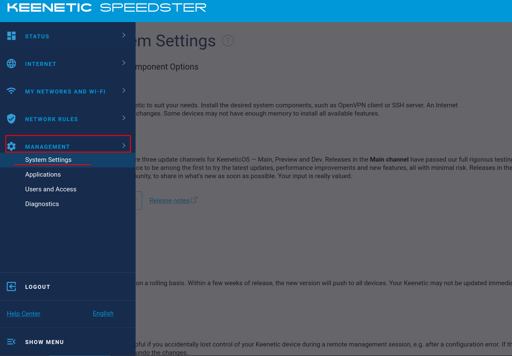

Шаг 3

Проверьте установленную версию KeeneticOS и доступность обновления до 4.2. Поддержка WireGuard с asc появилась начиная с KeeneticOS 4.2 Alpha 2. Если выпуск 4.2 ещё недоступен для вашей модели, попробуйте канал обновлений **Preview**.

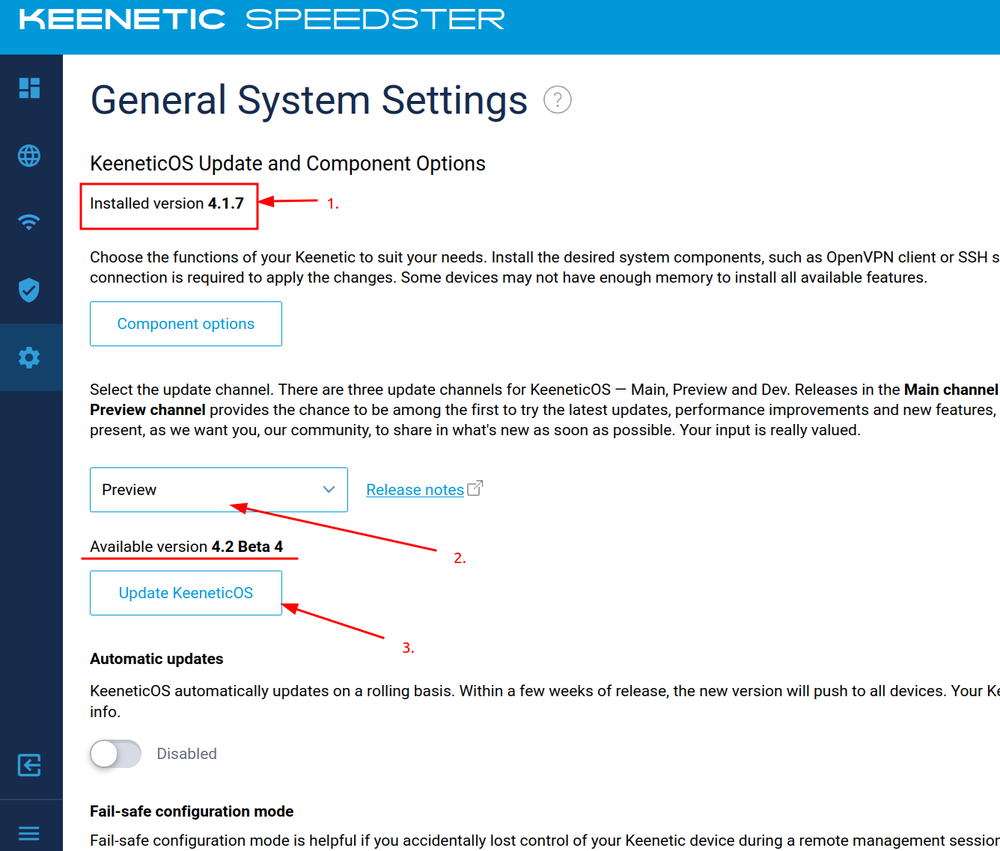

Шаг 4

Перед обновлением обязательно сохраните системные файлы: firmware, startup-config, default-config и running-config. Это поможет восстановить роутер при сбое обновления.

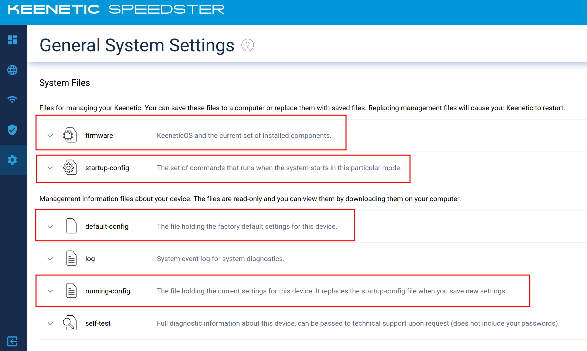

Шаг 5

На странице **System Component Options** в **Network Functions** проверьте компонент **WireGuard VPN**. Если он не установлен, отметьте его и нажмите появившуюся ниже кнопку **Update KeeneticOS**. Дождитесь обновления и перезагрузки.

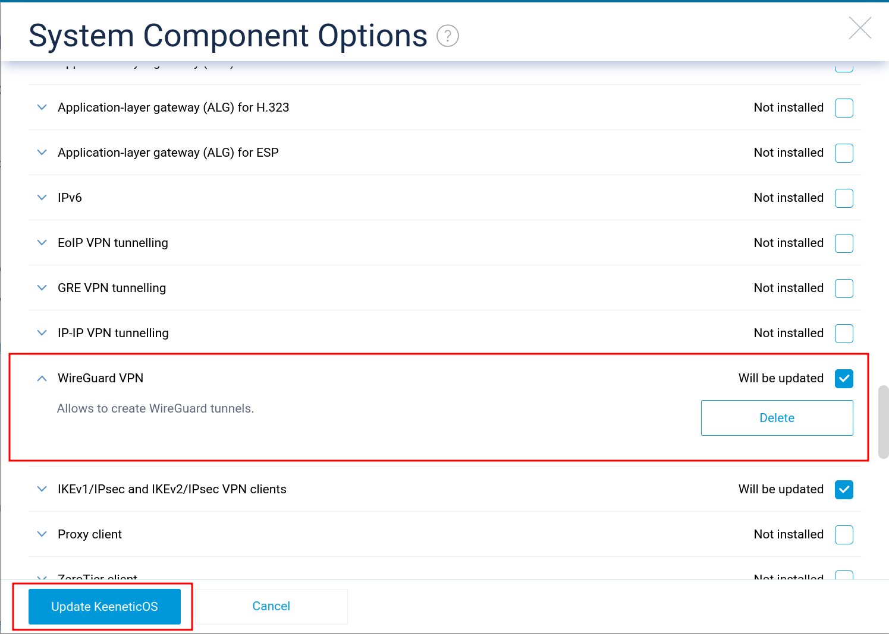

Шаг 6

Если появится сообщение о нехватке памяти для всех выбранных компонентов, нажмите **View changes** и отключите ненужные компоненты для освобождения памяти.
*Если обновление прерывается сообщением Not enough space, уменьшите его размер, сняв лишние компоненты в списке.*


Шаг 7

Обновите роутер до версии 4.2 или новее кнопкой **Update KeeneticOS** на странице **System Settings**. В процессе роутер перезагрузится.

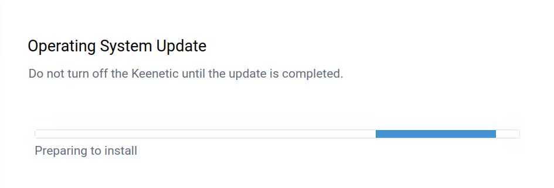

Шаг 8

После обновления и перезапуска снова войдите на страницу управления.

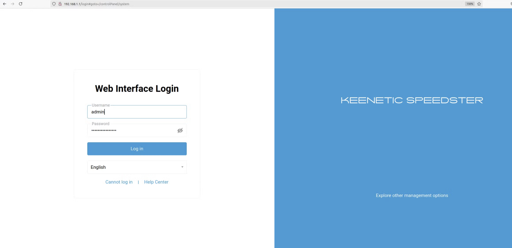

Шаг 9

Убедитесь, что Keenetic OS обновлена до 4.2 и компонент WireGuard VPN установлен.

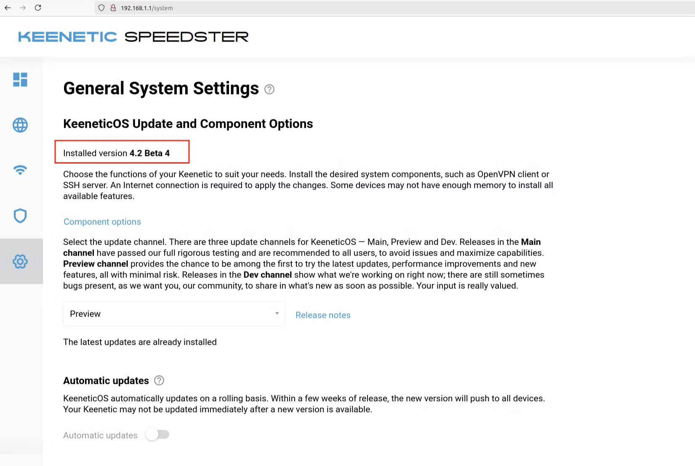

Шаг 10

В настройках роутера перейдите в **Internet → Other connections**.

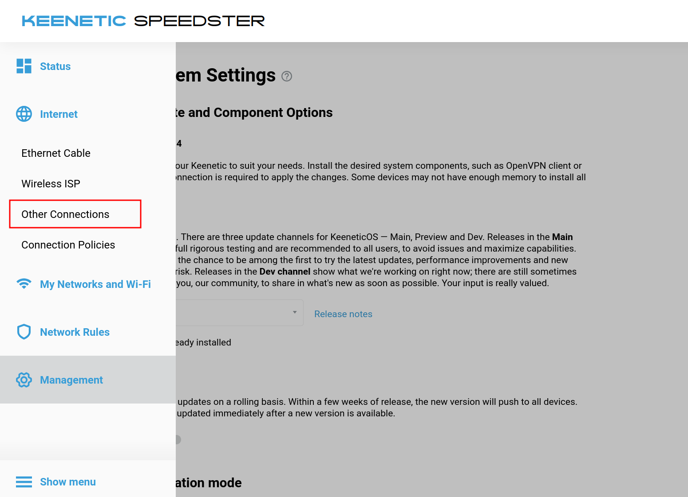

Шаг 11

В разделе Wireguard создайте подключение и импортируйте сохранённый файл AmneziaWG через **Import from file**.

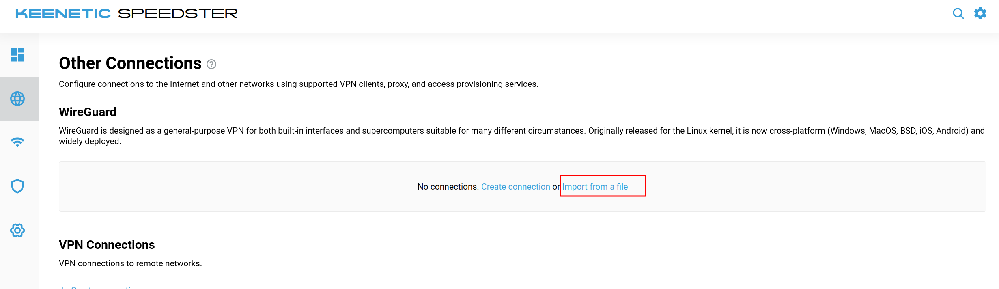

Шаг 12

Выберите файл и нажмите Enter. Результат должен выглядеть как на скриншоте, где VPS\_IP\_ADDRESS — IP VPS, а 42666 — порт.
В разделе Wireguard появится подключение с именем импортированного файла. Пока не включайте его: откройте настройки щелчком по строке в любом месте, кроме переключателя.

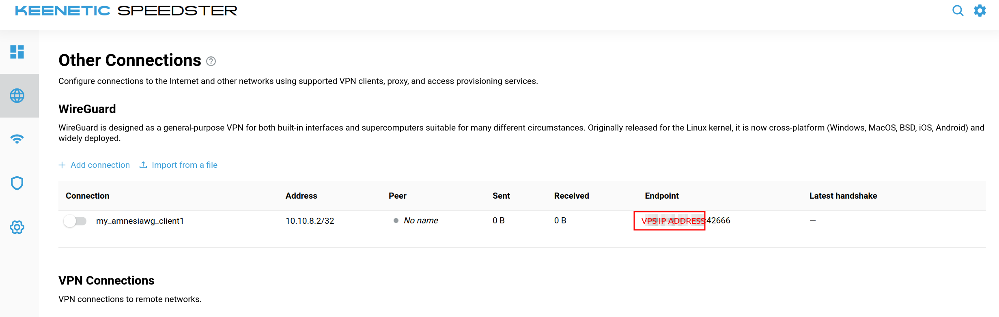

*Внутренний IP нового подключения должен быть уникальным среди существующих Wireguard-соединений. При конфликте создайте новый файл конфигурации с другим IP для одного из них.*

Шаг 13

В настройках отметьте **Use to access the Internet** и нажмите **Save** внизу страницы.

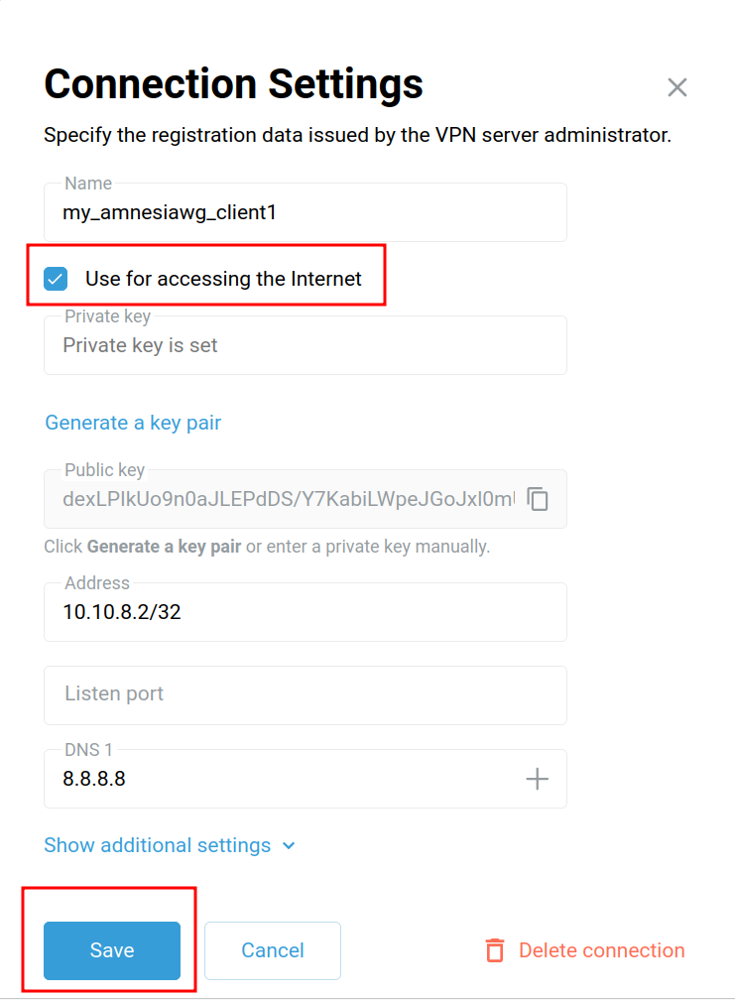

Шаг 14

Откройте веб-версию командной строки Keenetic: в настройках нажмите значок шестерёнки справа вверху и ссылку **Command line**.

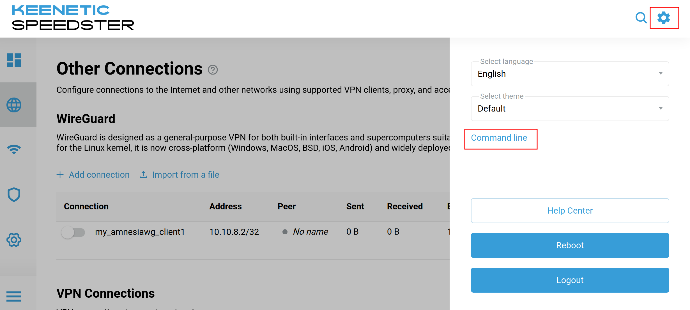

Шаг 15

Введите **show interface** и нажмите **Send Request**. Ниже появятся сведения обо всех интерфейсах.

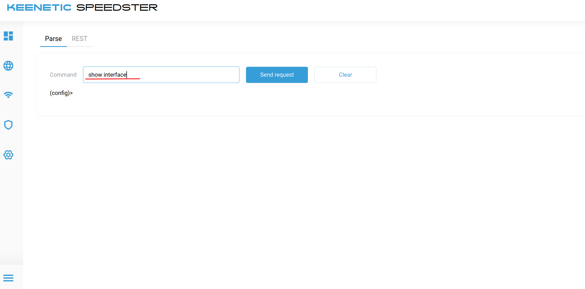

Шаг 16

Найдите имя интерфейса по имени созданного подключения. Откройте поиск страницы клавишами Ctrl+F и введите имя — в примере my\_amneziawg\_client1. Найдётся единственное значение в **description**, рядом с которым поле **interface-name** содержит нужный интерфейс. В примере это **Wireguard 0**.

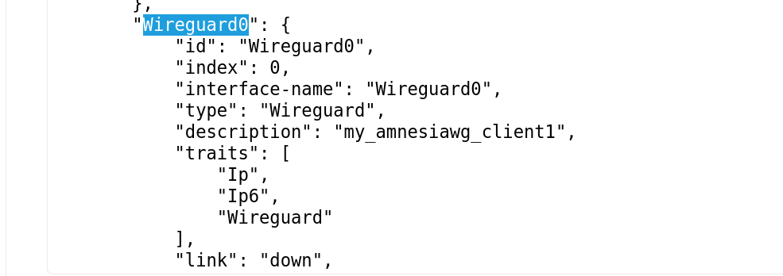

Шаг 17

Теперь известны имя интерфейса и значения **asc** из сохранённого my\_amneziawg\_client1.conf. Замените все значения шаблона в скобках своими и удалите сами скобки:

```bash
interface {name} wireguard asc {jc} {jmin} {jmax} {s1} {s2} {h1} {h2} {h3} {h4}
```

Откройте my\_amneziawg\_client1.conf на компьютере. Нужны параметры Jc, Jmin, Jmax, S1, S2, H1, H2, H3, H4 — это параметры asc.

```bash
[Interface]
PrivateKey = kHcPwRvI3FRc4qcE+Fgrln1K1qxQNM3jl4CpPzaYx4o=
#_PublicKey = 7vzU3tVk39Dj+XvjpX3e9yZzDZhfbTZUde2Elju3nRM=
Address = 10.10.8.2/32
DNS = 8.8.8.8
Jc = 120
Jmin = 60
Jmax = 1266
S1 = 11
S2 = 54
H1 = 563549684
H2 = 1544213701
H3 = 529241130
H4 = 981267317

[Peer]
AllowedIPs = 0.0.0.0/5, 8.0.0.0/7, 11.0.0.0/8, 12.0.0.0/6, 16.0.0.0/4, 32.0.0.0/3, 64.0.0.0/2, 128.0.0.0/3, 160.0.0.0/5, 168.0.0.0/6, 172.0.0.0/12, 172.32.0.0/11, 172.64.0.0/10, 172.128.0.0/9, 173.0.0.0/8, 174.0.0.0/7, 176.0.0.0/4, 192.0.0.0/9, 192.128.0.0/11, 192.160.0.0/13, 192.169.0.0/16, 192.170.0.0/15, 192.172.0.0/14, 192.176.0.0/12, 192.192.0.0/10, 193.0.0.0/8, 194.0.0.0/7, 196.0.0.0/6, 200.0.0.0/5, 208.0.0.0/4, 8.8.8.8/32
Endpoint = VPS_REMOTE_IP:54666
PersistentKeepalive = 60
PublicKey = 7gExcFjYZ6rR5nU7F3xzrDQchtGu4OCxEwGjSlRGwnE=
```

В этом примере строка выглядит так:

```bash
interface Wireguard0 wireguard asc 120 60 1266 11 54 563549684 1544213701 529241130 981267317
```

Вставьте полученную строку в веб-командную строку роутера и нажмите **Send request**. При правильной команде ниже появится результат, как на скриншоте.

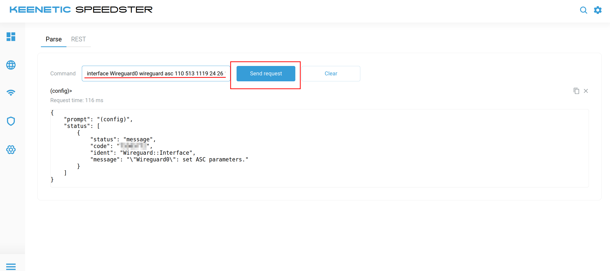

Шаг 18

Выполните **system configuration save** в веб-командной строке кнопкой **Send request**.

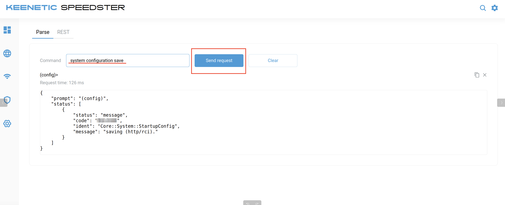

Шаг 19

Перейдите в **Internet → Connection Policies**.

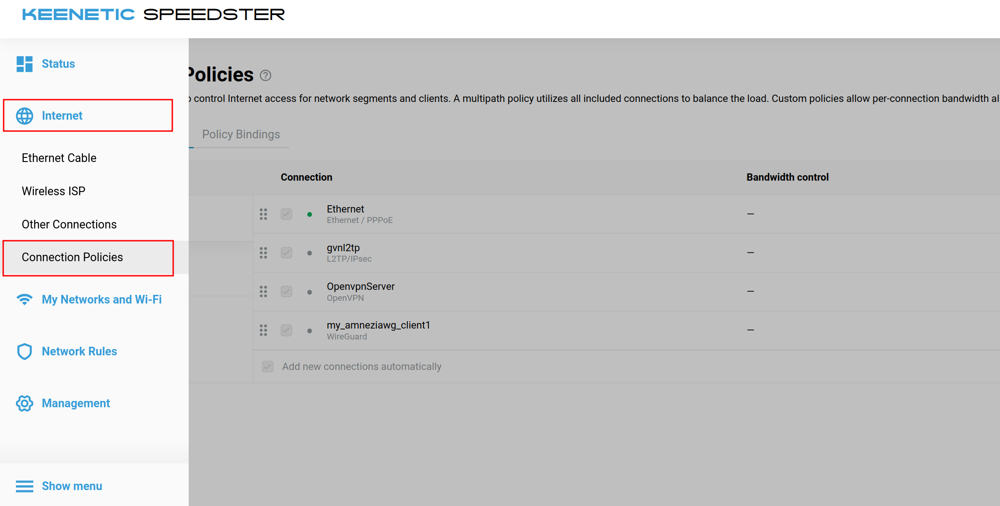

Шаг 20

Добавьте политику в Connection Policies. Например, назовите её **amneziawg** и нажмите **Save**.

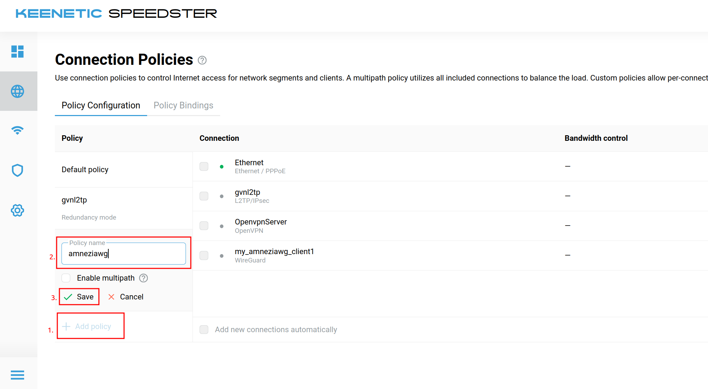

Шаг 21

Откройте политику **amneziawg**, переместите **my\_amneziawg\_client1** наверх, отметьте его и сохраните кнопкой **Save**.

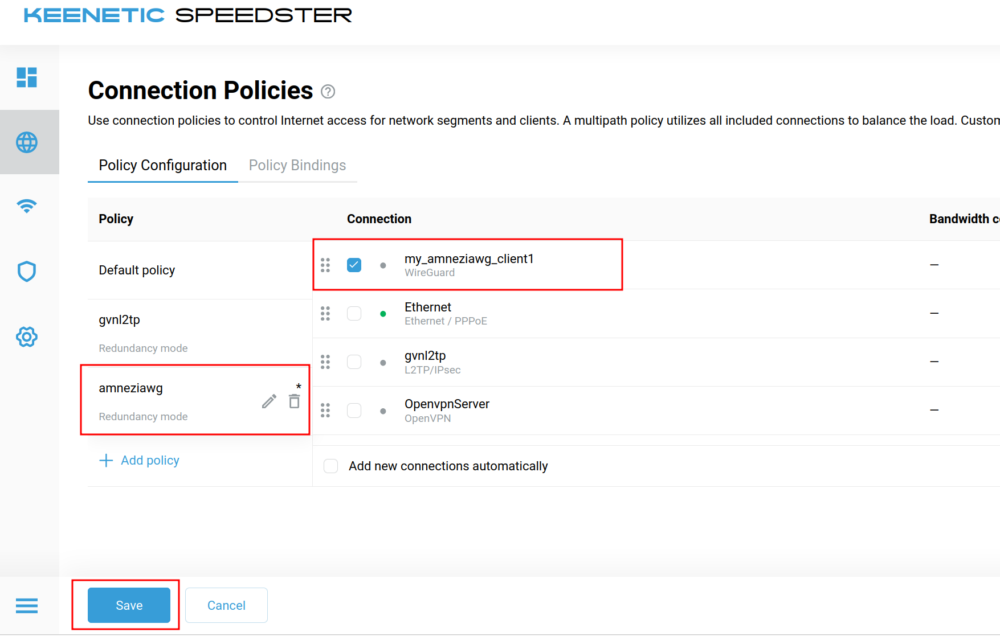

*В настройках Access Policy у Default Policy созданное VPN-соединение my\_amneziawg\_client1 должно находиться ниже основного интернет-подключения. Это предотвращает проблемы повторного подключения роутера при обрыве основного Интернета.*

Шаг 22

В **Internet → Other connections** проверьте созданное WireGuard-соединение, переведя его в **Enabled**. Через несколько секунд индикатор активности пира должен смениться с серого на зелёный. На странице также появятся входящий и исходящий трафик и время последнего handshake.

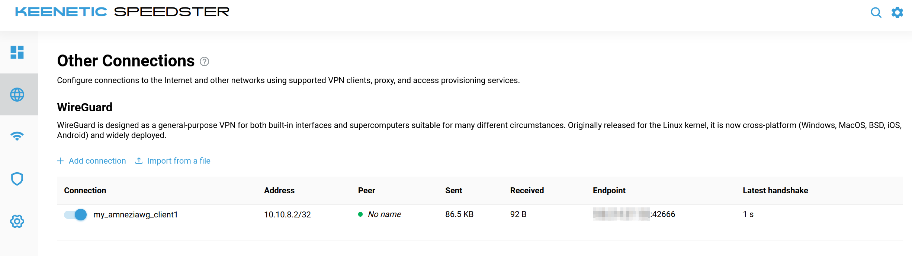

Шаг 23

Снова перейдите в **Internet → Connection Policies → Policy Bindings**. В **Default policy** выберите **устройство**, например SamsungSmartTv, трафик которого должен идти через amneziawg. В меню переключения выберите **amneziawg** и нажмите **Confirm**.

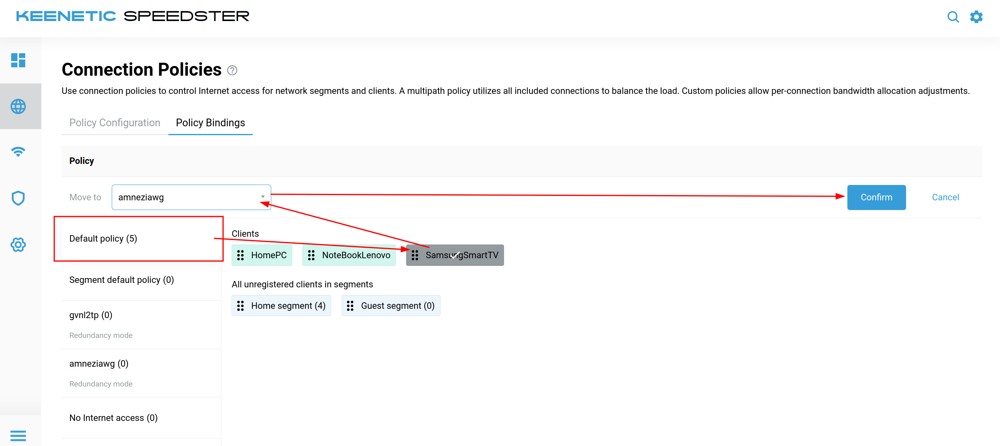

Роутер переместит устройство в политику amneziawg.

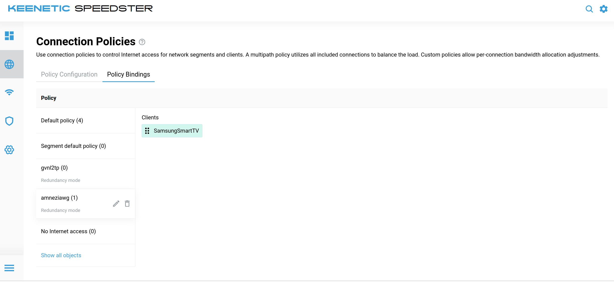

Шаг 24

Проверьте IP выбранного устройства, например через [whoer.net](http://whoer.net). Он должен совпадать с адресом VPN-сервера. Это подтверждает, что трафик Samsung Smart TV или другого выбранного устройства проходит через AmneziaWG. Приятного использования 🏄‍♂️!
