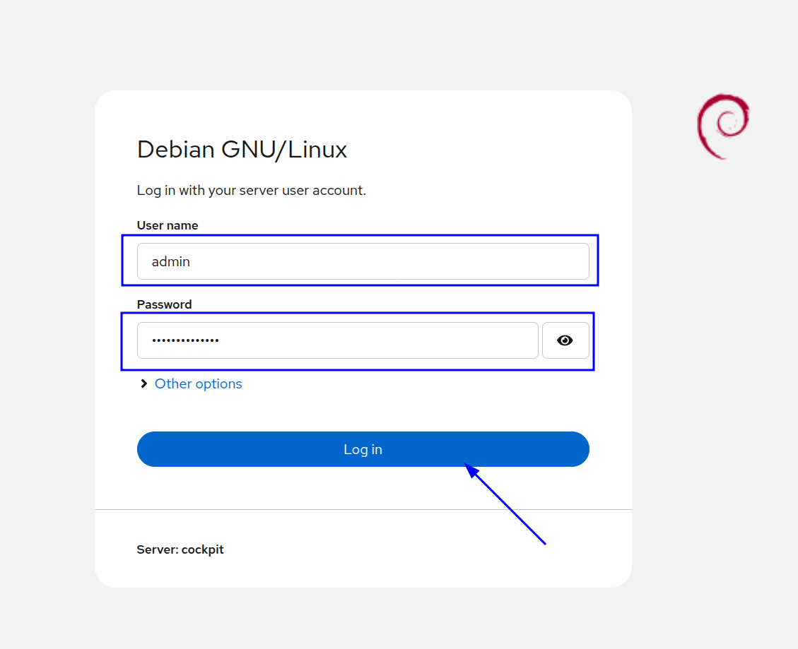
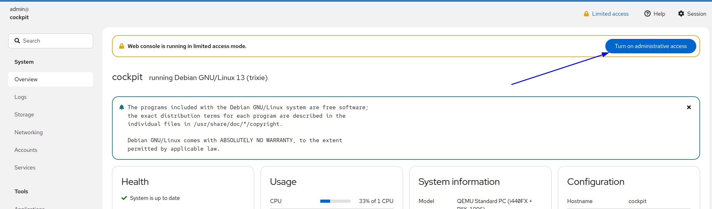
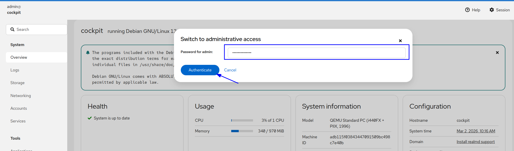
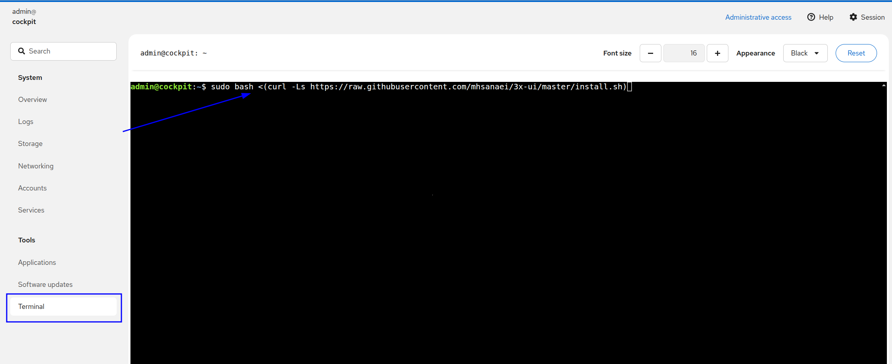

В этом руководстве установим Cockpit на VPS Debian 13 и покажем встроенный Web Terminal как альтернативу при нестабильном, ограниченном или фильтруемом SSH-доступе.

## Что такое Cockpit? {#what-is-cockpit}

Cockpit — лёгкий веб-интерфейс управления Linux-сервером. Он позволяет наблюдать за VPS, настраивать и контролировать его прямо из обычного браузера.

Cockpit особенно полезен администраторам VPS, которым нужен быстрый, защищённый и удобный доступ к системным инструментам без исключительной зависимости от SSH.

Web Terminal помогает там, где SSH нестабилен или фильтруется провайдерами, межсетевыми экранами либо региональными сетевыми правилами. Cockpit работает через HTTPS на порту 9090 и может предоставить более доступный канал управления.

## Особенности веб-терминала Cockpit {#what-makes-the-cockpit-web-terminal-special}

По сравнению с консолью VNC, Cockpit Web Terminal предоставляет:

- Надёжный доступ при ограничении или фильтрации SSH-порта 22.
- Полную командную строку в браузере.
- Защищённое соединение HTTPS.
- Встроенную поддержку буфера обмена для копирования и вставки команд.
- Более быстрый и отзывчивый интерфейс, чем VNC.
- Работу без дополнительного клиентского ПО.

## Как установить Cockpit Web Terminal на Debian 13 {#how-to-install-cockpit-web-terminal-on-debian-13}

Выполните следующие шаги:

1. Подключитесь к Debian 13 по SSH или другим удобным способом доступа к терминалу.
2. При желании создайте отдельного пользователя для Cockpit:

```bash
sudo useradd -m -s /bin/bash newusername
sudo passwd newusername
```

Замените `newusername` нужным именем. После создания можно входить в Cockpit с этой учётной записью.

3. При необходимости административных прав добавьте пользователя в `sudo`:

```bash
sudo usermod -aG sudo newusername
```

Теперь он сможет использовать административный доступ Cockpit.

4. Обновите список пакетов и установите Cockpit:

```bash
sudo apt update
sudo apt install cockpit ufw -y
```

5. Включите и запустите службу:

```bash
sudo systemctl enable --now cockpit.socket
sudo systemctl start cockpit
```

6. При необходимости откройте порт межсетевого экрана:

```bash
sudo ufw allow 9090/tcp
```

7. Перезапустите Cockpit для применения изменений:

```bash
sudo systemctl restart cockpit
```

## Доступ к веб-терминалу Cockpit {#access-cockpit-web-terminal}

Откройте `https://your-server-ip:9090` в браузере. Введите имя пользователя и пароль сервера. После входа веб-терминал доступен из панели Cockpit.



## Замечания по безопасности {#security-notes}

Cockpit по умолчанию использует HTTPS. Из-за самоподписанного сертификата браузер может показать предупреждение — для новой установки это нормально. В рабочей среде можно установить доверенный SSL-сертификат Let's Encrypt.

## Включите права администратора {#activate-administrator-privileges}

После входа нажмите имя пользователя справа вверху и выберите **Turn on administrative access**.

Cockpit запросит пароль повторно для подтверждения повышенных прав.



Введите пароль ещё раз и нажмите **Authenticate**.



Откройте **Terminal** слева. В веб-терминале можно выполнять команды прямо на сервере, удобно копируя и вставляя их из Интернета без SSH и других удалённых терминальных программ.



Ссылки:

- [https://cockpit-project.org](https://cockpit-project.org)
- [https://cockpit-project.org/running.html](https://cockpit-project.org/running.html)
- [https://cockpit-project.org/guide/latest/](https://cockpit-project.org/guide/latest/)

⸻

## Cockpit на VPS EDIS Global {#cockpit-on-edis-global-vps}

Cockpit работает на KVM VPS EDIS Global и предоставляет удобное веб-управление наряду с SSH и VNC.

Типичные задачи:

- Мониторинг и диагностика VPS.
- Администрирование VPN-сервера.
- Управление Linux.
- Удалённая эксплуатация инфраструктуры.

⸻

## Заключение {#conclusion}

Cockpit — мощный и эффективный инструмент веб-управления Linux VPS. Он упрощает администрирование, предоставляет мониторинг в реальном времени и защищённый терминал для полного контроля системы.

Рекомендуем Cockpit, если хотите упростить управление сервером, сохранив производительность и гибкость.
