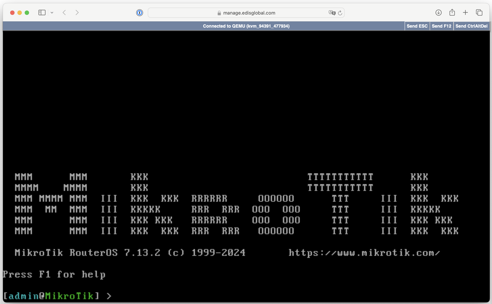
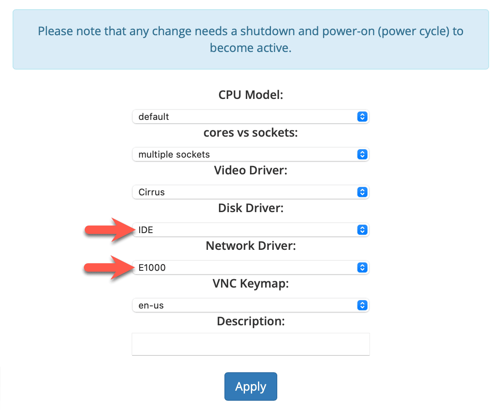

import { CtaButton } from "/snippets/cta-button.mdx";

НОВОЕ: установка MikroTik CHR с помощью скрипта

----------------------------------------------------------------------

<CtaButton label="Скрипт установки MikroTik CHR" link="/ru/advanced-setup-guides/script-based-mikrotik-router-os-installation-guide-winbox" />

…или продолжайте ниже для **классической ручной установки**.

## Как установить MikroTik на VPS {#how-to-install-mikrotik-on-your-vps}

Для установки MikroTik на VPS EDIS Global сначала нужно изменить несколько параметров оборудования, после чего можно перейти к установке.

<Steps>
  <Step title="Войдите в портал">
    [Портал управления VPS](https://manage.edisglobal.com/clientarea.php)
  </Step>
  <Step title="Найдите VPS на вкладке Services" />
  <Step title="Нажмите KVM Settings" />
  <Step title="Измените Disk driver на IDE" />
  <Step title="Измените Network Driver на E100" />
  <Step title="Выполните холодный запуск VPS">
    
  </Step>
</Steps>

## MikroTik CHR — облачный маршрутизатор {#mikrotik-chr-cloud-hosted-router}

Чтобы попробовать MikroTik CHR, скачайте образы с <a href="https://mikrotik.com/download" target="_blank">официальной страницы MikroTik</a>. Для удобства мы преобразовали несколько <a href="https://files.edisglobal.com/index.php/s/Jph4RkS7Cgw0ryY" target="_blank">облачных образов</a> с сайта MikroTik для нашего установщика Cloud-Init 😎

<Steps>
  <Step title="Войдите в портал">
    [Портал управления VPS](https://manage.edisglobal.com/clientarea.php)
  </Step>
  <Step title="Найдите VPS на вкладке Services" />
  <Step title="Нажмите KVM Settings" />
  <Step title="Измените Disk driver на IDE" />
  <Step title="Измените Network Driver на E100" />
  <Step title="Нажмите Reinstall OS" />
  <Step title="Перейдите на вкладку Custom Cloud-Init Images" />
  <Step title="Загрузите файл .qcow2 и продолжите установку, указав любой пароль">
    Сначала появится Server Status: AUTOINSTALL IN PROGRESS.
    Затем статус сменится на Server Status: RUNNING, **AUTOINSTALL IN PROGRESS**.

    **Установка займёт несколько минут!**
  </Step>
  <Step title="После завершения установки: Server Status: RUNNING">
    Запустите сеанс VNC, откройте noVNC, щёлкните внутри окна для передачи фокуса и завершите установку.

    Пользователь MikroTik: admin.

    Пароль MikroTik: отсутствует; оставьте поле пустым и нажмите Enter.
  </Step>
</Steps>


## Настройка статического IPv4 в MikroTik {#configure-static-ipv4-in-mikrotik}

Войдите в маршрутизатор MikroTik:

* Подключитесь через **сеанс VNC**.
* Введите учётные данные: по умолчанию пользователь `admin` и пустой пароль, если вы его не изменили.

### Назначьте статический IPv4 {#set-static-ipv4-address}

После входа откройте **Terminal** и выполните команды для настройки статического IP.

**Назначьте статический адрес:**
Для нужного интерфейса, например `ether1`, выполните:

```bash
ip/address/add address=192.168.1.100/24 interface=ether1
```

* Замените `192.168.1.100/24` статическим IP и маской подсети своего VPS.
* Замените `ether1`, если интерфейс называется иначе.

**Задайте шлюз — маршрут по умолчанию:**

```bash
ip/route/add gateway=192.168.1.1
```

* Замените `192.168.1.1` адресом шлюза своего VPS.

**Настройте DNS-серверы:**
Например, для Google DNS:

```bash
ip/dns/set servers=8.8.8.8,8.8.4.4
```

* Можно использовать другие DNS, например публичные серверы Cloudflare `1.1.1.1` и `1.0.0.1`.

### Проверьте настройки {#verify-your-configuration}

Перезагрузите сервер для применения изменений и настройки сети:

```bash
system/reboot
```

* После перезагрузки подключайтесь по настроенному IP через **Winbox**, **веб-интерфейс** или **SSH**.

## Настройка IPv6 в MikroTik {#configure-ipv6-in-mikrotik}

Каждому VPS EDIS Global выделяется собственный **диапазон IPv6, эквивалентный по размеру /64**. Он не маршрутизируется как отдельная подсеть `/64`.

Каждая локация использует общую IPv6-сеть `/48` и собственный шлюз. Поэтому назначенный IPv6 в MikroTik нужно настроить с **длиной префикса `/48`**. Это не означает, что весь `/48` локации выделен вашему VPS.

В командах используются примеры:

- IPv6-адрес: `2a03:f80:22:4198::1`.
- Шлюз по умолчанию: `2a03:f80:22::1`.
- Интерфейс: `ether1`.

Используйте точные адрес и шлюз из **Network Info** в [портале управления VPS](/ru/vps-management/ip-address-information).

### Назначьте IPv6-адрес {#assign-the-ipv6-address}

Откройте терминал MikroTik или подключитесь через Winbox, затем выполните:

```bash
/ipv6 address add address=2a03:f80:22:4198::1/48 interface=ether1
```

Замените адрес и интерфейс значениями своего VPS. Используйте только адреса из выделенного этому VPS диапазона, эквивалентного `/64`.

### Настройте маршрут IPv6 по умолчанию {#configure-the-ipv6-default-route}

Добавьте точный шлюз локации, показанный в портале:

```bash
/ipv6 route add dst-address=::/0 gateway=2a03:f80:22::1
```

Не вычисляйте и не угадывайте шлюз по адресу примера. У каждой локации EDIS Global свой шлюз.

### Проверьте конфигурацию {#verify-the-configuration}

Покажите назначенные IPv6-адреса:

```bash
/ipv6 address print
```

Покажите маршрут по умолчанию:

```bash
/ipv6 route print
```

<Warning>
  На одном VPS можно одновременно настроить не более 20 постоянных IPv6-адресов. IPv6-прокси с ротацией, генерацией случайных адресов или перебором большого количества адресов запрещены [Правилами допустимого использования](/ru/getting-started/acceptable-use-policy).
</Warning>

Подробнее о диапазоне, эквивалентном `/64`, и обязательном префиксе интерфейса `/48` см. в [Настройке IPv6](/ru/vps-management/ipv6-configuration).
