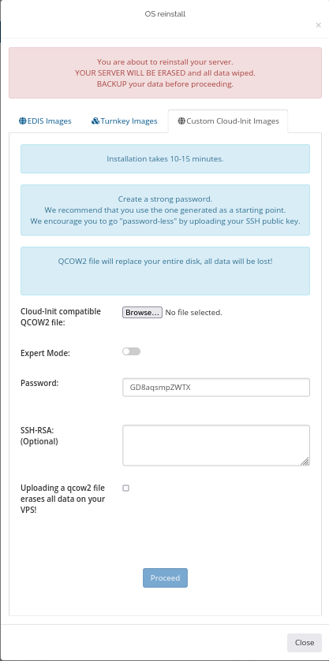
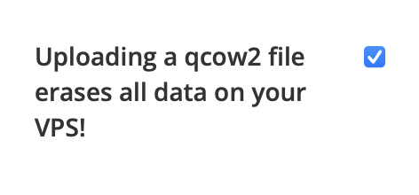

### Пошаговое развёртывание ОС через Cloud-Init {#step-by-step-guide-for-deploying-an-os-using-cloud-init}

В примере показана установка **Oracle Linux 8** из облачного образа .qcow2 через панель управления KVM. Руководство охватывает вход в портал VPS, выбор подходящего образа .qcow2 и настройку виртуальной машины.

<Note>
  Убедитесь, что на вашем тарифе VPS достаточно места для облачного образа.
</Note>

### Установка Oracle Linux 8 через Cloud-Init {#installing-oracle-linux-8-using-cloud-init}

1. Откройте портал управления VPS и перейдите в раздел <a href="/ru/vps-management/autoinstall-reinstall-install-vps-linux-windows" target="_blank">Reinstall</a>.
2. Скачайте на компьютер облачный образ <a href="https://yum.oracle.com/templates/OracleLinux/OL8/u10/x86_64/OL8U10_x86_64-kvm-b237.qcow2" target="_blank">Oracle Linux .qcow2</a> с официальной <a href="https://yum.oracle.com/oracle-linux-templates.html" target="_blank">страницы шаблонов</a>.
3. В портале управления выберите **Reinstall OS**, затем третью вкладку **Custom Cloud-Init Images**.



1. Нажмите **Browse** для загрузки образа .qcow2.
2. Выберите ранее скачанный файл на компьютере.
3. Введите надёжный пароль.
4. Отметьте подтверждение **Uploading a qcow2 file erases all data on your VPS!** — загрузка qcow2 стирает все данные VPS.

<Warning>
  Процесс **удаляет все данные на VPS!**
</Warning>



1. Нажмите **Proceed** и дождитесь полной загрузки файла. Развёртывание Cloud-Init начнётся сразу после неё и займёт примерно 5–10 минут.

   После завершения можно подключиться с паролем, заданным при установке.
2. Подключитесь по SSH через стандартный порт 22:

```shell
ssh root@IP_address_VPS
```

```shell
#To check Oracle version use:
cat /etc/oracle-release
```

Oracle Linux успешно установлена через Cloud-Init.
