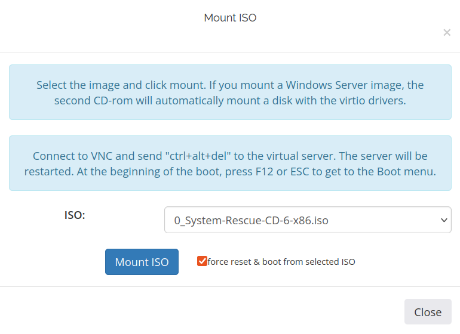
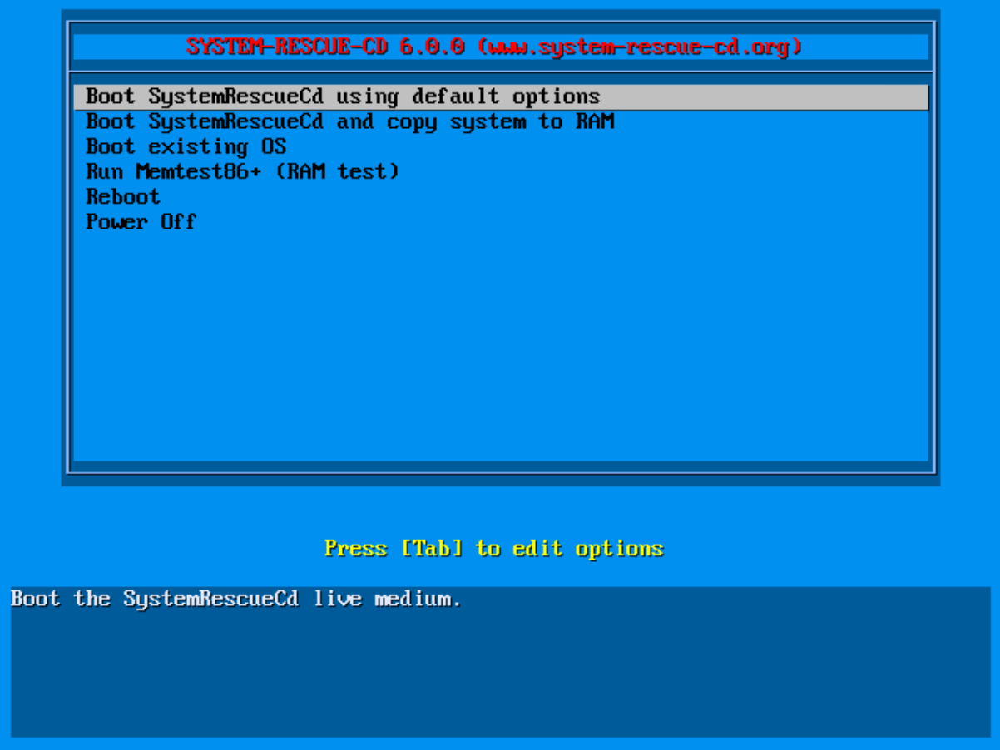
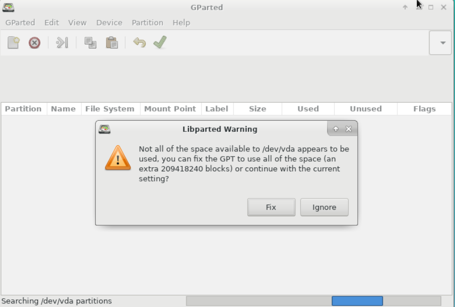
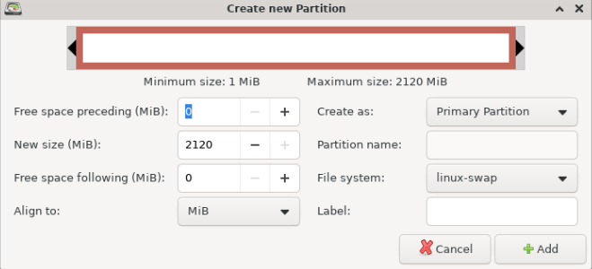

<Warning>
  ### Важное предупреждение: риски изменения размера диска {#important-notice-risks-associated-with-resizing-disk-space}

  Изменение размера дисков и разделов рабочих Linux-систем — сложный и потенциально опасный процесс, предназначенный только для опытных системных администраторов. Возможна потеря данных. Перед любыми изменениями сделайте полную резервную копию всего диска. Процесс может пойти не по плану; возможны непредвиденные проблемы. **Действуйте осторожно и используйте руководство на свой риск.**
</Warning>

Руководство применяется после повышения тарифа VPS или добавления **Drive Size Boost**. Не всегда возможно переустановить ОС ради автоматического расширения диска. Здесь показано ручное увеличение существующего корневого раздела.

Для работы с размером разделов и нераспределённым пространством используйте SystemRescueCD — загрузочный диск восстановления Linux.

Изменение разделов и файловых систем может привести к потере данных, особенно при отключении питания или ошибочных действиях. Всегда сохраняйте важные данные заранее. Ниже — общая инструкция ручного расширения.

<Note>
  Это **офлайн-процедура**: обычная ОС и её службы остановлены, пока работает rescue ISO. Скриншоты показывают только одну схему. До изменений изучите `lsblk -f`, определите корневую файловую систему, swap, EFI- и загрузочные разделы, LVM и зашифрованные тома. Не переносите имена разделов из примера на другую схему.
</Note>

## Откройте портал управления VPS {#access-the-vps-management-portal}

После подтверждения расширения:

* Войдите в <a href="https://manage.edisglobal.com/clientarea.php" target="_blank">портал управления VPS</a>.
* Найдите VPS на вкладке Services.
* После подтверждения расширения <a href="/ru/vps-management/power-cycle-or-reboot-a-vps" target="_blank">завершите работу и выключите VPS</a>, затем включите его снова. Важно полностью отключить питание виртуального сервера.

## Подключите SystemRescueCD и загрузитесь с него {#mount-system-rescue-cd-and-boot}

* Нажмите <a href="/ru/vps-management/mount-iso-image" target="_blank">Mount ISO</a>.
* Выберите образ ***System-Rescue-CD-6-x86.iso***.
* Отметьте **force reset & boot**.
* Нажмите **Mount ISO**.
* <a href="/ru/vps-management/enable-vnc-server" target="_blank">**Включите VNC-сервер**</a>.



## Откройте консоль в браузере {#open-the-browser-console}

1. Нажмите **Start VNC**, затем **Open Console** для просмотра консоли.
2. Щёлкните внутри окна noVNC, чтобы передать ему фокус.
3. Выберите **Boot SystemRescueCd using default options**.
4. Подтвердите клавишей **Enter**.



## Измените размер раздела {#resize-partition}

* **Запустите графический интерфейс:** если SystemRescueCD загрузился в командную строку, выполните `startx`.
* **Откройте GParted:** это бесплатный графический редактор разделов. В окне **Libparted Warning** нажмите **Fix**.



В примере скриншота `/dev/vda1` содержит корневую файловую систему, а `/dev/vda2` — swap между корневым разделом и новым нераспределённым местом. **Ваша схема может отличаться.**

Если свободное место уже находится сразу за расширяемым разделом, пропустите удаление и создание swap. Если расширению мешает раздел, сначала определите его назначение. Не удаляйте EFI, загрузочный, восстановительный, LVM-раздел или раздел данных только из-за совпадения номера с примером. LVM и шифрованные схемы требуют подходящих для этих уровней хранения процедур.

Следующие шаги применимы только после подтверждения, что промежуточный раздел — swap, который допустимо пересоздать. Если он активен в среде восстановления, сначала выполните **Swapoff** в GParted. См. [руководство GParted](https://gparted.org/display-doc.php?name=help-manual).

1. **Удалите swap.** В примере vda2 расположен между vda1 и свободным местом. Нажмите на него правой кнопкой и выберите **Delete**.
2. **Расширьте раздел:** нажмите правой кнопкой на корневой vda1 и выберите **Resize/Move**. Перетащите границы, включив нераспределённое пространство, и нажмите **Resize/Move**. В **Free space following** оставьте размер будущего swap.
3. **Примените изменения:** после настройки нажмите **Apply**. Процесс может занять время; ошибки могут привести к потере данных.
4. **Создайте swap:** нажмите правой кнопкой на свободное место и выберите **New**. В **File system** выберите **Linux-swap**, нажмите **Add** и примените ожидающую операцию перед продолжением.



1. **Проверьте файловые системы:** после завершения рекомендуется проверить ошибки. В GParted нажмите правой кнопкой на раздел и выберите **Check**.
2. **Обновите swap до перезагрузки:** если swap пересоздан, выполните следующий раздел, оставаясь в rescue. У нового swap может быть другой UUID.

## Обновите ссылку на swap в установленной системе {#update-the-installed-system’s-swap-reference}

Если swap не пересоздавался, пропустите этот раздел.

1. Выполните `lsblk -f` и `blkid`, чтобы определить новый UUID swap и корневую файловую систему установленной ОС.
2. Подключите корневую файловую систему в `/mnt/system`. Только для подтверждённой схемы из примера:

   ```bash
   mkdir -p /mnt/system
   mount /dev/vda1 /mnt/system
   cp /mnt/system/etc/fstab /mnt/system/etc/fstab.before-resize
   nano /mnt/system/etc/fstab
   ```

3. Замените старый UUID новым **только в записи swap**. Не меняйте записи корневой файловой системы и EFI.
4. Если настройка возобновления/гибернации ссылается на старый UUID swap, обновите её по процедуре своего дистрибутива до перезагрузки.
5. Сохраните файл, выйдите из каталогов внутри `/mnt/system` и размонтируйте корневую файловую систему командой `umount /mnt/system`. Если она занята, сначала закройте использующие её процессы.

**Завершение:**

1. <a href="/ru/vps-management/mount-iso-image" target="_blank">**Отключите SystemRescueCD**</a>.
2. Загрузитесь с виртуального диска и проверьте увеличенную файловую систему командами `df -hT` и `lsblk -f`. Если swap пересоздавался, проверьте `swapon --show`.
3. Убедитесь в нормальной работе служб, затем [остановите доступ VNC](/ru/vps-management/enable-vnc-server).
