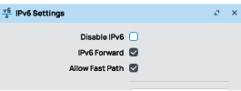

В RouterOS интерфейс туннеля IPv6 поверх IPv4 называется **6to4**. При явно заданном `remote-address` он позволяет создать соединение точка-точка между двумя маршрутизаторами. Оно маршрутизирует IPv6, но не объединяет Ethernet-сегменты мостом и не предоставляет автоматически публичный IPv6-доступ в Интернет.

В примере используются частные IPv6-сети за двумя маршрутизаторами и параметр RouterOS `ipsec-secret`. Актуальное поведение и параметры IPsec по умолчанию описаны в [справочнике интерфейса MikroTik](https://manual.mikrotik.com/docs/cli-reference/interface/6to4/).

## Перед началом {#before-you-begin}

- Вы администрируете оба маршрутизатора RouterOS и их межсетевые экраны.
- На обоих концах есть доступные публичные IPv4. NAT здесь не рассматривается.
- У каждого маршрутизатора есть подходящий LAN-интерфейс или мост для внутренней сети. Не назначайте LAN-адрес публичному/WAN-интерфейсу VPS без проверки.
- Сохраните резервную копию конфигурации и запасной способ управления.

У VPS EDIS уже есть [нативный IPv6](/ru/vps-management/ipv6-configuration). Этот туннель нужен для определённой сетевой схемы, а не для включения обычного IPv6 на VPS.

## Пример адресного плана {#example-address-plan}

Все адреса ниже — **примеры для документации**. Замените IPv4 концов туннеля своими публичными адресами. Для рабочих частных сетей создайте уникальный префикс ULA `/48` и непересекающиеся подсети; см. [RFC 4193](https://www.rfc-editor.org/rfc/rfc4193.html).

| Параметр | Маршрутизатор 1 | Маршрутизатор 2 |
| --- | --- | --- |
| Пример публичного IPv4 | `192.0.2.10` | `198.51.100.20` |
| Адрес туннеля | `fd42:ed15:1234:ffff::1/126` | `fd42:ed15:1234:ffff::2/126` |
| Подсеть LAN | `fd42:ed15:1234:1::/64` | `fd42:ed15:1234:2::/64` |
| LAN-адрес маршрутизатора | `fd42:ed15:1234:1::1/64` | `fd42:ed15:1234:2::1/64` |

ULA предназначены для частной связи и не маршрутизируются глобально в Интернете. Замените `LAN_INTERFACE` реальным внутренним интерфейсом или мостом каждого маршрутизатора.

## 1. Включите IPv6 {#1-enable-ipv6}

На обоих маршрутизаторах:

```text
/ipv6/settings/set disable-ipv6=no
```



## 2. Создайте туннель {#2-create-the-tunnel}

Используйте **одинаковый длинный случайно сгенерированный секрет** на обоих концах. `REPLACE_WITH_UNIQUE_SECRET` — заполнитель, а не готовый пароль. Не используйте публичный пароль из документации.

На маршрутизаторе 1:

```text
/interface 6to4 add local-address=192.0.2.10 remote-address=198.51.100.20 mtu=1280 name=6to4-tunnel ipsec-secret="REPLACE_WITH_UNIQUE_SECRET"
```

На маршрутизаторе 2:

```text
/interface 6to4 add local-address=198.51.100.20 remote-address=192.0.2.10 mtu=1280 name=6to4-tunnel ipsec-secret="REPLACE_WITH_UNIQUE_SECRET"
```

Параметр `ipsec-secret` создаёт динамического пира и политику IPsec. Сверьте согласованные алгоритмы и политику со своими требованиями: создание интерфейса само по себе не доказывает передачу зашифрованного трафика.

## 3. Назначьте адреса туннеля и LAN {#3-assign-the-tunnel-and-lan-addresses}

На маршрутизаторе 1:

```text
/ipv6/address/add address=fd42:ed15:1234:ffff::1/126 interface=6to4-tunnel advertise=no
/ipv6/address/add address=fd42:ed15:1234:1::1/64 interface=LAN_INTERFACE advertise=no
```

На маршрутизаторе 2:

```text
/ipv6/address/add address=fd42:ed15:1234:ffff::2/126 interface=6to4-tunnel advertise=no
/ipv6/address/add address=fd42:ed15:1234:2::1/64 interface=LAN_INTERFACE advertise=no
```

Эти примеры не настраивают внутренние клиентские устройства или объявления маршрутизатора. Назначьте клиентам адреса их LAN-подсети и маршрут через локальный маршрутизатор либо отдельно настройте раздачу IPv6-адресов.

## 4. Настройте маршрут к удалённой LAN {#4-route-the-remote-lan}

На маршрутизаторе 1:

```text
/ipv6/route/add dst-address=fd42:ed15:1234:2::/64 gateway=fd42:ed15:1234:ffff::2
```

На маршрутизаторе 2:

```text
/ipv6/route/add dst-address=fd42:ed15:1234:1::/64 gateway=fd42:ed15:1234:ffff::1
```

Разрешите необходимое согласование IPsec и зашифрованный трафик между двумя конкретными IPv4-пирами, а также нужную пересылку IPv6 между LAN. Протокол 41 — номер IP-протокола, а не TCP- или UDP-порт 41. Не добавляйте широкое правило, разрешающее незащищённый инкапсулированный трафик, ради обхода проблемы политики IPsec.

## 5. Проверьте маршрутизацию и шифрование {#5-verify-both-routing-and-encryption}

Сначала убедитесь, что в RouterOS установлены нужный пир IPsec и ассоциации безопасности. Затем проверьте удалённый конец туннеля и LAN-адрес удалённого маршрутизатора.

С маршрутизатора 1:

```text
/ping fd42:ed15:1234:ffff::2
/ping fd42:ed15:1234:2::1
```

С маршрутизатора 2:

```text
/ping fd42:ed15:1234:ffff::1
/ping fd42:ed15:1234:1::1
```

В конце проверьте трафик между реальными внутренними устройствами и счётчики IPsec. Успешный ping только до маршрутизатора не подтверждает маршрутизацию к клиентам или конфиденциальность пути.

При сбое проверьте доступность концов туннеля, общий секрет, политики IPsec, маршруты IPv6, счётчики межсетевого экрана и обратные маршруты LAN-клиентов. Начальное MTU `1280` также может потребовать проверки конкретного пути: оно не гарантирует передачу инкапсулированного пакета без фрагментации на любом нижележащем маршруте.
