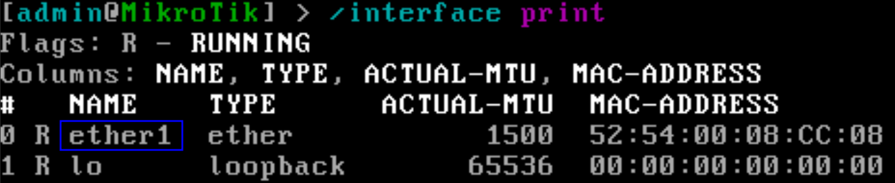
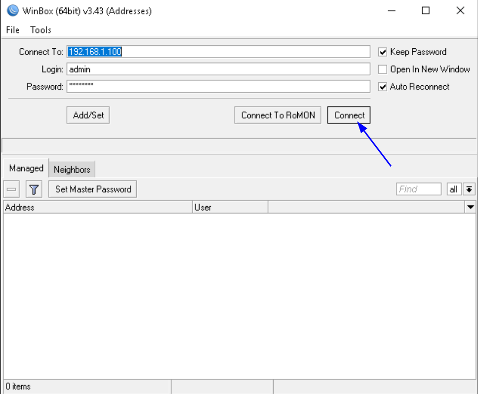

## Введение {#introduction}

Это руководство описывает установку MikroTik RouterOS (CHR) на VPS EDIS Global с помощью скрипта. Установщик автоматически получает **последнюю стабильную версию RouterOS v7, доступную у MikroTik на момент запуска**, и скачивает соответствующий образ CHR. Выбирать фиксированный номер версии не требуется.

Последняя версия выбирается при запуске установщика; это не включает постоянное автообновление уже установленной RouterOS. После установки задайте пароль администратора и сетевые параметры по инструкции ниже, затем подключитесь через Winbox.

## Начало работы: требования и подготовка VPS {#getting-started-prerequisites-and-vps-preparation}

<Steps>
  <Step>
    [Установите Debian 13 на VPS](/ru/vps-management/autoinstall-reinstall-install-vps-linux-windows).
  </Step>
  <Step>
    [Подключитесь к серверу по SSH](/ru/getting-started/linux-secure-shell-ssh).
  </Step>
</Steps>

Откройте терминал и создайте файл скрипта:

```bash
nano mikrotik.sh
```

Скопируйте в него следующий скрипт:

```bash Script expandable
#!/bin/bash
set -euo pipefail

# Include sbin paths
export PATH="$PATH:/usr/bin:/bin:/usr/sbin:/sbin"

# Auto-detect target disk (vda vs sda)
if [ -b /dev/vda ]; then
  export TARGET_DISK=/dev/vda
elif [ -b /dev/sda ]; then
  export TARGET_DISK=/dev/sda
else
  echo "ERROR: Neither /dev/vda nor /dev/sda found. Available disks:" >&2
  lsblk -d -o NAME,SIZE,TYPE >&2
  exit 1
fi
echo "Using TARGET_DISK=$TARGET_DISK"

sudo apt-get update && sudo apt-get upgrade -y
# add parted for partprobe; util-linux provides fdisk
sudo apt-get -y install gzip unzip curl wget util-linux ca-certificates parted

# Latest stable RouterOS v7
latest_version="$(curl -fsSL https://download.mikrotik.com/routeros/NEWESTa7.stable | awk '{print $1}')"

# CHR RAW disk image
ZIP="chr-${latest_version}.img.zip"
IMG="chr-${latest_version}.img"
download_url="https://download.mikrotik.com/routeros/${latest_version}/${ZIP}"

# Download + extract
wget -O "$ZIP" "$download_url"
rm -f "$IMG"
unzip -o "$ZIP" "$IMG"

# Attach image with partition scan
LOOP="$(sudo losetup --find --show --partscan "$IMG")"
sudo udevadm settle 2>/dev/null || true
lsblk "$LOOP"

cleanup() {
  set +e
  sudo umount /mnt/image 2>/dev/null || true
  sudo losetup -d "$LOOP" 2>/dev/null || true
}
trap cleanup EXIT

# Mount partition for injection:
# Prefer p2 first (typically main filesystem) then p1
sudo mkdir -p /mnt/image
MOUNTED=0
for p in "${LOOP}p2" "${LOOP}p1"; do
  [ -b "$p" ] || continue
  if sudo mount "$p" /mnt/image 2>/dev/null; then
    if sudo sh -c 'touch /mnt/image/.writetest && rm -f /mnt/image/.writetest'; then
      MOUNTED=1
      echo "Mounted writable partition: $p"
      break
    fi
    sudo umount /mnt/image
  fi
done

if [ "$MOUNTED" != "1" ]; then
  echo "ERROR: Could not mount a writable partition inside CHR image ($IMG)." >&2
  exit 1
fi

sync
sudo umount /mnt/image
sudo losetup -d "$LOOP"
trap - EXIT

# Write CHR image to disk
echo u | sudo tee /proc/sysrq-trigger >/dev/null
sudo dd if="$IMG" bs=4M of="$TARGET_DISK" status=progress conv=fsync
sudo sync

# Verify layout best-effort
sudo partprobe "$TARGET_DISK" 2>/dev/null || true
lsblk "$TARGET_DISK" || true
sudo fdisk -l "$TARGET_DISK" 2>/dev/null || true

echo s | sudo tee /proc/sysrq-trigger >/dev/null

echo "Waiting 5 seconds..."
end_time=$((SECONDS + 5))
while [ $SECONDS -lt $end_time ]; do :; done

echo "Reboot OS"
echo b | sudo tee /proc/sysrq-trigger >/dev/null
```

Нажмите `CTRL+O` для сохранения, затем `CTRL+X` для выхода.

### Настройте права скрипта {#set-script-permissions}

Разрешите выполнение:

```bash
chmod +x mikrotik.sh
chmod 755 mikrotik.sh
```

### Запустите скрипт {#run-the-script}

```bash
./mikrotik.sh
```

После завершения установки VPS автоматически перезагрузится.

### Настройте RouterOS вручную {#install-settings-manually-in-routeros}

1. Войдите в [портал управления VPS](https://manage.edis.at/whmcs/clientarea.php).
2. Найдите VPS на вкладке Services.
3. [**Включите VNC-сервер**](/ru/vps-management/enable-vnc-server).
4. Откройте noVNC или подключитесь VNC-клиентом.
5. Войдите в RouterOS с пользователем **admin** и **пустым паролем**.
6. Задайте новый пароль admin.
7. Посмотрите имена интерфейсов:

<Card title="Проверьте имя интерфейса">
  

  ```bash
  /interface print
  ```
</Card>

8. Проверьте [**сетевые параметры**](/ru/vps-management/ip-address-information#find-your-vps-network-settings) в панели биллинга. Настройте IP сервера: **192.168.1.100** — пример IP, **ether1** — имя интерфейса.

```bash
 /ip address add address=192.168.1.100/24 interface=ether1 
```

9. Настройте шлюз: **192.168.1.1** — пример адреса шлюза.

```bash
/ip route add gateway=192.168.1.1 dst-address=0.0.0.0/0
```

10. Настройте DNS:

```bash
/ip dns set servers=1.1.1.1,1.0.0.1
```

После настройки через VNC подключитесь к MikroTik RouterOS через Winbox.

### Подключение к серверу через Winbox {#connect-to-the-server-using-winbox}

1. **Скачайте и установите** Winbox с [сайта MikroTik](https://mikrotik.com/download).
2. Откройте Winbox и создайте подключение:
   - Введите **IP-адрес** VPS.
   - В **Login** укажите admin, а в **Password** — ранее заданный пароль.
   - Нажмите **Connect**.

   

MikroTik RouterOS установлена и работает на VPS. Скрипт упрощает запуск MikroTik CHR и управление через Winbox. После защиты учётных данных и проверки настройки инфраструктура готова к сетевому управлению.
