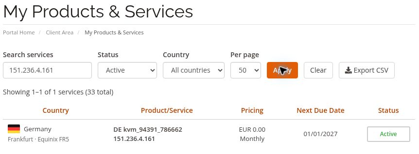
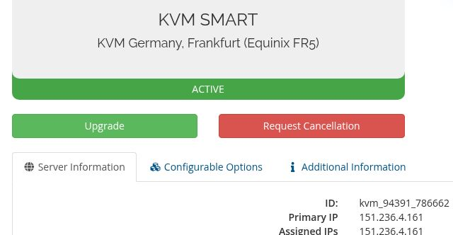
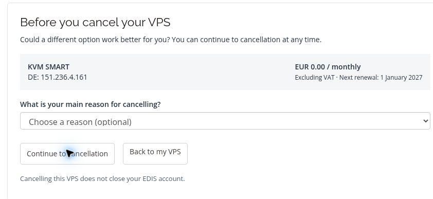
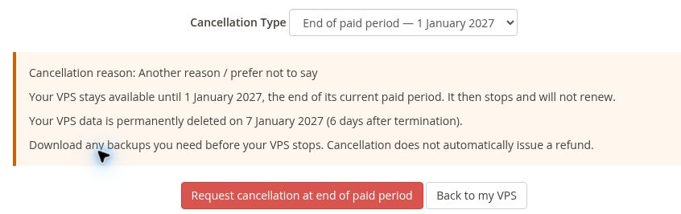

Отменить VPS EDIS Global можно в [портале управления VPS](https://manage.edisglobal.com/clientarea.php).

**Сначала сделайте резервную копию данных.**

<Steps>
  <Step title="Откройте нужный VPS">
    Перейдите в **Services** и выберите VPS. Проверьте его имя и IP-адрес.

    
  </Step>
  <Step title="Запросите отмену">
    Нажмите **Request Cancellation**.

    
  </Step>
  <Step title="Продолжите">
    При желании выберите причину, затем нажмите **Continue to cancellation**.

    
  </Step>
  <Step title="Выберите срок и подтвердите">
    - **End of paid period:** VPS продолжит работать до указанной даты.
    - **Immediate:** VPS прекратит работу сразу.

    Проверьте даты остановки и удаления, затем нажмите красную кнопку **Request cancellation…**.

    
  </Step>
</Steps>

Данные VPS безвозвратно удаляются **через шесть дней после прекращения услуги**, а не через шесть дней после подачи запроса на отмену в конце периода. Сохраните свою резервную копию.

При отмене начисления за продление этого VPS удаляются из неоплаченных счетов-проформ. Начисления за другие услуги сохраняются. Оплаченный, но неиспользованный период не возмещается.

<Tip>
  **Уже запросили отмену, но хотите сохранить VPS?** Вы можете отозвать немедленную отмену или отмену в конце периода до удаления сервера, в течение **шести дней после прекращения услуги**. Откройте **Portal Home → VPS Cancellation Requests → Manage Cancellations → Revoke Cancellation**. Скриншоты и инструкции приведены в разделе [**Управление запросами на отмену VPS**](/ru/faq/billing-lifecycle/manage-cancellation-requests).
</Tip>
