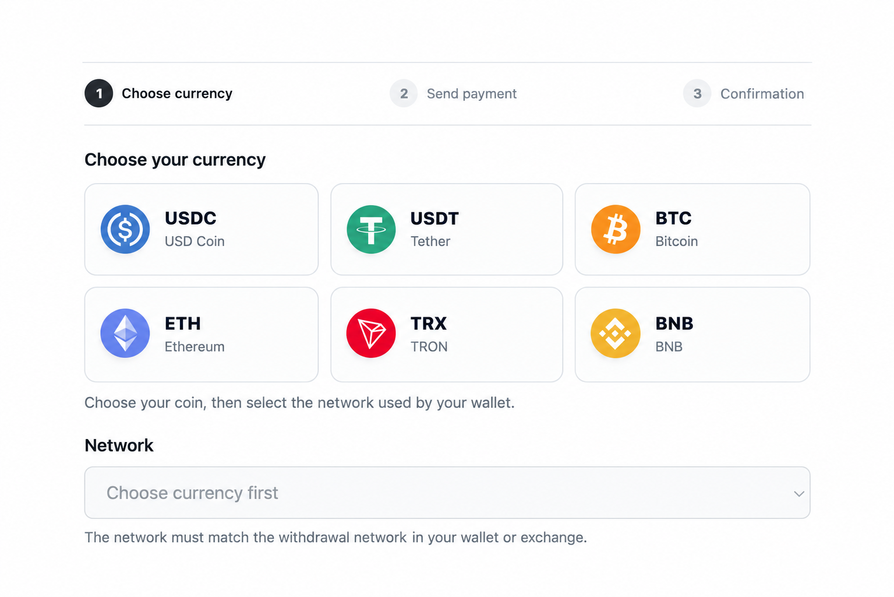
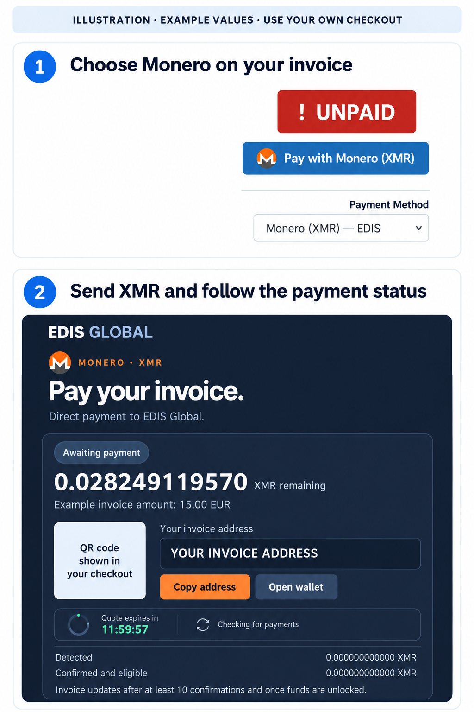

**EDIS Global теперь использует собственную платёжную интеграцию Monero (XMR).** Она работает на нашей инфраструктуре, и для платежей Monero мы больше не используем стороннего платёжного оператора. Платежи XMR уже доступны через отдельный способ оплаты **Monero (XMR)**.

Для BTC, ETH, TRX, BNB, USDC и USDT используйте наш шлюз **Crypto by EDIS Global**.

Криптовалютой можно оплатить счёт или [пополнить баланс аккаунта](/ru/faq/billing-lifecycle/how-to-add-account-credit). Цены и баланс указаны в EUR; страница оплаты рассчитывает сумму к отправке в выбранной криптовалюте.

<Frame caption="Crypto by EDIS Global: выбор валюты и сети. Для Monero (XMR) предусмотрен отдельный способ оплаты на странице счёта.">
  
</Frame>

## Поддерживаемые валюты и блокчейны {#supported-currencies-and-blockchains}

Оба способа оплаты вместе поддерживают **семь валют в пяти блокчейнах**. Для Monero используется собственная интеграция; остальные девять сочетаний валюты и сети доступны через **Crypto by EDIS Global**.

| Валюта | Блокчейн | Тип перевода |
| --- | --- | --- |
| Monero (XMR) | Monero | Нативная XMR; отдельная страница оплаты Monero (XMR) |
| Bitcoin (BTC) | Bitcoin | Нативный BTC, перевод в блокчейне |
| Ether (ETH) | Ethereum | Нативный ETH |
| TRON (TRX) | Tron | Нативный TRX |
| BNB | BNB Smart Chain (BSC) | Нативный BNB |
| USD Coin (USDC) | Ethereum | ERC-20 |
| USDC (Binance-Peg) | BNB Smart Chain (BSC) | BEP-20 |
| Tether (USDT) | Ethereum | ERC-20 |
| Tether (USDT) | Tron | TRC-20 |
| USDT (Binance-Peg) | BNB Smart Chain (BSC) | BEP-20 |

Для **USDT** выберите Ethereum (ERC-20), Tron (TRC-20) или BNB Smart Chain (BEP-20). Для **USDC** выберите Ethereum (ERC-20) или BNB Smart Chain (BEP-20).

EDIS Global принимает только сочетания валюты и сети, доступные на странице оплаты. Одного совпадения тикера недостаточно.

<Warning>
  Сеть вывода в вашем кошельке или на бирже должна совпадать с сетью, выбранной на странице оплаты. Отправка поддерживаемой валюты в другой сети не делает платёж поддерживаемым. Средства, отправленные в неверной сети или в виде неверного токена, могут оказаться невосстановимыми.
</Warning>

## Как оплатить Monero (XMR) {#how-to-pay-with-monero-xmr}

1. Войдите в [личный кабинет](https://manage.edisglobal.com/clientarea.php) и откройте неоплаченный счёт.
2. Выберите **Monero (XMR)** и откройте **Pay with Monero (XMR)**.
3. Отправьте точную сумму XMR на адрес Monero или по QR-коду, указанному для этого счёта. Оплатите комиссию за отправку отдельно и учитывайте срок действия, показанный на странице оплаты Monero. Не используйте повторно адрес или расчёт суммы от предыдущего счёта.
4. Оставьте страницу оплаты открытой или вернитесь на неё, чтобы проверить статус. **Перед зачислением EDIS Global платёж XMR должен получить не менее 10 подтверждений блокчейна, а средства должны быть разблокированы.** Когда подтверждённый платёж покрывает сумму задолженности, счёт автоматически отмечается как оплаченный.

<Frame caption="Иллюстрация на основе страниц счёта и оплаты Monero. Значения приведены для примера; адрес и QR-код являются заглушками. Всегда используйте страницу оплаты собственного счёта.">
  
</Frame>

### Как читать страницу оплаты Monero {#understanding-the-monero-checkout}

| Поле | Что означает |
| --- | --- |
| **XMR remaining** | Сумма, которую ещё требуется отправить. Отправляйте XMR в основной сети Monero и оплачивайте сетевую комиссию кошелька отдельно. |
| **Copy address / Open wallet** | Используйте адрес или ссылку для открытия кошелька из текущего счёта. На иллюстрации выше нет пригодного для оплаты адреса или QR-кода. |
| **Quote expires in** | Оставшееся время действия расчёта платежа. Следите за таймером на своей странице оплаты. Если к моменту истечения срока вы уже отправили деньги, свяжитесь с поддержкой, прежде чем платить повторно. |
| **Detected** | Средства, обнаруженные интеграцией, которые могут ещё ожидать подтверждений или разблокировки. Сам факт обнаружения не переводит счёт в статус оплаченного. |
| **Confirmed and eligible** | Средства, прошедшие проверки подтверждений и допустимости зачисления. Вся запрошенная сумма должна получить не менее **10 подтверждений** и быть **разблокирована**, прежде чем счёт будет отмечен как оплаченный. |

Обнаруженный платёж может всё ещё ожидать подтверждений. Время подтверждения зависит от сети Monero и не составляет фиксированное количество минут. Если вы уже отправили платёж, проверьте его статус или обратитесь в поддержку, прежде чем платить повторно.

## Как оплатить через Crypto by EDIS Global {#how-to-pay-with-crypto-by-edis-global}

Эти действия относятся к BTC, ETH, TRX, BNB, USDC и USDT:

<Steps>
  <Step title="Откройте счёт">
    Войдите в [личный кабинет](https://manage.edisglobal.com/clientarea.php), откройте неоплаченный счёт и выберите **Crypto by EDIS Global**.
  </Step>
  <Step title="Выберите валюту и сеть">
    Выберите валюту, затем сеть, используемую вашим кошельком или биржей. Прежде чем продолжить, проверьте сумму, сеть и инструкции по оплате.
  </Step>
  <Step title="Отправьте платёж">
    Используйте адрес или QR-код, показанный для этого платежа. Отправьте точную указанную сумму криптовалюты и оплатите комиссию кошелька или биржи отдельно, чтобы на платёжный адрес поступила вся требуемая сумма.

    Платёжные инструкции и указанный курс действуют **12 часов**, как показывает таймер. При каждой оплате используйте текущие инструкции для этого счёта. Не сохраняйте адрес для будущих платежей и не используйте адрес из другого счёта.
  </Step>
  <Step title="Дождитесь подтверждения">
    Страница оплаты отслеживает платёж. Счёт становится оплаченным после зачисления необходимой суммы по результатам подтверждения в блокчейне. Сама отправка транзакции или получение её идентификатора не означает, что счёт оплачен.

    Для Bitcoin сейчас требуются **3 подтверждения**. Подробнее о задержках в каждой поддерживаемой сети см. [Подтверждения блокчейна](/ru/faq/billing-lifecycle/cryptocurrency-payments-confirmation-guide-edis-global).
  </Step>
</Steps>

Если вы изменили валюту или сеть либо срок оплаты истёк, используйте новые инструкции со страницы оплаты. Если средства уже отправлены, проверьте статус платежа или обратитесь в поддержку, прежде чем начинать новую оплату.

## Комиссии и обменные курсы {#fees-and-exchange-rates}

**EDIS Global не добавляет комиссию к криптовалютным платежам.** Кошелёк или биржа могут взимать комиссию за вывод; также действуют комиссии сети блокчейна.

При создании платёжных инструкций страница оплаты конвертирует сумму счёта в EUR в выбранную криптовалюту. Указанный курс фиксируется на весь срок действия этих инструкций. Суммы USDT и USDC также рассчитываются из EUR: сумма в EUR не равна такому же числу USDT или USDC. См. [Конвертация валюты](/ru/faq/billing-lifecycle/automatic-currency-conversion).

## Баланс аккаунта и продления {#account-credit-and-renewals}

Чтобы внести предоплату для будущих счетов, откройте **Billing → Add Funds** в личном кабинете и выберите **Crypto by EDIS Global**. Будет создан счёт на пополнение с собственными инструкциями по оплате. Постоянного адреса для пополнения баланса мы не предоставляем.

Криптовалютные платежи требуют отправки средств из вашего кошелька. Для автоматической оплаты продлений поддерживайте достаточный баланс в EUR до создания счетов за продление. Средства, внесённые после создания счёта, необходимо [применить к нему вручную](/ru/faq/billing-lifecycle/pay-invoices-from-credit-balance).

## Проблемы с оплатой и возвраты {#payment-problems-and-refunds}

Если платёж поступил с опозданием, в недостаточном размере, повторно или не отображается в счёте, см. [Помощь с криптовалютными платежами](/ru/faq/billing-lifecycle/cryptocurrency-payment-help). Обратитесь в поддержку EDIS Global и укажите номер счёта, валюту, блокчейн и идентификатор транзакции (TXID).

EDIS Global рассматривает запросы возврата согласно [правилам отмены и возврата средств](/ru/faq/billing-lifecycle/cancellation-and-refund-policy#cryptocurrency-refunds). Если платёж был выполнен через прежний платёжный шлюз, сообщите первоначальный номер счёта, TXID и идентификатор платежа, чтобы мы нашли нужную запись.
