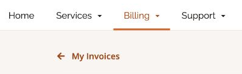
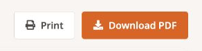

## Как найти и скачать счета {#how-to-find-and-download-your-invoices}

Управлять счетами в EDIS Global просто и удобно. Личный кабинет позволяет легко скачать прошлые счета и отслеживать платежи. Это руководство поможет найти и скачать нужные документы.

***

## Где находятся счета {#where-to-find-your-invoices}

Мы автоматически отправляем счета на адрес электронной почты, связанный с аккаунтом. Вы также можете:

* Настроить другой адрес для получения счетов. Подробнее см. [Получение счетов на другой адрес электронной почты](/ru/faq/billing-lifecycle/add-contact-receive-invoices-different-email).

Все счета также хранятся в **личном кабинете EDIS Global**. Чтобы открыть их:

1. Войдите в личный кабинет: [https://manage.edisglobal.com/clientarea.php](https://manage.edisglobal.com/clientarea.php).

2. Выберите **Billing** в главном меню.

3. В раскрывающемся меню нажмите **My Invoices**.

Из открытого счёта можно вернуться к списку по ссылке **My Invoices** над счётом.

<Frame>
  
</Frame>

* Для более удобного учёта можно перейти на единый ежемесячный счёт. См. [Как получать объединённые ежемесячные счета](/ru/faq/billing-lifecycle/how-to-receive-monthly-consolidated-invoice).

***

## Как скачать счета {#how-to-download-invoices}

На странице **My Invoices**:

1. Вы увидите список всех счетов аккаунта и их статусы, например Paid — оплачен, Unpaid — не оплачен, Cancelled — отменён или Refunded — возвращён.

2. Найдите счёт, который хотите скачать.

3. Нажмите на номер счёта, чтобы открыть подробную информацию.

4. Нажмите **Download PDF** над счётом рядом с **Print**, чтобы скачать документ на устройство.

<Frame>
  
</Frame>

***

## Дополнительная информация {#additional-information}

* **Статус счёта:** панель статусов слева позволяет быстро просмотреть оплаченные, неоплаченные, отменённые счета и счета с возвратом.

* **Сортировка и поиск:** строка поиска и заголовки таблицы помогают быстро найти счёт по номеру, дате или сумме.

* **Доступный баланс:** проверяйте остаток средств непосредственно в разделе **Billing**, чтобы удобнее управлять оплатой.

* **Пополнение:** вносите средства на баланс для автоматической оплаты счетов за продление и бесперебойной работы услуг.

***

## Кратко {#summary}

Счета всегда доступны для просмотра и скачивания в личном кабинете EDIS Global. Если возникнут вопросы или потребуется помощь, обратитесь в поддержку через чат или электронную почту.

> **Быстрая ссылка на счета:** [личный кабинет EDIS Global](https://manage.edisglobal.com/clientarea.php?action=invoices)
