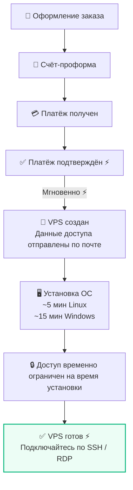

**Мгновенное развёртывание ⚡ после подтверждения оплаты.**

## Скорость развёртывания {#deployment-speed}

- **Linux:** готов примерно через 5 минут.
- **Windows:** может потребоваться примерно до 15 минут.

## Способы оплаты {#payment-methods}

Развёртывание начинается сразу после подтверждения платежа:

- **PayPal и банковские карты:** практически в реальном времени ⚡.
- **Криптовалюта:** после получения необходимого числа подтверждений блокчейна.

---

## Процесс предоставления услуги {#delivery-process}

---

## Когда предоставление может занять больше времени {#when-delivery-may-take-longer}

В редких случаях возможна задержка из-за:

- Временной нехватки ресурсов.
- Дополнительных проверок соответствия требованиям.

При необходимости наша команда свяжется с вами или предложит возврат средств.
