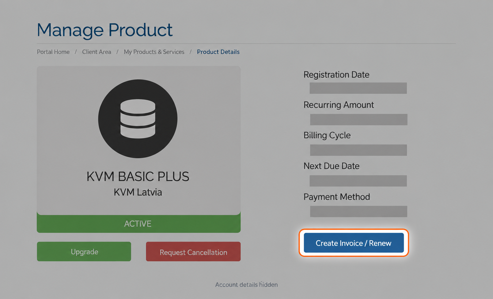

## Автоматическое продление и отмена

  <h3 style={{ color: "#17202a", fontSize: "24px", lineHeight: 1.3, fontWeight: 700, margin: "0 0 20px" }}>
    Ваш VPS продлевается автоматически
  </h3>
  

    Чтобы остановить продление, <strong>отмените услугу в личном кабинете до создания следующего счёта</strong>.
  

  

    Счета за продление создаются <strong>за 7 дней до срока оплаты услуги</strong>.
  

  

    <a href="/ru/faq/billing-lifecycle/cancel-a-service" style={{ color: "#17202a", fontWeight: 600, textDecoration: "underline", textDecorationColor: "#e85d04", textUnderlineOffset: "4px" }}>Как отменить VPS →</a>
  

---

## Когда мы отправляем счета

Мы создаём **счёт-проформу за 7 дней до срока оплаты** услуги.

Счёт-проформа действует как предложение:

- Если вы оплачиваете его, услуга продлевается, а мы выдаём окончательный налоговый счёт, соответствующий всем требованиям.
- Если вы не оплачиваете его, мы отправляем напоминания. Если счёт остаётся неоплаченным, мы приостанавливаем услугу, затем прекращаем её и удаляем все данные.

Полная последовательность действий описана в разделах [Выставление счетов за VPS](/ru/faq/billing-lifecycle/automated-vps-billing-workflow) и [Правила хранения данных](/ru/faq/billing-lifecycle/data-retention-period#what-is-your-data-retention-period).

---

## Немедленное продление через личный кабинет

Не хотите ждать? Вы можете продлить услугу в любой момент.

В личном кабинете откройте **Services → My Services** и выберите VPS. Найдите синюю кнопку **Create Invoice / Renew** под **Payment Method**, рядом с карточкой услуги.

<Frame caption="Актуальный вид личного кабинета. Платёжные данные конкретного аккаунта скрыты.">
  
</Frame>

Это позволяет:

- Сразу создать счёт за продление.
- Выбрать желаемый период оплаты.

<Tip>
  **Годовое предложение 11+1 даёт один месяц бесплатно.** Вы оплачиваете 11 месяцев и получаете 12.

  Для этого предложения используется купон. Покупки с таким купоном **не подлежат возврату по [правилам возврата в течение 24 часов](/ru/faq/billing-lifecycle/cancellation-and-refund-policy)**.
</Tip>

Вы также можете попросить нашу команду выставить счёт заранее.

---

## Автоматические платежи

Если у вас **сохранена банковская карта**, настроена **подписка PayPal** или есть **средства на балансе аккаунта**, счета-проформы за продление оплачиваются автоматически. По умолчанию мы используем доступные средства баланса, если вы не отключили их автоматическое применение.

| Способ оплаты | Когда выполняется списание |
| --- | --- |
| Сохранённая банковская карта | **Через 4 дня после** отправки счёта |
| Баланс аккаунта | По умолчанию **сразу** при выставлении счёта |
| Подписка PayPal | PayPal выполняет регулярный платёж от вашего имени в день наступления срока оплаты |

При использовании средств баланса услуга продлевается сразу.

Подробнее:

- [Автоматические платежи](/ru/faq/billing-lifecycle/automated-payments)
- [Оплата счетов с баланса](/ru/faq/billing-lifecycle/pay-invoices-from-credit-balance)
- [Поиск и отмена подписки PayPal](/ru/faq/billing-lifecycle/how-to-locate-and-cancel-a-subscription-in-your-paypal-account)

---

## Для реселлеров: отключение автоматического использования баланса

Если вы пользуетесь балансом аккаунта и хотите проверять счета за продление перед оплатой, [обратитесь в поддержку](https://www.edisglobal.com/contact). Мы можем отключить автоматическое использование средств баланса при плановом создании счетов. Это настройка на уровне аккаунта. Мы продолжим выставлять счета за продление, и вы должны будете оплачивать их в срок. Другие способы автоматической оплаты настраиваются отдельно.

См. [Можно ли отключить автоматическую оплату счетов за продление с баланса?](/ru/faq/billing-lifecycle/pay-invoices-from-credit-balance#can-i-disable-automatic-credit-application-to-renewal-invoices) и [Дополнительный порядок работы с балансом при создании счетов](/ru/faq/billing-lifecycle/scheduled-billing-window#optional-credit-handling-during-invoice-creation).

---

## Случайно продлили услугу?

Вы можете запросить перевод платежа на баланс аккаунта. Применяются определённые условия.

См. [Случайное продление: перевод платежа на баланс аккаунта](/ru/faq/billing-lifecycle/accidental-renewal-convert-payment-to-credit).
