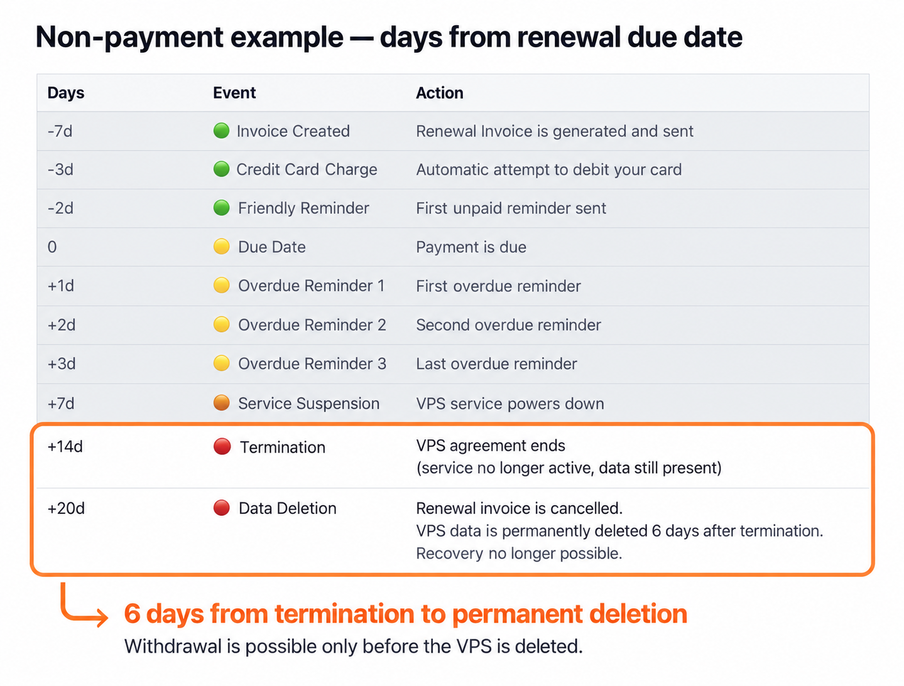
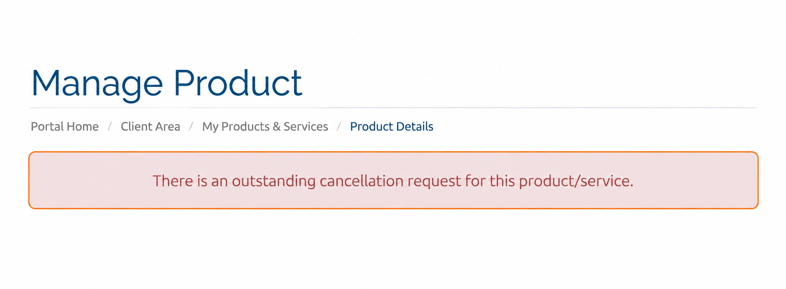
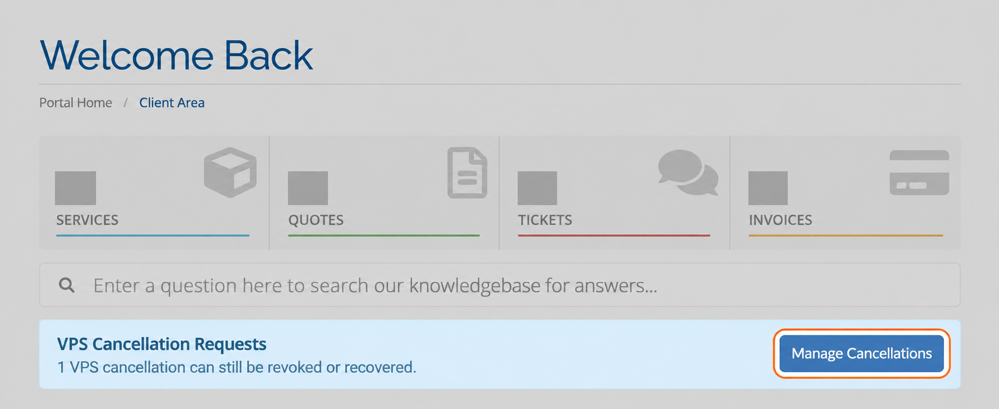
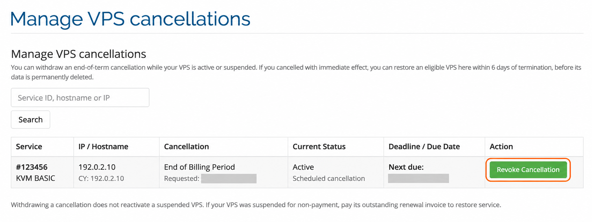

Передумали и хотите сохранить VPS? Вы можете **отозвать запрос на отмену, пока сервер не удалён**. Это возможно и после прекращения услуги — в течение **шести дней с даты прекращения**. Правило действует как для **немедленной отмены**, так и для **отмены в конце периода**. Откройте **Manage Cancellations** в портале управления VPS, чтобы отозвать запрос или восстановить VPS.

<Tip>
  **Краткий путь:** [главная страница портала](https://manage.edisglobal.com/clientarea.php) → **VPS Cancellation Requests** → **Manage Cancellations** → **Revoke Cancellation**.
</Tip>

## До какого момента можно отозвать отмену?

**Крайний срок — удаление сервера, а не прекращение услуги.** Запрос можно отозвать до безвозвратного удаления VPS. Период хранения длится до **шести дней после фактического прекращения услуги**, а не шести дней после подачи запроса.

- **Отмена в конце периода:** услуга VPS прекращается в дату следующей оплаты. С этой даты начинается шестидневный срок.
- **Немедленная отмена:** услуга VPS прекращается сразу. Шестидневный срок начинается в этот момент.

Действуйте до удаления: после безвозвратного удаления сервера отозвать отмену и восстановить данные невозможно.

<Frame caption="В схеме выставления счетов выделены шесть дней между прекращением услуги и удалением данных. В этом примере неоплаты дни отсчитываются от срока оплаты продления; при отмене по запросу клиента используется фактическая дата прекращения услуги.">
  
</Frame>

Полный график действий при неоплате приведён в разделе [Выставление счетов за VPS](/ru/faq/billing-lifecycle/automated-vps-billing-workflow), а правила удаления — в разделе [Сроки хранения данных](/ru/faq/billing-lifecycle/data-retention-period).

## Как найти действующий запрос на отмену

На странице **Manage Product** отдельного VPS с запросом на отмену вверху отображается уведомление:

> There is an outstanding cancellation request for this product/service

Оно означает, что для услуги зарегистрирован запрос на отмену. Сам по себе статус **Active** не означает, что запланированная отмена снята.

<Frame caption="Предупреждение отображается в верхней части страницы отдельной услуги.">
  
</Frame>

Чтобы управлять запросом, нажмите **Home** в навигации портала и вернитесь на главную панель.

## Откройте Manage Cancellations

На главной панели найдите **VPS Cancellation Requests** и нажмите **Manage Cancellations**. Баннер показывает количество отмен VPS, которые ещё можно отозвать, или серверов, которые можно восстановить.

<Frame caption="На главной панели нажмите Manage Cancellations. Данные аккаунта и числовые значения скрыты.">
  
</Frame>

После входа можно также [открыть страницу управления отменами VPS напрямую](https://manage.edisglobal.com/index.php?m=vpsrecovery).

## Отзыв запланированной отмены в конце периода

1. Найдите VPS в списке. При необходимости введите **идентификатор услуги, имя хоста или IP-адрес** в поле поиска и нажмите **Search**.
2. Проверьте столбцы **Service**, **IP / Hostname**, **Cancellation**, **Current Status** и **Deadline / Due Date**, чтобы убедиться, что выбрали нужный VPS. В столбце **Cancellation** запрос на отмену в конце периода указан как **End of Billing Period**.
3. Нажмите зелёную кнопку **Revoke Cancellation** в строке этого VPS.
4. Подтвердите запрос **“Keep this VPS and revoke its end-of-period cancellation request?”** — «Сохранить VPS и отозвать запрос на его отмену в конце периода?». Подтверждайте только в том случае, если хотите сохранить VPS.

<Frame caption="Нажмите Revoke Cancellation для нужного VPS. Показанные идентификатор услуги и IP-адрес вымышлены; даты скрыты.">
  
</Frame>

Отзыв снимает запланированный запрос, поэтому VPS больше не будет прекращён по его причине. Проверьте результат в портале, затем снова откройте страницу **Manage Product** этого VPS и убедитесь, что предупреждение об отмене исчезло.

<Warning>
  **Отзыв отмены не активирует приостановленный VPS.** Если услуга приостановлена за неоплату, для восстановления оплатите непогашенный счёт за продление.
</Warning>

<Note>
  После отзыва запроса на отмену VPS теряет право на возврат по [правилам отмены и возврата в течение 24 часов](/ru/faq/billing-lifecycle/cancellation-and-refund-policy).
</Note>

## Если услуга VPS уже прекращена

Вы всё ещё можете отозвать **немедленную отмену или отмену в конце периода**, пока сервер не удалён, — в течение **шести дней после прекращения услуги**.

Откройте **Manage VPS cancellations**, найдите VPS и выполните доступное действие восстановления. Если VPS отсутствует в списке или подходящего действия нет, незамедлительно [свяжитесь с поддержкой](https://www.edisglobal.com/contact), до удаления.

## Проверьте повторно выставленные счета за продление

При отзыве отмены **EDIS Global повторно выставляет счета за продление, чтобы обеспечить корректное продление и дальнейшую работу услуги**.

Откройте **Billing → My Invoices** и проверьте папку со счетами или электронную почту для получения счетов. Найдите новый счёт, проверьте сумму, срок и статус оплаты и погасите задолженность. Не ориентируйтесь на предыдущий счёт со статусом **Cancelled**.

Если вы не уверены, какой счёт оплачивать или всё ли в порядке с продлением, [обратитесь в поддержку](https://www.edisglobal.com/contact). Найти счета поможет руководство [Как найти и скачать счета](/ru/faq/billing-lifecycle/find-and-download-invoices).

## Хотите, наоборот, отменить VPS?

Следуйте руководству [Отмена VPS](/ru/faq/billing-lifecycle/cancel-a-service), чтобы подать новый запрос и разобраться в вариантах немедленной отмены и отмены в конце периода.
