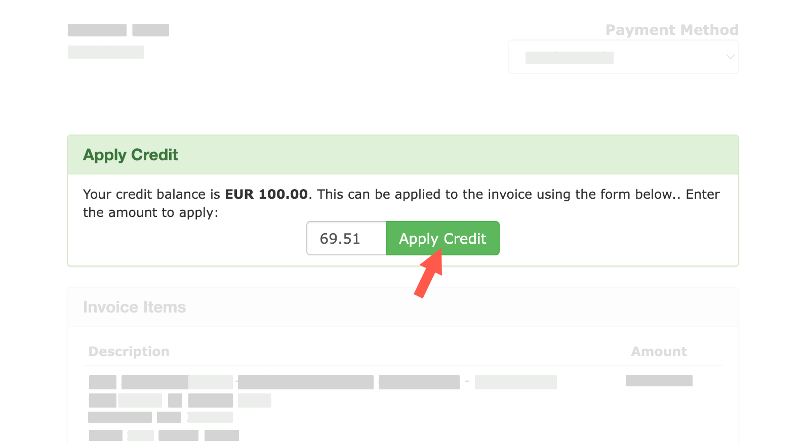

import { CtaButton } from "/snippets/cta-button.mdx";

## Оплата счетов с баланса аккаунта {#pay-invoices-with-account-credit}

После пополнения баланса вы можете использовать эти средства для оплаты счетов. **По умолчанию** EDIS Global автоматически применяет доступные средства баланса к **новым счетам за продление**. Баланс аккаунта также доступен как способ оплаты при оформлении новых заказов.

<Note>
  **Если услуга оплачена с баланса аккаунта, одобренный возврат за неё поступает на баланс — даже если первоначально он был пополнен криптовалютой.** Оставшиеся средства предназначены для будущих услуг EDIS Global, а не для вывода. Если вы покупаете один VPS и не уверены, что будете пользоваться им дальше, оплатите услугу непосредственно при оформлении заказа, без предварительного пополнения. Условия права на возврат и обязательные права, предусмотренные законом, не меняются; см. [правила использования платежей и меры защиты при возвратах](/ru/faq/billing-lifecycle/incoming-and-outgoing-payments).
</Note>

### Важно {#important}

- **К счетам за продление, созданным после пополнения баланса,** доступные средства **по умолчанию применяются автоматически**. Если средств достаточно для полной оплаты, счёт отмечается как оплаченный.
- **Счета, которые существовали до пополнения баланса, не** оплачиваются автоматически. Чтобы оплатить такой счёт с баланса, откройте его и нажмите **Apply Account Credit**.

### Можно ли отключить автоматическую оплату счетов за продление с баланса? {#can-i-disable-automatic-credit-application-to-renewal-invoices}

Да. Если вы хотите проверять счета за продление перед оплатой, [обратитесь в поддержку](https://www.edisglobal.com/contact). Мы можем настроить аккаунт так, чтобы средства баланса **не применялись автоматически при плановом создании счетов**.

После этого вы сможете проверять каждый счёт и оплачивать его вручную. Когда период выставления счетов закончится и баланс будет восстановлен, можно также воспользоваться кнопкой **Apply Credit** в личном кабинете.

Это **настройка выставления счетов на уровне аккаунта, которую выполняет поддержка**. Счета за продление продолжат выставляться, и их необходимо оплачивать в срок. Другие способы автоматической оплаты, например банковские карты и подписки PayPal, настраиваются отдельно.

Для большинства клиентов мы рекомендуем оставить автоматическое использование баланса включённым и [отменять услугу](/ru/faq/billing-lifecycle/cancel-a-service), когда VPS больше не нужен.

Порядок действий и время выполнения описаны в разделе [Дополнительный порядок работы с балансом при создании счетов](/ru/faq/billing-lifecycle/scheduled-billing-window#optional-credit-handling-during-invoice-creation).

### Как применить средства баланса к счёту {#how-to-apply-credit-to-an-invoice}

1. Войдите в **Client Portal** — личный кабинет.
2. Перейдите в **Billing → My Invoices**.
3. Откройте счёт, который хотите оплатить.
4. Найдите на странице счёта зелёный блок **Apply Credit**.
5. Введите сумму, которую хотите использовать, или полную сумму счёта.
6. Нажмите **Apply Credit**.

<Frame>
  
</Frame>

Если вы примените всю сумму задолженности, счёт сразу получит статус **Paid** — оплачен.

---

### Нужно пополнить баланс? {#need-more-credit}

Вы можете пополнить баланс через личный кабинет. Планируя пополнение и использование средств, учитывайте [правила периода выставления счетов](/ru/faq/billing-lifecycle/scheduled-billing-window).

<CtaButton label="Пополнить баланс аккаунта" link="/ru/faq/billing-lifecycle/how-to-add-account-credit" />
