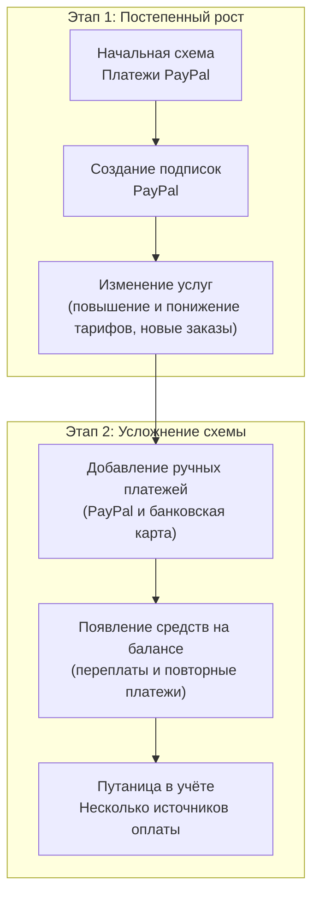

## Переход от запутанных платежей к автоматической оплате

По мере роста аккаунта схема оплаты часто складывается постепенно — и не всегда остаётся понятной и предсказуемой.

На основании **более чем десятилетнего** опыта работы с клиентами мы видим типичный сценарий, который повторяется по мере развития бизнеса.

В этом руководстве объясняется:

- Как схема оплаты обычно усложняется.
- Почему это затрудняет бухгалтерский учёт.
- Как безопасно перейти к **удобному, автоматическому процессу оплаты**.

Если вам или вашему бухгалтеру стало сложно отслеживать платежи, это руководство для вас.

---

## Типичный путь развития: что обычно происходит

Многие аккаунты начинают с простой схемы, которая со временем усложняется.

### Как это выглядит на практике

- Изначально услуги оплачиваются через **PayPal**.
- Клиенты оформляют **подписки PayPal**.
- Подписки продолжают перечислять **одну и ту же сумму**, даже если услуги изменились.
- Со временем клиенты также начинают платить **вручную через PayPal или банковской картой**.
- Забытые подписки PayPal продолжают перечислять деньги.
- Повторные платежи зачисляются **на баланс аккаунта**.
- По умолчанию средства баланса автоматически используются для оплаты новых счетов за продление.
- С ростом числа услуг отслеживать платежи становится всё сложнее.

---

## Сначала проверьте баланс аккаунта

Если на балансе появились средства, которые вы **не вносили намеренно**, часто это вызвано сочетанием:

- Ручных платежей и
- Действующих или забытых подписок PayPal.

---

## Самый важный шаг: отмените подписки PayPal

Прежде всего проверьте аккаунт PayPal и отмените все действующие подписки.

[https://docs.edisglobal.com/faq/billing-lifecycle/how-to-locate-and-cancel-a-subscription-in-your-paypal-account](/ru/faq/billing-lifecycle/how-to-locate-and-cancel-a-subscription-in-your-paypal-account)

Это остановит неожиданные автоматические перечисления. EDIS Global не списывает деньги с вашего аккаунта PayPal. PayPal регулярно отправляет нам платежи.

---

## Как используется баланс аккаунта во время перехода

По умолчанию средства баланса автоматически используются для оплаты новых счетов за продление. Их также можно использовать для новых заказов. Остаток средств отображается в панели управления.

[https://docs.edisglobal.com/faq/billing-lifecycle/pay-invoices-from-credit-balance](/ru/faq/billing-lifecycle/pay-invoices-from-credit-balance)

---

## Вы уже прошли больше половины пути

Когда подписки PayPal отменены, а средства баланса расходуются осознанно, вы уже прошли больше половины пути к понятной схеме оплаты.

[https://docs.edisglobal.com/faq/billing-lifecycle/automated-payments](/ru/faq/billing-lifecycle/automated-payments)

---

## На что обратить внимание в переходный период

- Внимательно проверяйте счета.
- Отслеживайте момент, когда оставшиеся средства баланса будут полностью израсходованы.
- Подключите автоматическую оплату до того, как счета станут просроченными.

---

## Переход на прямое дебетование SEPA или ACH — только по приглашению

Прямое дебетование SEPA и ACH доступно только одобренным клиентам. Сначала обратитесь в поддержку EDIS Global, чтобы подтвердить возможность подключения и оформить разрешение на списание. Не следует считать, что прямое дебетование доступно в каждом аккаунте.

После того как поддержка подтвердит возможность подключения:

1. Создайте небольшое пополнение баланса на сумму, указанную для оформления разрешения на списание.
2. Выберите доступный способ прямого дебетования SEPA или ACH.
3. Завершите оформление разрешения на списание.
4. После окончательного зачисления платежа свяжитесь с поддержкой, чтобы настроить согласованную схему оплаты услуг.

Важные замечания:

- Этот способ не подходит для немедленного предоставления услуг.
- Окончательное зачисление может занять несколько рабочих дней.
- Перед переходом оплатите все существующие счета вручную.
- Продолжайте использовать прежний способ оплаты, пока поддержка не подтвердит, что разрешение на списание и новая схема оплаты активны.

---

## Дополнительно: блокировка баланса на время выставления счетов

Для одобренных аккаунтов поддержка может настроить отключение автоматического использования средств баланса при плановом создании счетов. Перед запуском выставления счетов баланс временно устанавливается в ноль, а затем восстанавливается. Это может быть удобно при сочетании прямого дебетования и баланса аккаунта. Счета за продление оплачиваются по согласованной схеме прямого дебетования, а восстановленные средства баланса можно использовать для новых покупок с предоставлением услуг практически в реальном времени.

Время выполнения описано в разделе [Дополнительный порядок работы с балансом при создании счетов](/ru/faq/billing-lifecycle/scheduled-billing-window#optional-credit-handling-during-invoice-creation), а порядок подключения — в [руководстве по балансу аккаунта](/ru/faq/billing-lifecycle/pay-invoices-from-credit-balance#can-i-disable-automatic-credit-application-to-renewal-invoices). Другие способы автоматической оплаты настраиваются отдельно.

---

## Мы готовы помочь

Если ваша схема оплаты стала слишком сложной, наша команда поможет перейти к понятному автоматическому процессу.
