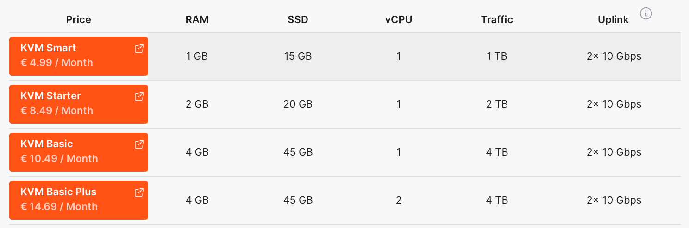

## Предоставляет ли EDIS Global почасовые тарифы VPS? {#does-edis-global-provide-hourly-vps-plans}

Нет, EDIS Global не предоставляет почасовой VPS-хостинг.

Наш <a href="https://www.edisglobal.com/vps-hosting/austria-vienna" target="_blank">начальный тариф KVM VPS</a> стоит всего от **€4.99 в месяц** (≈ €0.0068 в час) в большинстве из 50 локаций по всему миру.

Настоящая почасовая оплата финансово нецелесообразна:
- **4 дня услуги стоят всего ~€0.68**,
- что уже превышает **комиссии за обработку платежей**, взимаемые провайдерами за каждую транзакцию.

Поэтому мы предлагаем **только ежемесячную оплату**, обеспечивая прозрачные цены и надёжную услугу по всему миру.

---

### Почему нет почасового VPS? {#why-no-hourly-vps}

- Комиссии за транзакции превышают размер микроплатежей.
- Ежемесячная оплата сохраняет доступность и предсказуемость тарифов.
- При цене €4.99 в месяц стоимость использования всё равно близка к почасовой.

---

### Альтернатива: VPS на короткий срок {#alternative-short-term-vps}

Если VPS нужен ненадолго, его можно отменить к концу месяца.  
Так вы получаете **VPS-хостинг корпоративного уровня** по цене, близкой к почасовому хостингу у других провайдеров.
