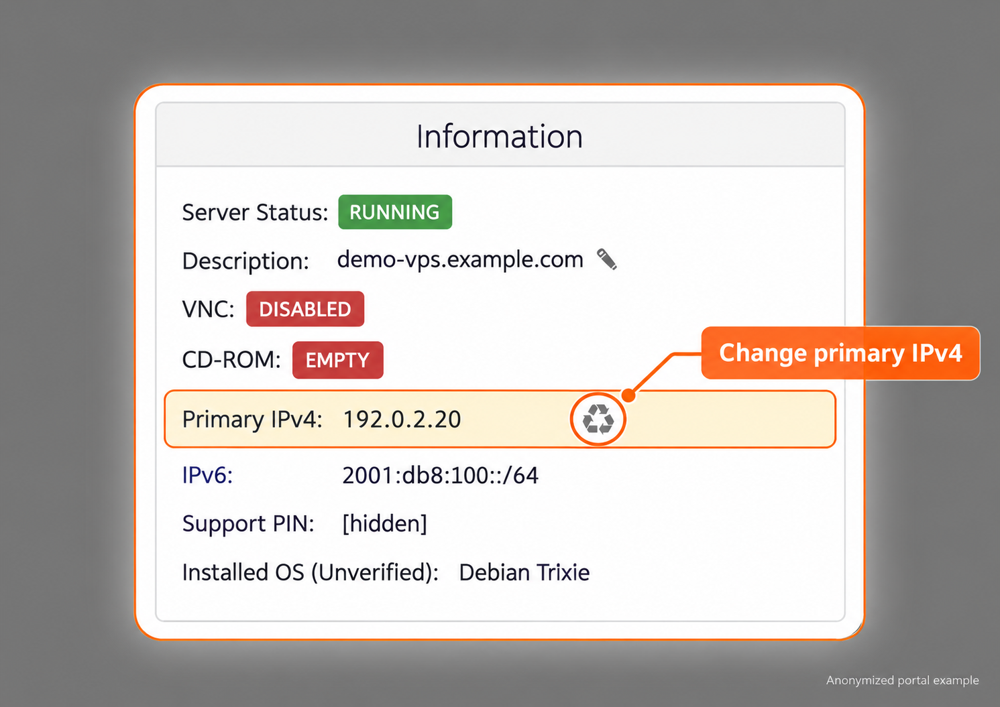
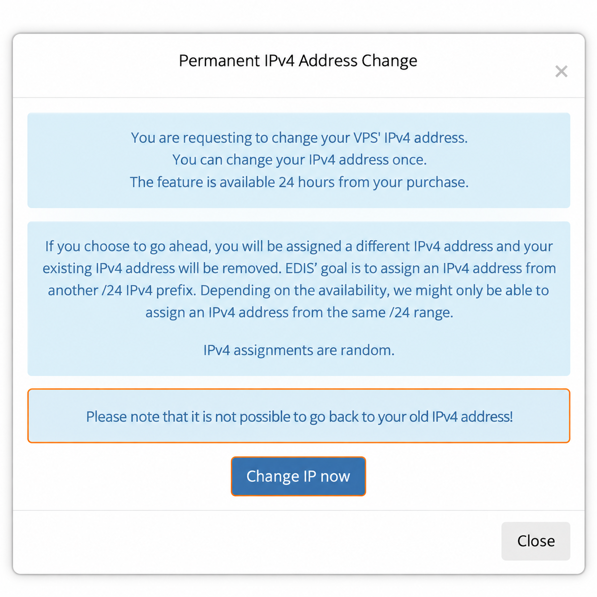

import { CtaButton } from "/snippets/cta-button.mdx";

## Как сменить IP-адрес {#how-to-change-your-ip-address}

### Бесплатная смена IP в течение 24 часов {#free-ip-change-within-24-hours}

Вы можете один раз **бесплатно сменить основной IPv4-адрес**, если запросите смену в первые 24 часа после предоставления VPS.

При смене IP сохраняются та же услуга VPS, локация сервера, тариф и период оплаты.

<Info>
  **Значок замены рядом с Primary IPv4 отображается в панели только в первые 24 часа после предоставления услуги.** Обычно он исчезает по окончании периода бесплатной смены. Это другой значок, чем обновление списка платного Bespoke, описанное ниже. После этого используйте [платные варианты смены IP](#ip-change-after-24-hours).
</Info>

<Steps>
  <Step title="Откройте свой VPS">
    Войдите в [панель управления VPS](https://manage.edisglobal.com/clientarea.php), откройте **Services** и выберите VPS.
  </Step>
  <Step title="Запросите смену IP">
    В блоке **Information** найдите **Primary IPv4** и нажмите небольшой **значок ♻** рядом с адресом.
  </Step>
  <Step title="Проверьте и подтвердите">
    Прочитайте окно **Permanent IPv4 Address Change**. Кнопка **Change IP now** заменяет адрес, а **Close** оставляет его без изменений. Окно предупреждает, что старый адрес нельзя восстановить этим действием и что новый адрес назначается случайно.
  </Step>
  <Step title="Настройте новый IP">
    Переустановите VPS или вручную настройте новый IP через VNC. Старый адрес перестаёт работать сразу после назначения нового IP компанией EDIS Global.
  </Step>
</Steps>

<Frame caption="VPS в первые 24 часа. Значок замены рядом с Primary IPv4 обычно исчезает через 24 часа после предоставления услуги. Снимок обрезан и обезличен.">
  
</Frame>

<Frame caption="Прочитайте подтверждение перед заменой IP-адреса.">
  
</Frame>

<Info>
  Бесплатная смена основного IPv4 **не** лишает права на возврат. Вы по-прежнему можете запросить возврат в первоначальные 24 часа, если соблюдены остальные [условия возврата](/ru/faq/billing-lifecycle/cancellation-and-refund-policy).
</Info>

При бесплатной [замене VPS в другой локации](/faq/server-locations/change-server-location) заменяющий VPS при необходимости также допускает одну дополнительную бесплатную смену основного IPv4. Поскольку локация уже изменена, заменяющая услуга не подлежит возврату.

Бесплатная смена относится только к основному IPv4. Для замены дополнительных IPv4 используйте платные **Standard** или **Bespoke IP Change**.

## Смена IP после 24 часов {#ip-change-after-24-hours}

Платная смена IP доступна в любое время, в том числе после первых 24 часов с момента предоставления услуги:

| Вариант | Цена | Описание |
| --- | --- | --- |
| **Standard IP Change** | **EUR 5** | EDIS Global автоматически назначает доступный IP. Выбрать или гарантировать конкретную подсеть нельзя. |
| **Bespoke IP Change** | **EUR 10** | Вы выбираете IP из списка доступных адресов и префиксов. |

### Стандартная смена IP {#standard-ip-change}

Standard IP Change назначает **случайно выбранный заменяющий IP**. Вы не выбираете новый адрес или подсеть; для выбора из доступных адресов используйте [Bespoke IP Change](#bespoke-ip-change).

<Steps>
  <Step title="Выберите VPS и нажмите Order Now">
    Откройте [Change IP Address](https://manage.edisglobal.com/cart.php?gid=addons) и при необходимости войдите. В карточке **Standard IP Change** выберите VPS из списка и нажмите **Order Now**.
  </Step>
  <Step title="Проверьте VPS и Select Old IP">
    На **Review & Checkout** проверьте VPS и выберите или подтвердите текущий адрес в **Select Old IP**. Это заменяемый адрес, а не новый IP. В Standard IP Change нет списка **Select New IP**.
  </Step>
  <Step title="Перейдите к Checkout">
    Нажмите **Checkout**, проверьте заказ и оплатите его. EDIS Global автоматически назначит замену после подтверждения оплаты. В панели указано предоставление в течение 7 минут.
  </Step>
</Steps>

Нажатие **Order Now** открывает проверку заказа, но само по себе не оплачивает заказ и не заменяет IP. После назначения замены старый IP перестаёт работать. [Настройте новый адрес через VNC](#configure-the-new-ip-after-any-change), чтобы сохранить систему и данные. Переустановка необязательна и удаляет все существующие данные.

<CtaButton label="Заказать Standard IP Change" link="https://manage.edisglobal.com/cart.php?gid=addons" />

### Смена IP с выбором адреса {#bespoke-ip-change}

Выберите заменяющий адрес до завершения заказа:

<Steps>
  <Step title="Откройте страницу смены IP">
    Откройте [Change IP Address](https://manage.edisglobal.com/cart.php?gid=addons) и при необходимости войдите. В карточке **Bespoke IP Change** выберите VPS, IP которого хотите заменить.

    Первый список показывает существующий VPS и его текущий IP; это **не** список адресов для замены.
  </Step>
  <Step title="Нажмите Order Now">
    Нажмите **Order Now** в карточке **Bespoke IP Change**, чтобы открыть **Review & Checkout**.
  </Step>
  <Step title="Выберите Select New IP">
    Проверьте **Select Old IP**, затем откройте **Select New IP**, чтобы увидеть и выбрать доступный заменяющий адрес.

    **Значок обновления** рядом с **Select New IP** или под ним обновляет список доступных адресов. Если нужна другая подсеть, изучите показанные адреса перед выбором.
  </Step>
</Steps>

Открытие страницы, нажатие **Order Now** для перехода к выбору и обновление списка сами по себе не завершают заказ и не заменяют IP. Завершайте **Checkout** и оплату только после решения о покупке. Наличие может меняться; конкретный адрес или префикс не гарантируется.

<Info>
  Значок обновления списка Bespoke отличается от значка бесплатной смены основного IP в Information VPS. Обновление списка не ограничено первыми 24 часами.
</Info>

### Можно ли проверить выбранный IP до покупки? {#can-i-test-a-candidate-ip-before-purchase}

Можно проверить предполагаемый IP по публичной базе блокировок, например [Cheburcheck](https://cheburcheck.ru/). Это поиск в базе данных, а не проверка реального соединения. Отсутствие IP в списке не доказывает доступность этого адреса или вашего VPN-протокола.

В списке находятся неназначенные адреса, а не рабочие тестовые узлы. EDIS Global не может временно назначать или настраивать их для ping-тестов до покупки. Тайм-аут неназначенного адреса не позволяет определить, фильтруется ли он.

Публичный тестовый IP локации — отдельный узел, который не позволяет проверить конкретный предполагаемый адрес. Успешный ping также не доказывает доступность VPN или приложения: Роскомнадзор (РКН) может фильтровать протоколы и порты, включая HTTPS/443 и SSH. Ни текущая, ни будущая доступность из России не гарантируется.

<CtaButton label="Заказать Bespoke IP Change" link="https://manage.edisglobal.com/cart.php?gid=addons" />

## Настройте новый IP после любой смены {#configure-the-new-ip-after-any-change}

<Warning>
  После назначения нового IP компанией EDIS Global старый IP сразу перестаёт работать. Настройте новый адрес вручную через VNC, чтобы сохранить ОС и данные. Альтернативой является переустановка, но она **удаляет существующую ОС и все данные**; заранее сохраните всё необходимое.
</Warning>

<CtaButton label="Переустановить Linux или Windows" link="/ru/vps-management/autoinstall-reinstall-install-vps-linux-windows" />

<CtaButton label="Включить VNC" link="/ru/vps-management/enable-vnc-server" />

Чтобы сохранить установленную ОС, следуйте руководству по ручной настройке для [Ubuntu](/ru/vps-management/manually-change-the-ip-address-in-ubuntu-versions-1804-to-2404) или [Windows Server](/ru/vps-management/how-to-change-ip-address-in-windows-server). Новый адрес, маска или префикс и шлюз указаны в **Network Info**.

## Доступность и повторные смены {#connectivity-and-repeated-changes}

Смена IP не гарантирует доступ из конкретной страны или сети провайдера, доступ к определённому сайту, определённую репутацию IP или отсутствие в блок-листах. Внешняя фильтрация может затрагивать целый префикс или протокол. Префиксы EDIS Global могут уже быть заблокированы в России, а работающий сегодня адрес может стать недоступным позже.

Повторные смены зависят от наличия адресов, проверки аккаунта и [Правил допустимого использования](/ru/getting-started/acceptable-use-policy). После смены обновите адрес сервера VPN и соответствующие DNS-записи. О выборе адреса и префикса см. [Bespoke IP Change](#bespoke-ip-change).

## Основные положения {#summary}

- В первые 24 часа после предоставления услуги можно один раз бесплатно сменить основной IPv4.
- Смена основного IPv4 не отменяет право на возврат в первоначальные 24 часа.
- Бесплатная замена локации при необходимости включает ещё одну бесплатную смену основного IPv4 заменяющего VPS.
- После 24 часов выберите платную смену Standard или Bespoke.
- После каждой смены IP переустановите VPS или настройте новый IP вручную.
- [Смена локации сервера](/faq/server-locations/change-server-location) — это прямая замена VPS с другими правилами возврата.
