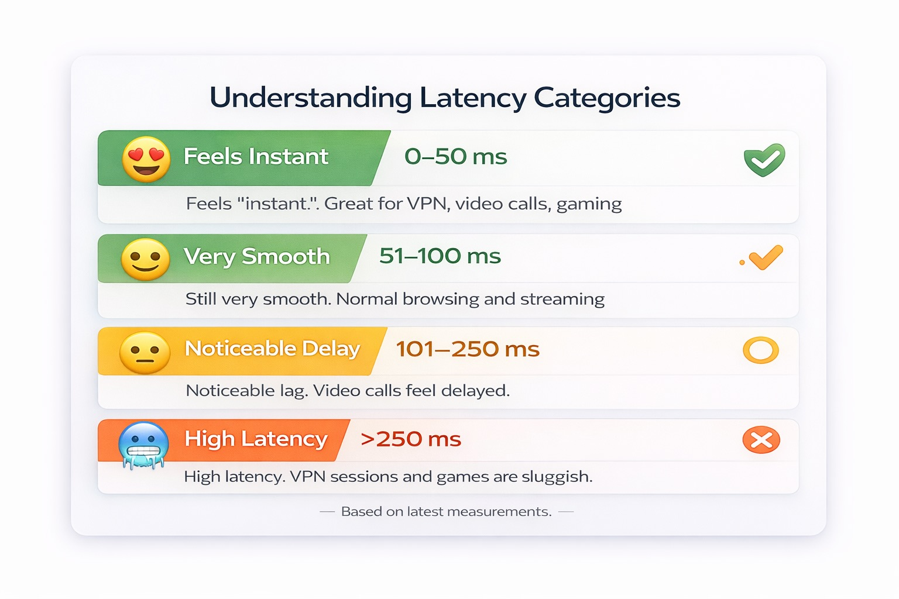

# Бесплатный тест задержки EDIS Global {#use-free-edis-global-latency-test}

**EDIS Global Free Latency Test** измеряет время ping от вашего устройства до локаций VPS по всему миру. Он помогает определить, какая локация обеспечит **лучшую отзывчивость для вашего соединения**.

Помимо числовой задержки в **миллисекундах (мс)**, инструмент показывает **индикатор Ping Feel**.

Он помогает выбрать **лучшую локацию для вашей задачи**, например:

- VPN-серверов;
- SSH-доступа;
- удалённого рабочего стола (RDP);
- игровых серверов;
- торговых ботов;
- веб-хостинга;
- API-инфраструктуры.

Меньшая задержка означает **более быстрый отклик и лучшую производительность**.

Открыть инструмент:

https://www.edisglobal.com/free-latency-test

---

## Что такое задержка? {#what-is-latency}

**Задержка** — время передачи данных между вашим устройством и сервером.

Она измеряется в **миллисекундах (мс)** и часто называется **временем ping**.\
Чем меньше значение, тем лучше: меньше миллисекунд означает более быстрый отклик соединения.

Типичные диапазоны:

| Задержка | Оценка |
| --- | --- |
| 0–50 мс | Отлично |
| 50–100 мс | Очень хорошо |
| 100–250 мс | Приемлемо |
| 250+ мс | Высокая задержка |

Меньшая задержка обычно обеспечивает **более плавную работу соединения и быстрый отклик приложений**.

---

## Что измеряет бесплатный тест {#what-the-free-latency-test-measures}

Инструмент измеряет **задержку ping от вашего устройства до локаций VPS EDIS Global**.

Он автоматически проверяет несколько локаций и показывает:

- **среднее время ping**;
- **минимальную задержку**;
- **максимальную задержку**;
- **оценку Ping Feel**.

**Индикатор Ping Feel** преобразует численные значения задержки в понятную оценку отзывчивости.

---

## Шаг 1: откройте бесплатный тест задержки {#step-1-open-the-free-latency-test}

Перейдите по адресу:

https://www.edisglobal.com/free-latency-test

Тест автоматически начнёт измерять задержку до доступных локаций VPS.

## Шаг 2: запустите бесплатный тест задержки {#step-2-start-the-free-latency-test}

Нажмите **Start test**.

---

## Шаг 3: дождитесь завершения теста {#step-3-wait-for-the-test-to-complete}

Тест отправляет несколько **ICMP ping-запросов** в каждую серверную локацию.

Во время проверки отображается индикатор **Running…**.

Результаты обычно появляются за несколько секунд.

---

## Шаг 4: изучите результаты задержки {#step-4-review-your-latency-results}

Для каждой локации показаны:

- **текущая задержка**;
- **минимальная задержка**;
- **средняя задержка**;
- **максимальная задержка**.

Пример результата:

```text
Cyprus – Limassol
13 ms
Feels Instant
```

Это указывает на **очень быстрое соединение** между вашим устройством и этой локацией VPS.

---

## Шаг 5: индикатор Ping Feel {#step-5-the-ping-feel-indicator}

Инструмент распределяет задержку по категориям **Ping Feel**.

<Frame>
  
</Frame>

| Ping Feel | Задержка |
| --- | --- |
| Feels Instant — мгновенный отклик | 0–50 мс |
| Very Smooth — очень плавно | 51–100 мс |
| Noticeable Delay — заметная задержка | 101–250 мс |
| High Latency — высокая задержка | 251+ мс |

Это помогает быстро найти **самые отзывчивые локации серверов**.

---

## Шаг 6: отфильтруйте локации {#step-6-filter-locations}

Локации можно фильтровать по задержке.

Доступные фильтры:

- **Feels Instant (0–50ms)**
- **Very Smooth (51–100ms)**
- **Noticeable Delay (101–250ms)**
- **High Latency (251ms+)**

Так можно быстро найти **лучшие локации VPS для вашего соединения**.

---

## Шаг 7: выберите лучшую локацию VPS {#step-7-choose-the-best-vps-location}

Выберите локацию с **минимальной задержкой и наиболее стабильными результатами**.

Например:

| Локация | Задержка |
| --- | --- |
| Кипр — Лимасол | 13 мс |
| Германия — Франкфурт | 20 мс |
| Франция — Париж | 29 мс |

Меньшая задержка обычно означает:

- более быстрые SSH-соединения;
- более плавные сеансы удалённого рабочего стола;
- лучшую производительность VPN;
- меньший отклик API и веб-приложений.

---

## Когда задержка особенно важна {#when-latency-matters-most}

**Локация VPS с низким ping** особенно важна для:

### VPN-серверы {#vpn-servers}

Низкая задержка улучшает скорость просмотра сайтов и отзывчивость соединения.

### Удалённый рабочий стол (RDP) {#remote-desktop-rdp}

Меньший ping обеспечивает более плавное движение мыши и обновление экрана.

### SSH-доступ {#ssh-access}

Быстрый отклик улучшает работу в терминале.

### Торговые боты {#trading-bots}

Меньшая задержка помогает сократить задержки исполнения.

### Игровые серверы {#gaming-servers}

Игрокам полезен более быстрый сетевой отклик.

---

## Что влияет на задержку {#factors-that-influence-latency}

Результаты могут различаться из-за нескольких факторов:

- маршрутизации вашего интернет-провайдера;
- географического расстояния;
- потерь пакетов;
- перегрузки сети;
- международных маршрутов.

Поэтому **проводите тесты из той сети, из которой будете использовать VPS**.

---

## Совет: проверяйте несколько раз {#tip-test-multiple-times}

Для наиболее точных результатов:

- запускайте тест в разное время;
- сравнивайте несколько локаций VPS;
- выбирайте сервер с наиболее стабильной средней задержкой.

---

## Зачем использовать тест задержки EDIS Global? {#why-use-the-edis-global-latency-test}

Он предоставляет:

- **измерения задержки в реальном времени**;
- **ping-тесты до десятков локаций VPS**;
- **наглядные индикаторы Ping Feel**;
- **охват глобальной инфраструктуры**.

Это упрощает выбор **лучшей локации VPS по показателям вашей сети**.

---

## Связанные ресурсы {#related-resources}

- Локации VPS-хостинга: https://www.edisglobal.com/vps-hosting
- Бесплатный тест задержки: https://www.edisglobal.com/free-latency-test
