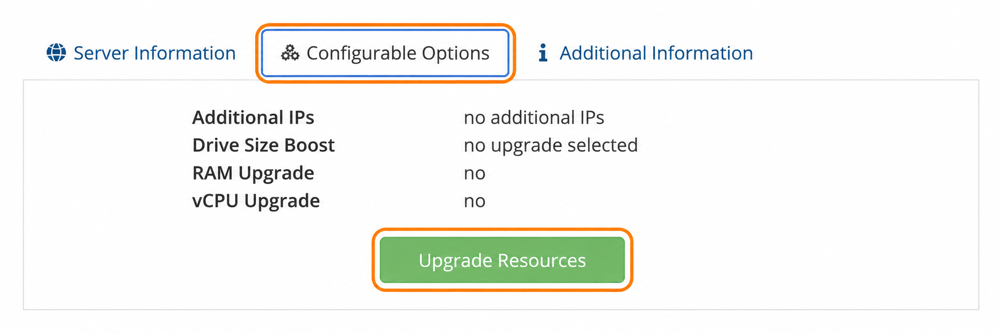
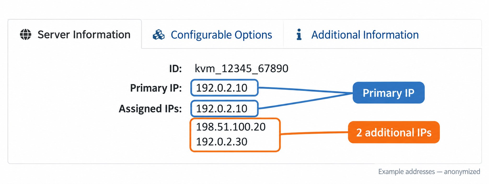
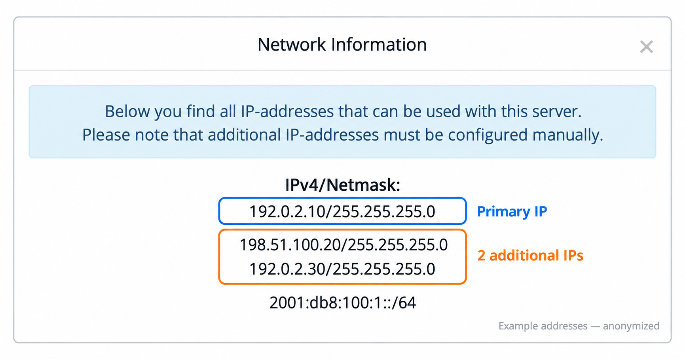

import { CtaButton } from "/snippets/cta-button.mdx";

## Добавьте IPv4-адреса через панель {#add-ipv4-addresses-through-the-portal}

Вы можете самостоятельно заказать до **10 дополнительных IPv4-адресов** в [панели управления VPS](https://manage.edisglobal.com/clientarea.php). Доступные адреса назначаются случайно.

**Порядок заказа: Configurable Options → Upgrade Resources → Additional IPs → счёт → оплата → предоставление.**

| Услуга | Цена |
| --- | --- |
| Случайное назначение адреса | Включено |
| Дополнительный IPv4-адрес | **€5 в месяц за адрес** |

💎 **Bespoke IPv4**: выберите желаемый адрес из доступного списка и [**закажите его через поддержку**](/ru/faq/ip-addresses/order-bespoke-ip-address).

## Заказ дополнительного IPv4 {#ordering-an-additional-ipv4-address}

<Steps>
  <Step title="Откройте VPS">
    Войдите в [панель управления VPS](https://manage.edisglobal.com/clientarea.php), откройте **Services → My Services** и выберите VPS, которому нужны дополнительные адреса.
  </Step>
  <Step title="Откройте Configurable Options">
    Выберите вкладку **Configurable Options**, затем нажмите **Upgrade Resources**.

    <Frame caption="Вкладка Configurable Options и кнопка Upgrade Resources. Снимок панели обрезан и улучшен для читаемости.">
      
    </Frame>
  </Step>
  <Step title="Выберите количество дополнительных IP">
    На странице **Upgrade/Downgrade** найдите строку **Additional IPs**. В **New Configuration** выберите нужное количество дополнительных адресов. Сравните его с **Current Configuration**, особенно если дополнительные IP уже есть.

    Для остальных ресурсов оставьте **No Change**, если не планируете увеличивать их. Нажмите **Click to Continue >>**, проверьте заказ и сумму и завершите запрос увеличения ресурсов, чтобы создать счёт.
  </Step>
  <Step title="Оплатите счёт">
    Оплатите созданный счёт. После подтверждения оплаты мы назначим дополнительные адреса вашему VPS.
  </Step>
  <Step title="Найдите предоставленные адреса">
    Мы подтверждаем назначенные IP **по email** и в панели. Вернитесь к VPS, откройте **Server Information** и нажмите **Network Info**, чтобы увидеть адреса и сетевые настройки.
  </Step>
  <Step title="Настройте адреса в ОС">
    Добавьте предоставленные адреса в ОС VPS и настройте службы, которые должны их использовать. При добавлении дополнительного адреса сохраните существующий основной адрес.

    Для Linux см. [Настройка дополнительных IPv4](/ru/faq/ip-addresses/configuring-additional-ip-address-linux).
  </Step>
</Steps>

<Info>
  **Значок ♻** рядом с Primary IPv4 заменяет основной адрес. Чтобы **добавить** адреса, используйте **Configurable Options → Upgrade Resources**.
</Info>

## Найдите назначенные сетевые настройки {#find-your-assigned-network-settings}

### Определите основной и дополнительные IPv4-адреса {#identify-the-primary-and-additional-ipv4-addresses}

Откройте **Server Information** и сравните два поля над кнопками управления:

1. **Primary IP** показывает основной IPv4 VPS.
2. **Assigned IPs** перечисляет **все назначенные IPv4, включая основной**.
3. Найдите адрес из **Primary IP** в **Assigned IPs**. Остальные IPv4 в списке являются дополнительными.

**Три назначенных IPv4 — это один основной и два дополнительных адреса.** Повторно показанный основной адрес не является дополнительным IP.

<Frame caption="Обезличенный пример: синим отмечен один и тот же основной адрес в обоих полях; оранжевым — два дополнительных IPv4. Выделения и подписи добавлены для руководства.">
  
</Frame>

Дополнительные адреса могут находиться в другой подсети. Определяйте основной адрес по полю **Primary IP**, а не по префиксу или позиции в списке.

### Проверьте адреса и настройки в Network Info {#check-the-addresses-and-settings-in-network-info}

Нажмите **Network Info** в блоке **Server management**. Окно **Network Information** показывает адреса и их маски сети. Найдите определённый выше основной адрес; остальные IPv4 — дополнительные. Префикс IPv6 указан отдельно от дополнительных IPv4.

<Frame caption="Те же примерные адреса в Network Info: один основной IPv4 и два дополнительных. Адреса обезличены; выделения добавлены для руководства.">
  
</Frame>

Используйте **собственные адреса и сетевые настройки из Network Info**, а не примеры на снимках. Нижний раздел **Network Configuration (Details)** содержит шлюз и DNS.

Назначение адреса услуге не настраивает его внутри ОС. **Сохраните основной адрес и добавьте дополнительные** в ОС и нужные службы.

- [Настройка дополнительных IPv4 в Linux](/ru/faq/ip-addresses/configuring-additional-ip-address-linux)
- [Просмотр сетевых настроек VPS](/ru/vps-management/ip-address-information)

<CtaButton label="Открыть панель управления VPS" link="https://manage.edisglobal.com/clientarea.php" />
