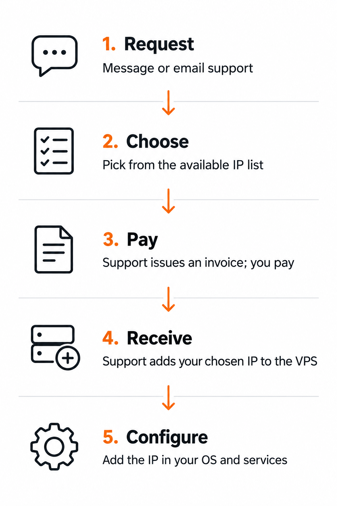

import { CtaButton } from "/snippets/cta-button.mdx";

<Info>
  **Заменяете существующий IP?** Используйте [Bespoke IP Change](/ru/faq/ip-addresses/change-ip-address#bespoke-ip-change): откройте страницу дополнений, выберите VPS, нажмите **Order Now**, затем **Select New IP**. Значок обновления перезагружает список доступных адресов.

  Это руководство описывает **добавление дополнительных адресов** — отдельную услугу.
</Info>

## Услуга выбора IP-адреса {#bespoke-ip-address-service}

**Дополнительные IPv4 по выбору заказываются через поддержку в мессенджере или по email.** Поддержка отправляет список доступных адресов, вы выбираете, и после оплаты команда добавляет их к VPS.

К VPS можно добавить до **10 дополнительных IPv4**. Для самостоятельного заказа случайно назначаемых адресов используйте [инструкцию по дополнительным IP](/ru/faq/ip-addresses/order-additional-ip-address).

| Услуга | Цена за адрес |
| --- | --- |
| Выбор конкретного адреса | **€10 однократно** |
| Дополнительный IPv4 | **€5 в месяц** |

Разовая плата за выбор взимается дополнительно к регулярной плате за IP.

## Заказ IPv4 по выбору {#ordering-a-bespoke-ipv4-address}

<Frame caption="Запрос → выбор → оплата → получение → настройка.">
  
</Frame>

<Steps>
  <Step title="Запросите дополнительные IP по выбору">
    Откройте **мессенджер** через значок чата внизу справа в панели или напишите в [поддержку](https://www.edisglobal.com/contact) по email.

    Укажите **основной IP VPS**, **количество дополнительных адресов** и требования к префиксам. Сообщите, что нужны **дополнительные IPv4 по выбору — bespoke**.
  </Step>
  <Step title="Выберите доступные адреса">
    Поддержка отправит список доступных IP для вашей локации VPS, **по возможности из нескольких префиксов /24**. Ответьте, какие адреса хотите получить.

    Выбор зависит от текущего наличия. Если нужны адреса из разных префиксов /24, попросите поддержку подтвердить доступность перед продолжением.
  </Step>
  <Step title="Получите и оплатите счёт">
    После согласования выбора поддержка создаст счёт. Проверьте и оплатите его. Команда ждёт подтверждения оплаты перед предоставлением выбранных адресов.
  </Step>
  <Step title="Получите выбранные адреса">
    После подтверждения оплаты команда добавит выбранные дополнительные IP к услуге VPS и подтвердит их предоставление.

    Откройте VPS в [панели управления](https://manage.edisglobal.com/clientarea.php) и перейдите в **Server Information**. Выбранные адреса появятся в **Assigned IPs** вместе с существующим **Primary IP**. Найдите основной адрес в списке; остальные IPv4 — дополнительные.

    Снимки панели с пояснениями приведены в разделе [**Как определить основной и дополнительные IPv4**](/ru/faq/ip-addresses/order-additional-ip-address#identify-the-primary-and-additional-ipv4-addresses). Затем нажмите **Network Info**, чтобы посмотреть назначенные сетевые параметры.
  </Step>
  <Step title="Настройте ОС и службы">
    Добавьте предоставленные IP внутри ОС VPS, затем настройте службы, которые должны их использовать. Сохраните существующий основной адрес.

    Для Linux см. [Настройка дополнительных IPv4](/ru/faq/ip-addresses/configuring-additional-ip-address-linux). Назначенные параметры описаны в разделе [Сетевая информация VPS](/ru/vps-management/ip-address-information).
  </Step>
</Steps>

## Что написать в поддержку {#what-to-send-support}

Можно использовать такое сообщение:

```text
Я хочу заказать дополнительные IPv4-адреса по выбору (bespoke).
Основной IP VPS: [IP-адрес вашего VPS]
Количество дополнительных IP: [количество]
Требования к префиксам, если есть: [ваши требования]
Пожалуйста, отправьте список доступных адресов до выставления счёта.
```

<CtaButton label="Обратиться в поддержку по выбору IP" link="https://www.edisglobal.com/contact" />

## Наличие и ожидания от IP {#availability-and-ip-expectations}

Выбор адреса не гарантирует доступ из конкретной страны или к определённой платформе, классификацию как домашнего IP или определённый статус в списках репутации. См. [Ожидания от доступности и IP](/commercial-vpn-hosting#connectivity-and-ip-expectations).

Заказ bespoke добавляет адреса к услуге. Замена существующего основного адреса — отдельная [смена IP](/ru/faq/ip-addresses/change-ip-address).
