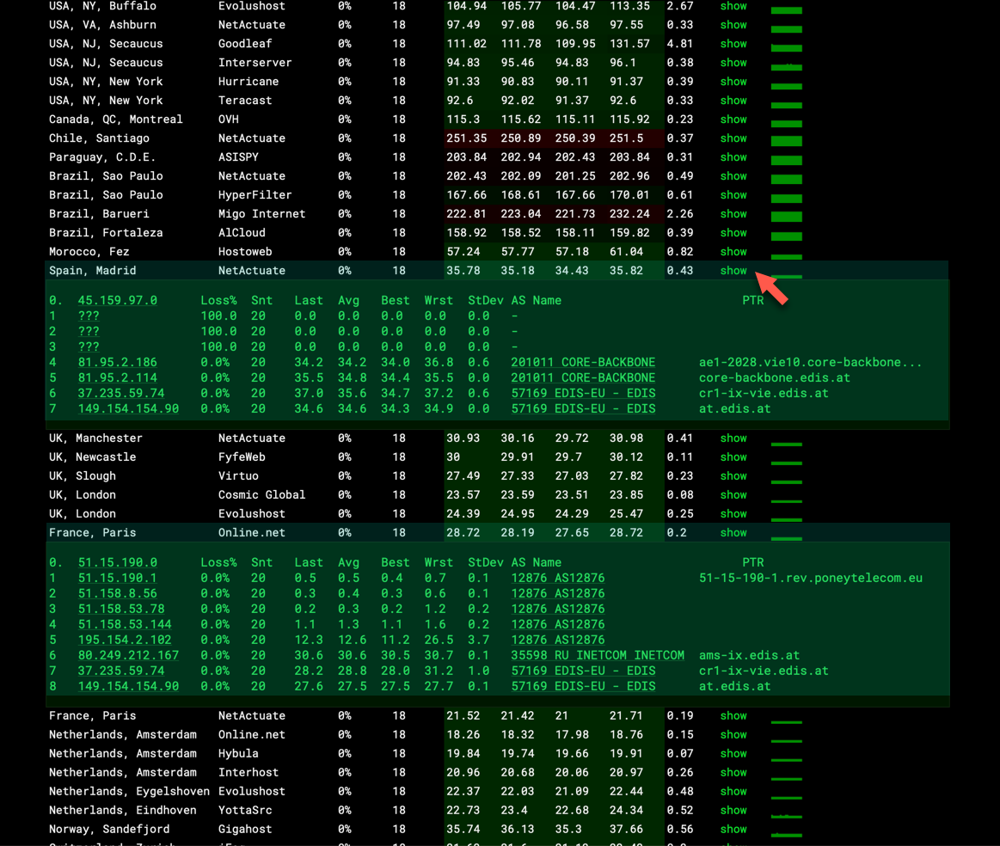

## Обзор {#overview}

ping.pe — публичный инструмент, показывающий ping и потери пакетов из нескольких локаций по всему миру. Он позволяет проверить доступность IP-адреса или имени хоста и возможные потери.

Измерительные узлы ping.pe работают на сторонней инфраструктуре VPS, поэтому результаты **не безошибочны**:

- узлы проверки могут быть временно нестабильны;
- некоторые провайдеры блокируют трафик других провайдеров;
- отдельные точки проверки могут показывать вводящие в заблуждение результаты.

Несмотря на ограничения, ping.pe полезен как первый шаг базового анализа соединения.

---

## Запуск теста ping.pe {#running-a-ping-pe-test}

1. Откройте [**https://ping.pe**](https://ping.pe).
2. Введите **IP-адрес или имя хоста** для проверки.
3. Запустите тест и оставьте его работать **минимум на 30 секунд**.

Достаточная длительность важна для выявления периодических потерь или нестабильной маршрутизации.

---

## Проверка потерь с помощью MTR {#reviewing-packet-loss-using-mtr}

При подозрении на потери не полагайтесь только на ping.\
Всегда изучайте **вывод MTR**.

1. Оставьте тест работать **минимум на 30 секунд**.
2. Нажмите зелёную кнопку **show** в столбце **MTR**\
   (второй справа).
3. Под таблицей откроются результаты MTR.

Вывод MTR помогает определить:

- есть ли потери пакетов;
- на каком узле они начинаются;
- связана ли проблема с вышестоящей сетью, транзитом или назначением.

Понимание места потерь необходимо для правильной диагностики.

---

## Как поделиться результатами ping.pe {#sharing-ping-pe-results}

Внизу страницы ping.pe нажмите **Save as image**.

Это создаст изображение текущего вывода.\
Отправьте ссылку на него в **поддержку EDIS Global**, чтобы мы увидели именно ваши измерения.

---

## Важные замечания {#important-notes}

- Результаты ping.pe ориентировочные и не являются окончательным подтверждением.
- Сбой отдельного измерительного узла не обязательно означает реальную проблему.
- При анализе потерь всегда включайте данные MTR.
