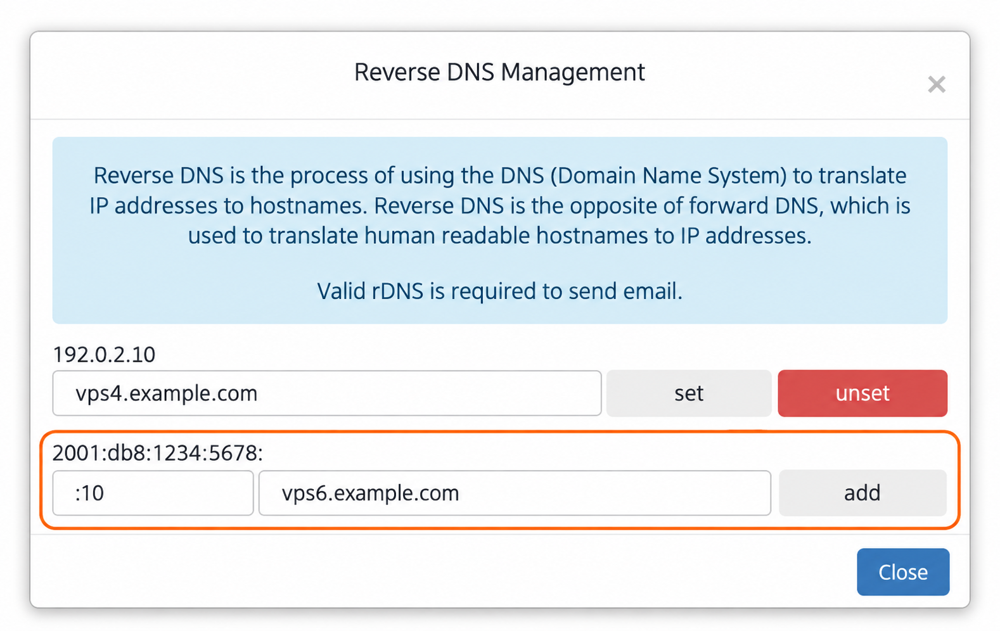
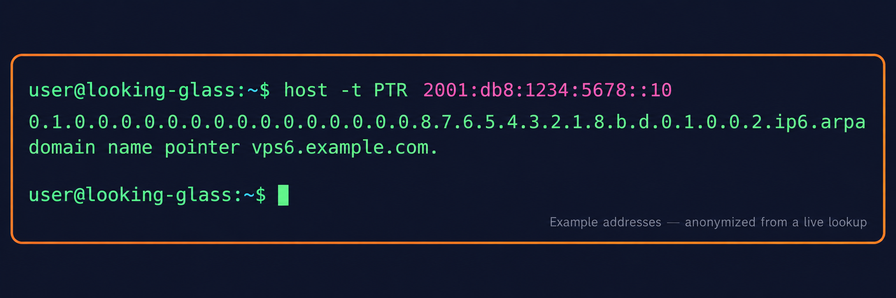

import { CtaButton } from "/snippets/cta-button.mdx";

## Настройка PTR-записей (обратного DNS) {#configure-ptr-records-reverse-dns}

PTR-запись связывает IP-адрес с именем хоста. PTR-записями IPv4 и IPv6 своего VPS можно управлять прямо в панели.

### Откройте Reverse DNS {#open-reverse-dns}

1. Войдите в [панель управления VPS](https://manage.edisglobal.com/clientarea.php).
2. Откройте **Services → My Services** и выберите VPS.
3. На вкладке **Server Information** нажмите **Reverse DNS** в блоке **Server management**.

### Создайте или измените PTR для IPv4 {#set-or-change-an-ipv4-ptr}

Найдите IPv4-адрес в окне, введите полное доменное имя хоста, например `vps4.example.com`, и нажмите **set** рядом со строкой. Чтобы удалить собственную запись, нажмите **unset** в той же строке.

### Добавьте PTR для IPv6 {#add-an-ipv6-ptr}

Последняя строка показывает выделенный префикс IPv6 и два поля ввода:

1. Введите оставшуюся часть IPv6-адреса в первое поле.
2. Введите имя хоста во второе поле.
3. Нажмите **add**. Сохранённый адрес появится отдельной строкой: **set** обновляет запись, **unset** удаляет её.

Например, если показанный префикс заканчивается одним двоеточием:

| Показанный префикс | Ввод в поле адреса | Полный IPv6-адрес | Пример имени хоста |
| --- | --- | --- | --- |
| `2001:db8:1234:5678:` | `:10` | `2001:db8:1234:5678::10` | `vps6.example.com` |
| `2001:db8:1234:5678:` | `:20` | `2001:db8:1234:5678::20` | `mail.example.com` |

<Frame caption="Примеры адресов и имён хостов. Используйте собственный выделенный префикс и имя хоста.">
  
</Frame>

<Note>
  Эти адреса и имена в example.com предназначены для документации. Используйте адрес, выделенный вашему VPS, и имя в домене, которым вы управляете. Добавление PTR не настраивает адрес внутри ОС и не создаёт прямую DNS-запись. Для согласования прямого и обратного DNS настройте A-запись имени хоста для IPv4 или AAAA-запись для IPv6 у DNS-провайдера домена.
</Note>

## Проверьте PTR из терминала {#verify-the-ptr-from-a-terminal}

Запустите `host` на Linux или macOS либо в удалённой оболочке, например сеансе Termius. Замените пример адресом своего VPS:

```bash
# IPv4
host -t PTR 192.0.2.10

# IPv6
host -t PTR 2001:db8:1234:5678::10
```

Успешный ответ заканчивается `domain name pointer vps6.example.com.` или настроенным вами именем хоста. Длинное имя с окончанием `ip6.arpa` — форма IPv6-адреса для обратного DNS.

<Frame caption="Обезличенный результат успешной реальной проверки IPv6.">
  
</Frame>

Если сразу после сохранения вы видите старое имя или `NXDOMAIN`, дождитесь обновления DNS и истечения срока кешированных ответов, затем повторите запрос. Также проверьте точный адрес и сохранённую строку в панели. Для сравнения с другим DNS-сервером:

```bash
host -t PTR 2001:db8:1234:5678::10 1.1.1.1
```

Параметры команды описаны в [руководстве ISC BIND host](https://bind9.readthedocs.io/en/latest/manpages.html#host-dns-lookup-utility).

## Автоматизация управления PTR {#automate-ptr-management}

Используйте Management API для [получения](/management-api-reference/ptr/get-ptr-records), [создания и изменения](/management-api-reference/ptr/set-ptr-records) или [удаления](/management-api-reference/ptr/delete-ptr-records) PTR-записей.

## Делегирование обратного DNS внешним серверам {#external-reverse-dns-delegation}

EDIS Global размещает обратный DNS на инфраструктуре rCodezero Anycast DNS. Управление PTR остаётся на этой инфраструктуре. EDIS Global не делегирует отдельные IP-адреса или части сетей внешним авторитетным DNS-серверам. Настройка PTR отличается от делегирования зоны обратного DNS.

## Нужен ли VPN-серверу собственный PTR? {#does-a-vpn-endpoint-need-a-custom-ptr}

Для VPN-соединения собственный PTR обычно не нужен. Если приложению требуется определённое обратное имя хоста, настройте PTR через панель или API. Если нужна помощь, сообщите поддержке техническое требование.

Подробнее о PTR — в статье нашего блога:

<CtaButton label="Статья о PTR-записях" link="https://www.edisglobal.com/blog/ptr-record" openInNewTab={true} />
