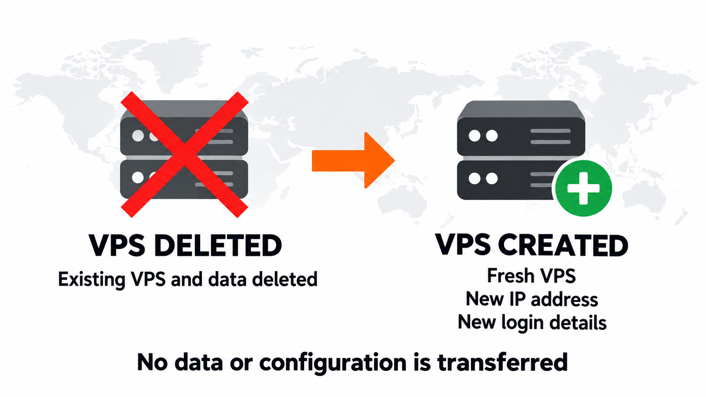

## Как происходит смена локации VPS {#how-a-vps-location-change-works}

IP-адреса и ресурсы VPS привязаны к конкретной серверной локации. Поэтому EDIS Global не может физически перенести существующий VPS в другой регион.

При одобренной смене локации мы **удаляем исходный VPS и создаём совершенно новый VPS** в другой доступной локации EDIS Global по вашему выбору. Это замена, **а не перенос существующего сервиса**. Данные, установленное ПО и настройки не переносятся.

## Бесплатная смена локации в течение 24 часов {#free-location-change-within-24-hours}

Вы можете запросить **одну бесплатную смену локации в течение 24 часов после первоначального заказа VPS**. Это удобно, если вы выбрали не ту локацию, хотите уменьшить задержку или вам нужен сервер в другом регионе.

### Что вы получите {#what-you-receive}

<Frame caption="Новый VPS в выбранной локации. Карта схематическая.">
  
</Frame>

После смены локации EDIS Global:

- Предоставляет **совершенно новый VPS** в другой доступной локации по вашему выбору.
- Выдаёт новые реквизиты доступа и новый IP-адрес.
- Сохраняет тариф VPS и платёжный цикл.
- Напрямую заменяет исходную услугу новым VPS.
- Безвозвратно удаляет исходный VPS, его IP-адреса и данные.

### Дополнительная бесплатная смена основного IPv4 {#additional-free-primary-ipv4-change}

После замены VPS также доступна **одна дополнительная бесплатная смена основного IPv4-адреса нового VPS**, если она необходима.

После смены IPv4 нужно переустановить VPS или вручную настроить новый адрес через VNC. Полная процедура описана в статье [Изменение IP-адреса](/ru/faq/ip-addresses/change-ip-address).

### Право на возврат после смены локации {#refund-eligibility-after-a-location-change}

<Warning>
  Выполненная смена локации заменяет возможность возврата средств. После того как EDIS Global создаст заменяющий VPS, ни исходный заказ, ни новая услуга больше не подлежат возврату.
</Warning>

Сама по себе смена основного IPv4 не отменяет право на возврат. Выполненная смена локации сервера — отменяет. Все условия приведены в [Правилах отмены и возврата средств](/ru/faq/billing-lifecycle/cancellation-and-refund-policy).

## Перед запросом смены локации {#before-requesting-the-location-change}

<Warning>
  Данные, IP-адреса, установленное ПО и настройки не переносятся на заменяющий VPS. Сделайте резервные копии всего необходимого до отправки запроса.
</Warning>

Смена локации:

- Доступна только в течение 24 часов после первоначального заказа.
- Допускается один раз для каждой услуги VPS.
- Зависит от наличия ресурсов в выбранной локации.
- Недоступна для услуг, отмеченных за злоупотребления, спам, мошенничество или другие нарушения правил.

Дополнительные IPv4-адреса не переносятся автоматически; для них может потребоваться новый заказ или согласование. EDIS Global может отклонить запрос для предотвращения злоупотреблений и мошенничества, из-за отсутствия ресурсов или для соблюдения правил.

## Смена локации после 24 часов {#changing-location-after-24-hours}

По окончании первых 24 часов бесплатная замена локации недоступна. Чтобы пользоваться другой локацией:

<Steps>
  <Step title="Закажите новый VPS">
    Выберите и закажите VPS в нужной локации.
  </Step>
  <Step title="Перенесите данные">
    Перенесите данные и настройки с существующего VPS на новый.
  </Step>
  <Step title="Отмените старый VPS">
    Отменяйте прежний VPS только после проверки, что новый сервис работает правильно.
  </Step>
</Steps>
