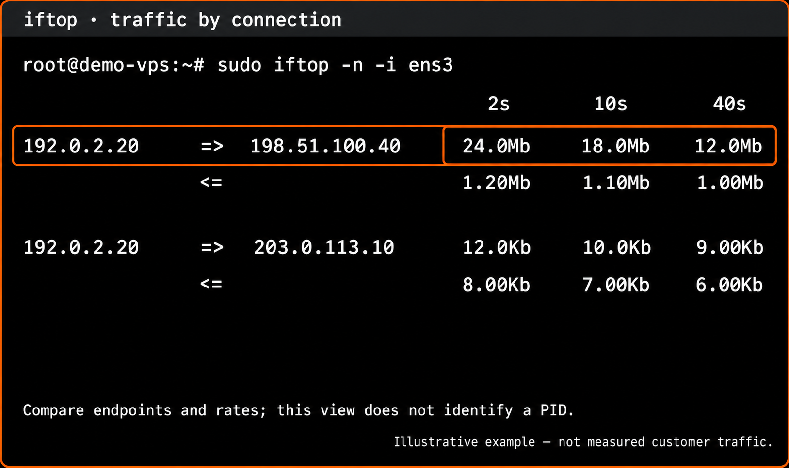
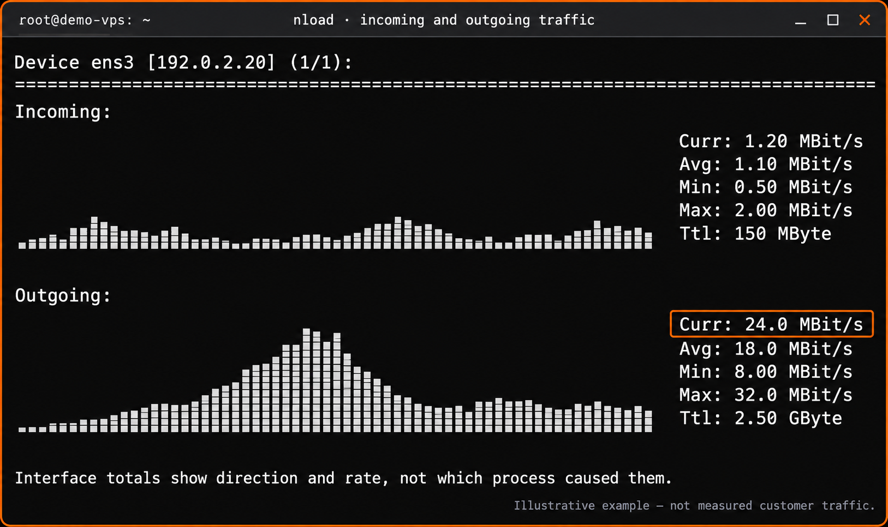
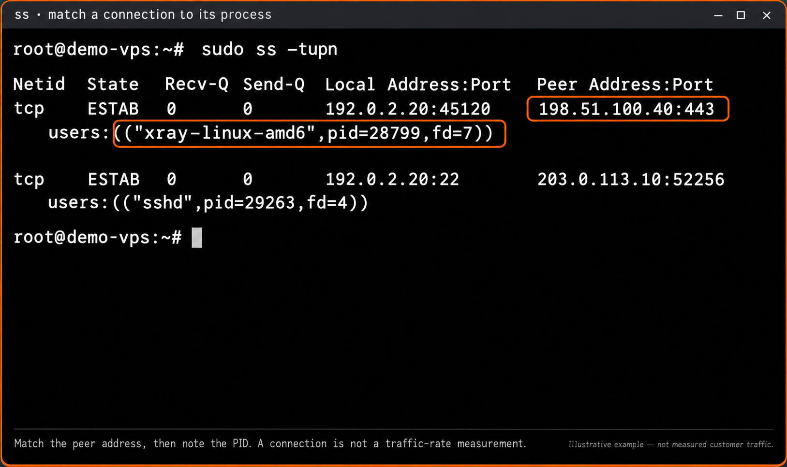
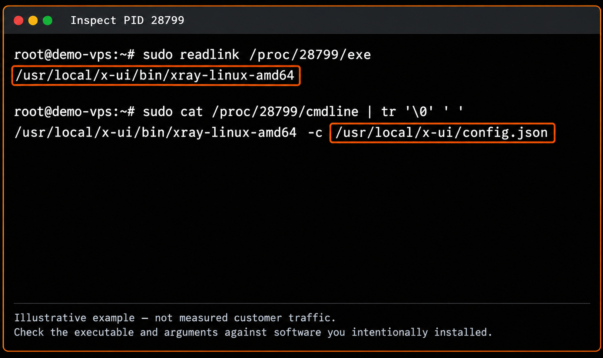
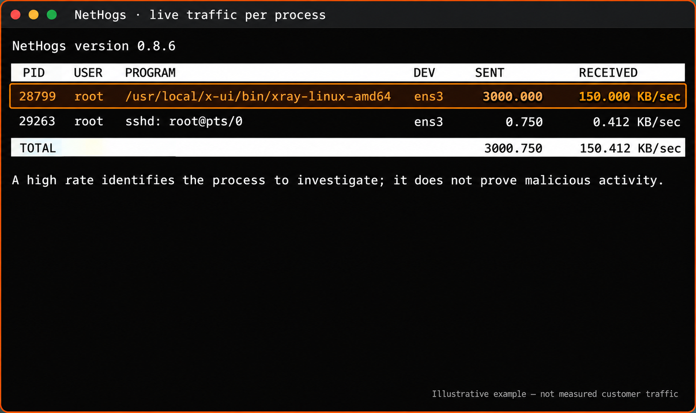

# Выявление подозрительных всплесков трафика на Linux-серверах 🚨 {#detecting-suspicious-network-spikes-in-linux-servers-}

Неожиданные всплески трафика часто вызваны фоновой активностью. Скрытые задачи или процессы могут незаметно занимать канал:

- **Нежелательные скрипты:** скрытые или забытые команды, постоянно передающие данные.
- **Криптомайнеры:** несанкционированное ПО, использующее процессор и сеть сервера для майнинга.
- **Некорректно работающие процессы:** обычные сервисы, застрявшие в циклах или повторных попытках и перегружающие сеть.

Раннее обнаружение помогает избежать лишнего расхода трафика, падения производительности и неожиданных сетевых затрат.

📘 **По теме:** разница между *трафиком* и *пропускной способностью* описана в [этом руководстве EDIS Global](/ru/faq/traffic-bandwidth/traffic-vs-bandwidth).

---

## 1) Следите за сетевой активностью в реальном времени {#1-monitor-live-network-activity}

Сначала выясните, какие IP-адреса или процессы используют сеть. Для этого подходят лёгкие утилиты `iftop` и `nload`.

Перед запуском уточните имя сетевого интерфейса. Это не всегда `eth0`: возможны `ens3`, `ens18`, `eno1` и другие. Активные интерфейсы можно найти командой:

```bash
ip -o link show up | awk -F': ' '{print $2}'
```

Замените `eth0` в следующих командах именем своего интерфейса:

```bash
sudo apt install iftop nload -y
sudo iftop -n -i eth0
```

В **iftop** сопоставьте адреса отправителей и получателей со скоростями передачи. Параметр `-n` оставляет адреса в числовом виде, чтобы их было проще сравнить с выводом `ss`. Уточните, относятся ли самые активные соединения к ожидаемой работе: незнакомый адрес сам по себе не доказывает злоупотребление.

<Frame caption="Воссозданный пример с вымышленными адресами и скоростями. Столбцы 2s, 10s и 40s — интервалы усреднения.">
  
</Frame>

Для более простого графического представления:

```bash
sudo nload eth0
```

<Frame caption="Воссозданный пример. Сравните входящую и исходящую скорости; итоговые значения не определяют процесс.">
  
</Frame>

---

## 2) Определите процесс, создающий трафик {#2-identify-which-process-is-behind-the-network-usage}

Обнаружив необычную активность, используйте современную утилиту `ss` или, по желанию, `netstat`, чтобы найти процесс, которому принадлежат соединения.

```bash
# recommended (modern tool)
sudo ss -tupn
```

Если предпочитаете `netstat`, сначала установите `net-tools`:

```bash
sudo apt install net-tools -y
sudo netstat -tupn
```

В примере ниже удалённый адрес `198.51.100.40` из статистики трафика найден в соединении процесса с PID **28799**. Имя показано как `xray-linux-amd6`: в этом представлении оно может быть обрезано.

<Frame caption="Воссозданный вывод ss с переносами строк и вымышленными адресами. Найдите удалённый адрес, затем запишите PID.">
  
</Frame>

`ss` определяет сокеты и их процессы, но не измеряет текущую скорость передачи. VPN-программы, например Xray, могут открывать такие соединения совершенно законно. Используйте `nethogs`, описанный ниже, для сравнения скоростей по процессам и сверьтесь с сервисами, которые вы намеренно запустили. См. [руководство ss](https://man7.org/linux/man-pages/man8/ss.8.html).

---

## 3) Изучите подозрительный процесс {#3-inspect-the-suspicious-process}

Получив подозрительный PID из **`ss`** или **`netstat`**, выясните, что это за процесс и откуда он запущен.

```bash
ps -p 28799 -o pid,ppid,user,lstart,args
sudo readlink /proc/28799/exe
sudo cat /proc/28799/cmdline | tr '\0' ' '
```

💡 *Замените **`28799`** на PID процесса, который вызвал подозрения на предыдущем шаге.*

Сравните путь к исполняемому файлу и аргументы с установленным вами ПО. Пути в `/tmp`, `/dev/shm` и `/var/tmp` требуют проверки, но само расположение файла ещё не доказывает взлом.

<Frame caption="Один процесс, две проверки: расположение исполняемого файла и аргументы запуска. Этот пример не является заключением о вредоносности.">
  
</Frame>

---

## 4) Сохраните свидетельства и остановите подтверждённую нежелательную активность {#4-record-evidence-then-stop-confirmed-unwanted-activity}

Имя процесса, незнакомый IP или путь в `/tmp` — повод для проверки, а не доказательство взлома. Сначала установите назначение процесса и его принадлежность установленному вами ПО.

**До остановки** запишите PID, путь, командную строку, время запуска, соединения и соответствующие журналы. Если для анализа нужен исполняемый файл, сохраните его, пока он доступен: после завершения процесса `/proc/PID/exe` может исчезнуть. Не запускайте подозрительный файл. См. [справку Linux по `/proc/PID/exe`](https://man7.org/linux/man-pages/man5/proc_pid_exe.5.html).

Если нежелательная активность подтверждена:

- По возможности остановите процесс через приложение или менеджер служб. Иначе управляющая программа может перезапустить завершённый процесс.
- Для отдельного процесса команда `sudo kill -TERM 28799` запрашивает штатное завершение. Замените пример PID на только что проверенный. Прежде чем применять принудительную остановку, проверьте, завершился ли процесс.
- Отключайте только подтверждённую нежелательную запись автозапуска, предварительно сохранив её копию для исследования.

Не удаляйте Xray, задание cron или исполняемый файл лишь потому, что он похож на пример в статье. Если сервер взломан, остановка одного процесса только сдерживает инцидент и не доказывает, что система очищена.

---

## 5) Проверьте cron и записи автозапуска {#5-check-cron-jobs-and-autostart-entries}

Многие нежелательные скрипты пытаются запускаться после перезагрузки через cron или файлы автозапуска. Внимательно проверьте:

```bash
crontab -l
sudo cat /etc/crontab
sudo ls /etc/cron.d/
sudo cat /etc/rc.local
```

Также проверьте распространённые пути:

```text
/etc/systemd/system/
/etc/init.d/
/home/*/.bashrc
/home/*/.profile
```

Если обнаружите подозрительную запись такого вида:

```bash
@reboot sleep 30 && /usr/local/x-ui/bin/xray-linux-amd64 -c /usr/local/x-ui/config.json >/dev/null 2>&1 &
```

или ссылку на временный каталог:

```bash
@reboot /tmp/.miner/start.sh
```

проверьте, относится ли она к ожидаемому сервису. Если нежелательность подтверждена, сохраните копию и удалите или отключите именно эту запись. Пример с Xray также может быть корректной конфигурацией VPN.

💡 *Совет:* обычные задания cron часто выполняют обслуживание системы — резервное копирование или ротацию журналов. Запуск из `/tmp`, `/dev/shm` или `/var/tmp` особенно подозрителен.

---

## 6) Отслеживайте трафик процессов через nethogs {#6-use-nethogs-for-per-process-network-tracking}

Для непрерывного наблюдения за процессами, больше всего использующими сеть:

```bash
sudo apt install nethogs -y
sudo nethogs
```

Вы увидите обновляемый список процессов со скоростями **отправки** и **приёма**. Это помогает замечать отклонения до того, как они станут серьёзными.

<Frame caption="Воссозданный пример с вымышленными скоростями в KB/sec. Высокая скорость указывает, что проверить, но не доказывает вредоносность.">
  
</Frame>

Сравните PID с предыдущим выводом `ss`. Учитывайте единицы: **KB/sec — килобайты в секунду**, а iftop обычно показывает скорость в битах в секунду. См. [проект NetHogs](https://github.com/raboof/nethogs).

---

## 7) Проверьте общий расход трафика {#7-check-your-overall-network-usage}

Если подозреваете, что уже потрачено слишком много данных, посмотрите статистику в панели EDIS. Там доступны **общий расход за месяц**, **ежедневные графики** и **сроки пополнения**.

📘 [Как EDIS Global измеряет расход сети и определяет циклы пополнения](/ru/faq/traffic-bandwidth/traffic-stats-refill-explained).

---

## 8) Восстановите систему и предотвратите повторение {#8-recover-and-prevent-recurrence}

При сбое приложения исправьте его настройки или обновите его, затем убедитесь, что трафик вернулся к ожидаемому уровню.

При подтверждённом взломе сохраните нужные свидетельства, ограничьте работу затронутого сервиса, смените раскрытые учётные данные с доверенного устройства и запланируйте чистое восстановление из проверенных программ и данных. Снижение трафика не означает, что весь несанкционированный доступ устранён.

Проверьте обновления, доступные извне службы и [настройки доступа SSH](/ru/getting-started/ssh-security-hardening-guide). Правила межсетевого экрана должны разрешать только действительно нужный трафик; UFW не определяет вредоносность процесса по имени. Изменения вроде монтирования с `noexec` не заменяют расследование причины активности.

О суммарном расходе, пополнении и общем резерве читайте в статьях [Статистика трафика](/ru/faq/traffic-bandwidth/traffic-stats-refill-explained) и [Traffic Pool](/ru/faq/traffic-bandwidth/traffic-pool).
