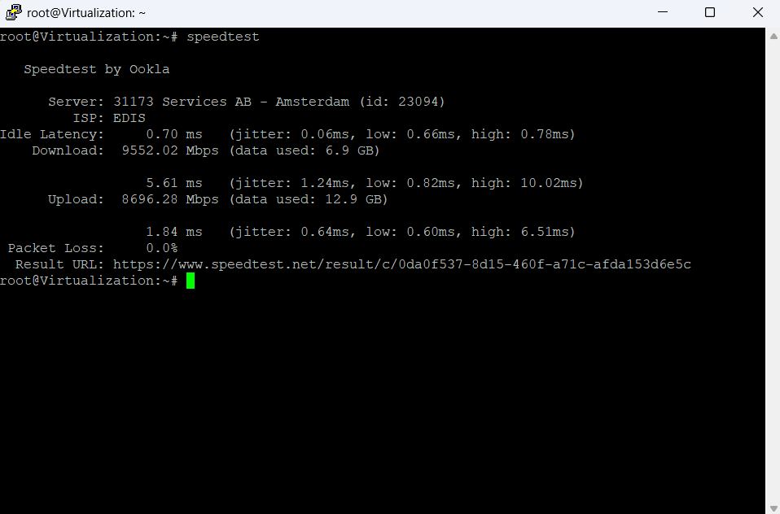
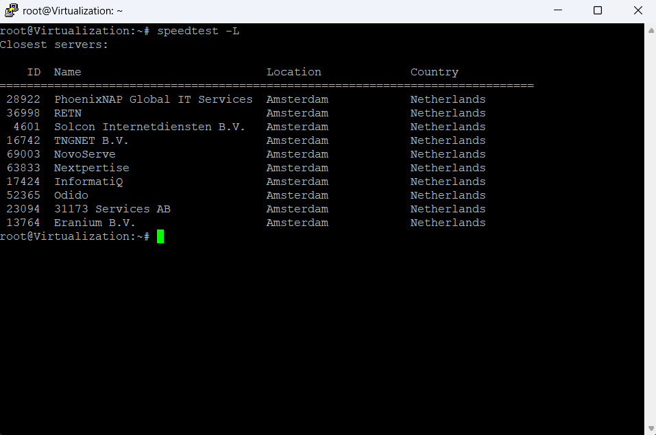
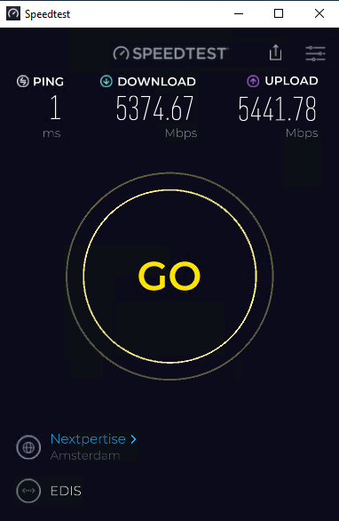
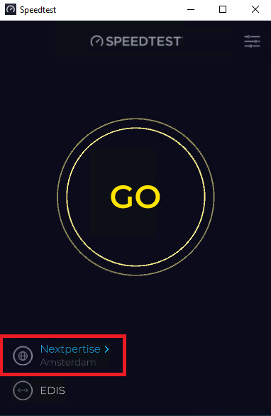
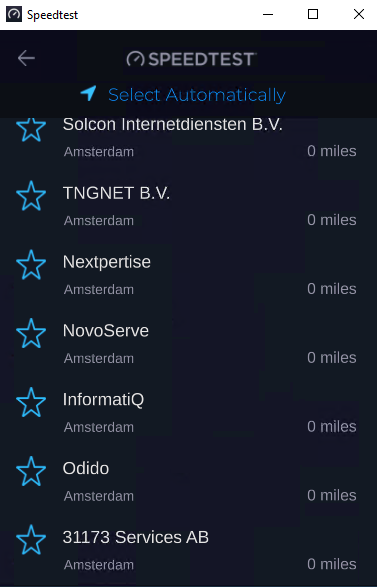

## Тест скорости в Linux и Windows с учётом 10Gbps {#running-a-speed-test-on-linux-and-windows-10gbps-aware}

Краткое руководство по надёжному измерению скорости в Linux и Windows, особенно для подключений 10Gbps.

---

## 🐧 Тест скорости в Linux {#-speed-test-on-linux}

Для достоверных результатов рекомендуем **Speedtest CLI** от Ookla.

### 🔧 Установка {#-installation}

Выполните следующие команды:

```bash
# Add Ookla's repository
curl -s https://packagecloud.io/install/repositories/ookla/speedtest-cli/script.deb.sh | sudo bash

# Install the speedtest tool
sudo apt install speedtest
```

### 🚀 Простой тест скорости {#-running-a-basic-speed-test}

После установки запустите тест:

```bash
speedtest
```


⚠️ Сервер по умолчанию может **не поддерживать 10Gbps**, поэтому результат окажется ниже ожидаемого.

**Для точного измерения высокой скорости:**

### 📋 Посмотрите доступные серверы {#-list-available-servers}

```bash
speedtest -L
```

Команда выведет список серверов с их ID.



### 🎯 Выполните тест на выбранном сервере {#-run-test-on-a-specific-server}

Выберите сервер с высокой пропускной способностью, учитывая его расположение и провайдера, и укажите ID:

```bash
speedtest -s <server-id>
```

Пример:

```bash
speedtest -s 12345
```


---

## 🪟 Тест скорости в Windows {#-speed-test-on-windows}

Вариант для командной строки также доступен, но в большинстве случаев рекомендуем **приложение Speedtest** от Ookla.

### ⬇️ Скачайте приложение {#-download-the-app}

Скачайте официальное приложение с сайта Ookla:

* [Скачать Speedtest для Windows](https://www.speedtest.net/apps/windows)

Графическое приложение даёт более стабильные и оптимизированные результаты, особенно на системах с высокой пропускной способностью.



### ⚠️ Особенности тестов на 10Gbps {#-notes-on-10gbps-testing}

Как и в Linux, **не все серверы поддерживают 10Gbps**. Если результаты низкие:

1. Нажмите **название текущего сервера** под индикатором скорости.

2. Выберите другой сервер из списка — желательно с заведомо высокой пропускной способностью.

3. Проверьте несколько ближайших серверов, чтобы найти лучший результат.

---
