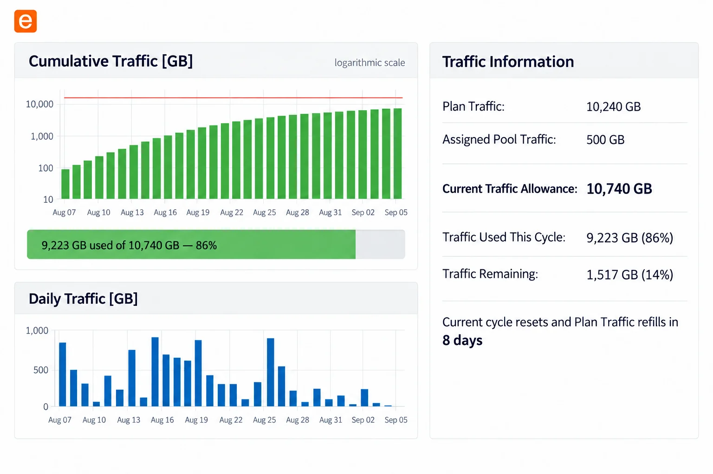
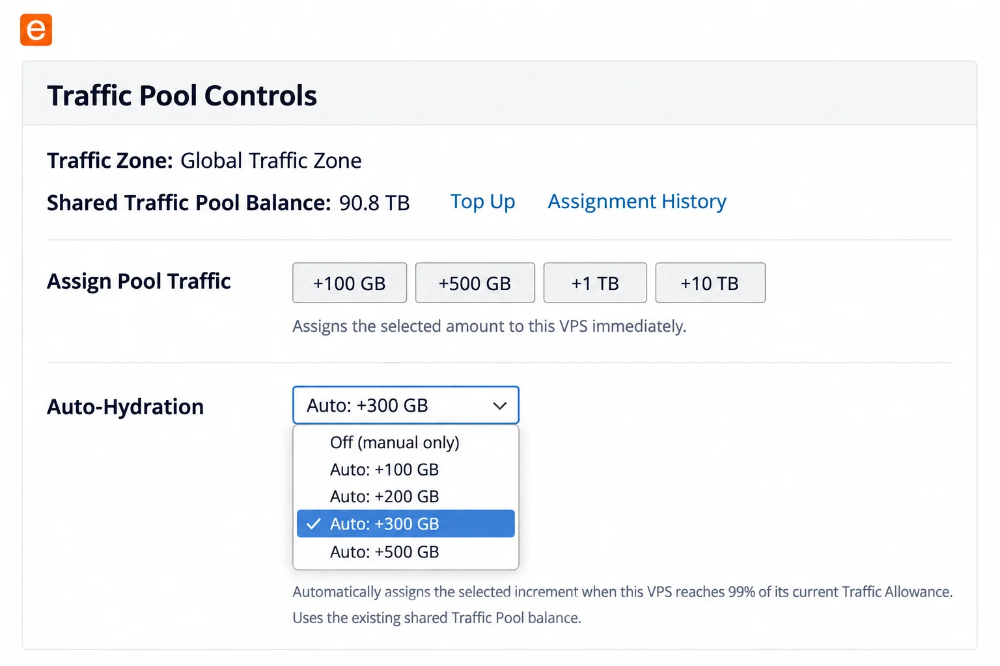
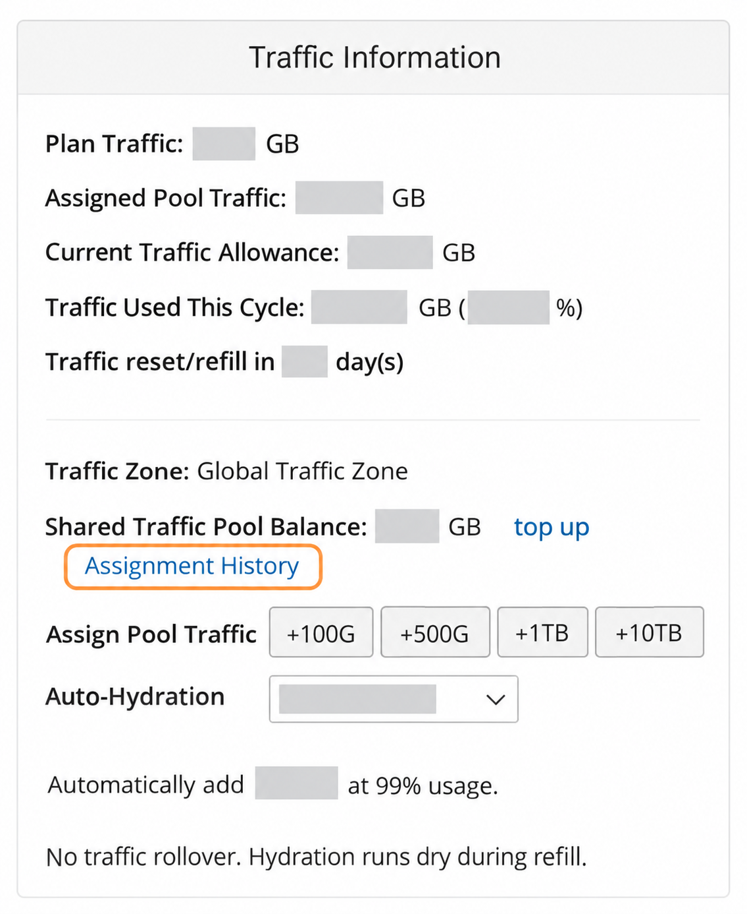
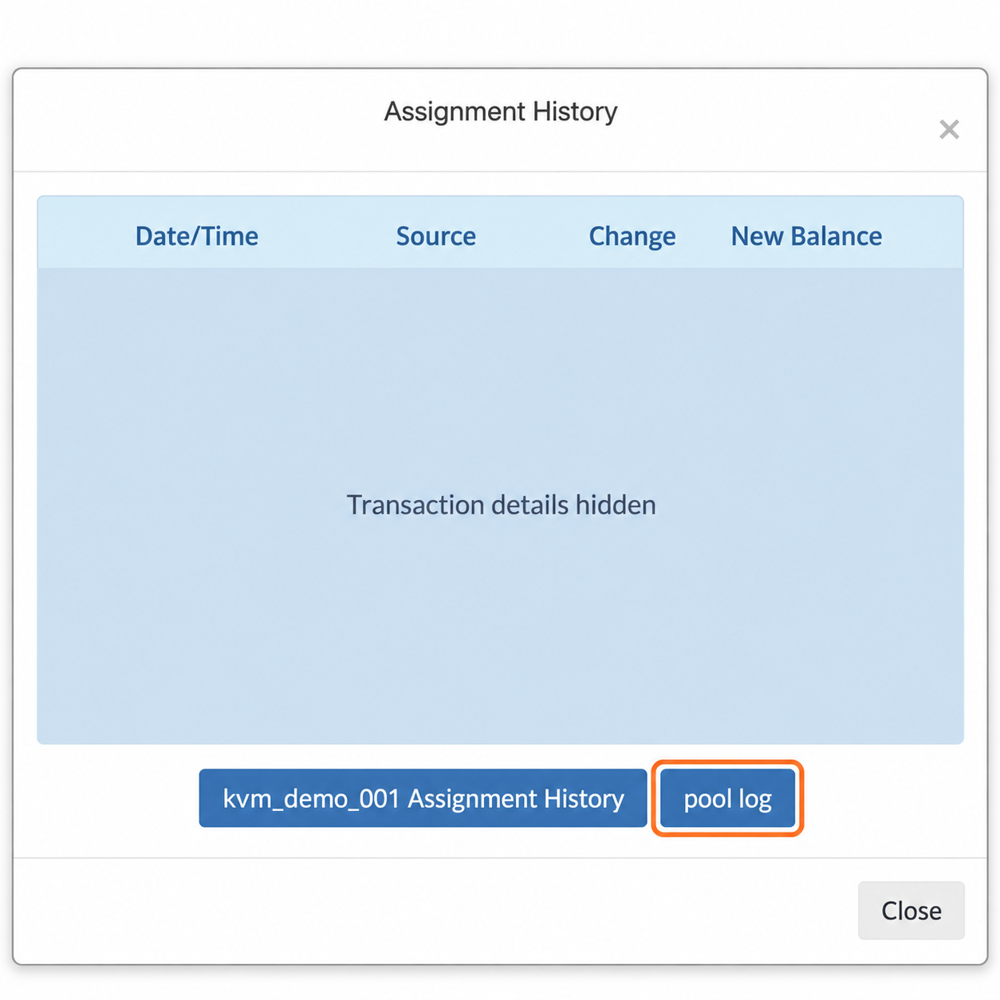

import { CtaButton } from "/snippets/cta-button.mdx";

<Tip>
  **Ищете выписку по Traffic Pool?** Откройте любой VPS → **Traffic Information** → **Assignment History** → **pool log**. [Инструкция со скриншотами](#how-to-access-the-balance-sheet).
</Tip>

## Единый пул трафика. Единая цена по всему миру. {#one-traffic-pool-one-global-price}

Traffic Pool EDIS Global предоставляет всем VPS вашего аккаунта доступ к общему резерву трафика. Купите трафик один раз и назначайте его любому VPS, когда требуется дополнительный объём.

Трафик, остающийся в пуле, **не сгорает**. Для ручного назначения в портале доступны кнопки **+100 GB**, **+500 GB**, **+1 TB** и **+10 TB**. Также можно включить **Auto-Hydration** для отдельного VPS и выбрать шаг **100 GB**, **200 GB**, **300 GB** или **500 GB**. Каждый раз, когда VPS расходует **99%** текущего лимита, Auto-Hydration назначает выбранный объём из общего Traffic Pool.

🌍 **Без зон тарификации. Единая цена во всех 50 локациях EDIS.**

<CtaButton label="Купить трафик" link="https://www.edisglobal.com/buy-traffic" />

<Warning>
  Трафик не сгорает, пока остаётся в Traffic Pool. После назначения VPS он становится частью текущего лимита этого сервера. Неиспользованный назначенный трафик сгорает при следующем ежемесячном пополнении вместе с месячным Plan Traffic.
</Warning>

---

## Трафик тарифа и трафик из пула {#plan-traffic-and-pool-traffic-explained}

| Тип трафика | Где доступен | Что происходит при ежемесячном пополнении VPS? |
| --- | --- | --- |
| **Plan Traffic — трафик тарифа** | Включён в один VPS на текущий месячный цикл | Расход сбрасывается, лимит тарифа восстанавливается. Неиспользованный объём не переносится. |
| **Неназначенный Pool Traffic** | Общий для всех VPS вашего аккаунта | Остаётся в пуле и не сгорает. |
| **Назначенный Pool Traffic** | Добавлен к текущему лимиту одного VPS | Неиспользованный назначенный объём сгорает при следующем ежемесячном пополнении этого VPS. |
| **Стартовый бонус 100 GB** | Добавляется в общий пул при покупке нового VPS | Не сгорает, пока остаётся в пуле неназначенным. |

<Note>
  Назначайте VPS только тот объём, который он, вероятно, использует до следующего ежемесячного пополнения. Остальное храните в пуле для будущего использования.
</Note>

---

## Зачем нужен Traffic Pool? {#why-use-the-traffic-pool}

- ✅ Храните неиспользованный трафик в общем бессрочном резерве.
- ✅ Назначайте трафик любому KVM VPS в своём аккаунте.
- ✅ Пользуйтесь единой ценой во всех локациях EDIS.
- ✅ Включайте Auto-Hydration отдельно для каждого VPS.
- ✅ Покрывайте временные всплески расхода без постоянной смены тарифа VPS.
- ✅ Покупайте **1 TB за 6 EUR**; при больших объёмах цена снижается до **4,49 EUR за TB**.

---

## Стартовый бонус Traffic Pool {#traffic-pool-starter-credit}

Каждый новый купленный VPS добавляет **100 GB бесплатного трафика** в ваш Traffic Pool. Этот бонус создаёт небольшой резерв и позволяет попробовать ручное назначение или Auto-Hydration до покупки дополнительного трафика.

Ваш стартовый бонус 100 GB:

- ✅ Не сгорает, пока хранится в Traffic Pool.
- ✅ Может быть назначен любому VPS вашего аккаунта.
- ✅ Доступен для ручного назначения и Auto-Hydration.
- ✅ Суммируется с купленным Pool Traffic.

---

## Как пользоваться EDIS Traffic Pool {#how-to-use-the-edis-traffic-pool}

### 1. [Купите трафик](https://edisglobal.com/buy-traffic) {#1-purchase-traffic}

Выберите нужный объём от **1 TB** до **10 PB**. Чем больше пакет, тем ниже цена за TB. Купленный трафик поступает в общий пул и не сгорает, пока остаётся там.

### 2. [Назначьте Pool Traffic](#traffic-pool-in-the-traffic-information-window) {#2-assign-pool-traffic}

Откройте окно **Traffic Information** нужного VPS и нажмите **+100 GB**, **+500 GB**, **+1 TB** или **+10 TB**. EDIS Global сразу вычтет назначенный объём из пула и добавит его к текущему лимиту VPS.

<Warning>
  Назначенный Pool Traffic не переносится за пределы следующего ежемесячного пополнения этого VPS. Проверьте дату пополнения, прежде чем назначать большой объём.
</Warning>

### 3. [Включите Auto-Hydration](#traffic-pool-in-the-traffic-information-window) {#3-enable-auto-hydration}

Включите **Auto-Hydration** для отдельного VPS и выберите шаг **100 GB**, **200 GB**, **300 GB** или **500 GB**. При расходе **99%** текущего лимита выбранный объём будет назначен из Traffic Pool. Текущий лимит включает месячный Plan Traffic и весь Pool Traffic, уже назначенный в этом цикле.

<Note>
  Auto-Hydration использует имеющийся остаток Traffic Pool и не покупает дополнительный трафик автоматически. Если остатка недостаточно, дальнейшее назначение возможно только после пополнения пула.
</Note>

---

## Traffic Pool в окне Traffic Information {#traffic-pool-in-the-traffic-information-window}

Окно **Traffic Information** показывает, сколько трафика VPS ещё может использовать в текущем цикле, и позволяет назначить дополнительный трафик из общего пула.

### Расход трафика и ежемесячное пополнение {#traffic-usage-and-monthly-refill}

_Портал показан с вымышленными демонстрационными данными._

<Info>
  **Current Traffic Allowance** = **Plan Traffic** + **Assigned Pool Traffic**

  **Traffic Remaining** = **Current Traffic Allowance** - **Traffic Used This Cycle**
</Info>

- **Cumulative Traffic:** расход за текущий цикл относительно **Current Traffic Allowance**. График использует логарифмическую шкалу.
- **Daily Traffic:** расход по дням для выявления закономерностей и всплесков.
- **Plan Traffic:** объём, включённый в тариф VPS на каждый месячный цикл.
- **Assigned Pool Traffic:** дополнительный трафик из пула, назначенный этому VPS на текущий цикл.
- **Current Traffic Allowance:** сумма Plan Traffic и Assigned Pool Traffic на текущий цикл.
- **Traffic Used This Cycle:** расход после последнего ежемесячного пополнения в GB и процентах от Current Traffic Allowance.
- **Traffic Remaining:** объём и процент, которые ещё можно использовать до исчерпания Current Traffic Allowance.
- **Current cycle resets and Plan Traffic refills:** обратный отсчёт до сброса текущего цикла расхода и получения следующего лимита Plan Traffic.

### Управление назначением Traffic Pool {#traffic-pool-assignment-controls}

_Портал показан с вымышленными демонстрационными данными._

- **Traffic Zone:** зона тарификации Pool Traffic. EDIS Global использует единую Global Traffic Zone для всех локаций.
- **Shared Traffic Pool Balance:** неназначенный остаток Pool Traffic, доступный всему аккаунту.
- **Top Up:** открывает [страницу покупки Traffic Pool](https://edisglobal.com/buy-traffic).
- **Assignment History:** история ручного и автоматического назначения. Кнопка **pool log** в этом окне открывает [общую выписку по аккаунту](#how-to-access-the-balance-sheet).
- **Assign Pool Traffic:** кнопки быстрого назначения **+100 GB**, **+500 GB**, **+1 TB** и **+10 TB**.
- **Auto-Hydration:** выбор шага **100 GB**, **200 GB**, **300 GB** или **500 GB**; настраивается отдельно для каждого VPS.

Ручное назначение и Auto-Hydration используют существующий Shared Traffic Pool Balance. Auto-Hydration не покупает трафик и срабатывает только при достаточном остатке для выбранного шага.

Для собственного мониторинга используйте callback в Management REST API: он позволяет отправлять уведомления при заданном пороге.

<CtaButton label="Настроить callback через API" link="https://docs.edisglobal.com/management-api-reference/hooks/example-callback-triggered" />

---

## Выписка по Traffic Pool {#traffic-pool-accounting-balance-sheet}

Выписка хронологически фиксирует каждую операцию: покупки, бесплатные стартовые бонусы, ручные и автоматические назначения VPS, а также остаток пула после каждой операции.

### Как открыть выписку {#how-to-access-the-balance-sheet}

Общую выписку Traffic Pool можно открыть из **любого VPS вашего аккаунта**.

1. Войдите в [портал управления VPS](https://manage.edisglobal.com/clientarea.php), откройте **Services → My Services** и выберите любой VPS.
2. На вкладке **Server Information** прокрутите до **Traffic Information**. Нажмите **Assignment History** рядом с **Shared Traffic Pool Balance** или под ним.
3. В окне **Assignment History** нажмите синюю кнопку **pool log** под списком операций.

<Frame caption="Шаг 2: нажмите Assignment History в Traffic Information. Расход и остатки клиента скрыты.">
  
</Frame>

<Frame caption="Шаг 3: нажмите pool log под списком операций. Детали операций скрыты, ID VPS вымышленный.">
  
</Frame>

**pool log** показывает операции общего пула по всему аккаунту: покупки, начисления и назначения разным VPS. Кнопка **ID вашего VPS + Assignment History** возвращает к назначениям для конкретного VPS.

<Note>
  Просмотр Assignment History или pool log не назначает и не покупает трафик и не меняет настройки Auto-Hydration.
</Note>

### Как читать выписку {#how-to-read-the-balance-sheet}

- **Date/Time:** время операции.
- **Source:** причина операции, например покупка, стартовый бонус или назначение VPS.
- **Change:** объём, добавленный в пул (`+`) или списанный из него (`-`).
- **New Balance:** остаток после операции.

Новые операции показаны первыми. Списание означает **назначение трафика VPS**, а не то, что сервер уже израсходовал этот объём.

| Дата/время | Источник | Изменение | Новый остаток |
| --- | --- | --- | --- |
| 2025-03-17 16:52:12 | kvm_demo_id002 | -100 GB | 6600 GB |
| 2025-03-17 14:12:12 | kvm\_demo\_id002 | -100 GB | 6700 GB |
| 2025-03-17 12:22:32 | **Стартовый бонус (100 GB) kvm_demo_id003** | **+100 GB** | **6800 GB** |
| 2025-03-17 12:22:32 | kvm\_demo\_id002 | -1000 GB | 6700 GB |
| 2025-03-16 10:02:30 | kvm\_demo\_id002 | -500 GB | 7700 GB |
| 2025-03-16 10:01:45 | kvm\_demo\_id004 | -300 GB | 8200 GB |
| 2025-03-16 09:59:10 | **Пополнение Traffic Pool** | **\+1000 GB** | **8500 GB** |
| 2025-03-15 23:15:35 | kvm_demo_id001 | -1000 GB | 7500 GB |
| 2025-03-15 22:12:20 | kvm\_demo\_id003 | -500 GB | 9500 GB |
| 2025-03-10 09:59:10 | **Пополнение Traffic Pool** | **+10000 GB** | **10000 GB** |

---

## Уведомление по email при остатке 20% или меньше {#email-notification-when-20%-or-less-remains}

После каждого пополнения Traffic Pool получившийся остаток становится базой для уведомления о низком балансе. Когда **80% или больше этого объёма назначено**, EDIS Global отправляет письмо о том, что **осталось 20% или меньше**.

Поскольку трафик назначается фиксированными порциями, к моменту отправки остаток может быть ниже 20% или даже составлять **0 GB**. Письмо сообщает, что порог низкого остатка пересечён.

<Note>
  Малый или нулевой остаток пула не влияет на VPS, у которого ещё есть доступный назначенный трафик. Но ручное назначение и Auto-Hydration не смогут добавить трафик до пополнения пула.
</Note>

<CtaButton label="Пополнить Traffic Pool" link="https://www.edisglobal.com/buy-traffic" />

---

## Какой вариант выбрать? {#which-option-should-you-choose}

Используйте [калькулятор трафика VPS](https://www.edisglobal.com/vps-traffic-calculator), чтобы сравнить Pool Traffic с повышением тарифа по текущим ценам вашей локации, ожидаемому расходу, остатку пула и числу дней до пополнения. Оценивайте разовый всплеск отдельно от постоянной ежемесячной потребности.

| Ситуация | Рекомендация |
| --- | --- |
| Временный или непредсказуемый рост трафика | Назначьте или купите Pool Traffic. |
| Имеющегося остатка пула достаточно | Назначьте трафик вручную или включите Auto-Hydration. |
| Трафик регулярно заканчивается до месячного пополнения | Сравните тарифы и перейдите на более высокий. |
| Следующее месячное пополнение совсем скоро | Назначьте только ожидаемый расход до пополнения либо дождитесь обновления Plan Traffic. |
| У вас уже максимальный доступный тариф VPS | Используйте Traffic Pool для дополнительного трафика. |

<Columns cols={2}>
  <Card title="Лимит трафика и восстановление скорости" icon="gauge-high" href="/ru/faq/traffic-bandwidth/exceeding-monthly-traffic-limit-edis-global">
    Что происходит при достижении лимита трафика VPS и как вернуть полную скорость.
  </Card>
  <Card title="Повышение тарифа VPS" icon="arrow-up" href="/ru/faq/upgrades-downgrades/upgrade-plan">
    Сравните более высокие тарифы, если повышенный расход трафика стал постоянным.
  </Card>
</Columns>
