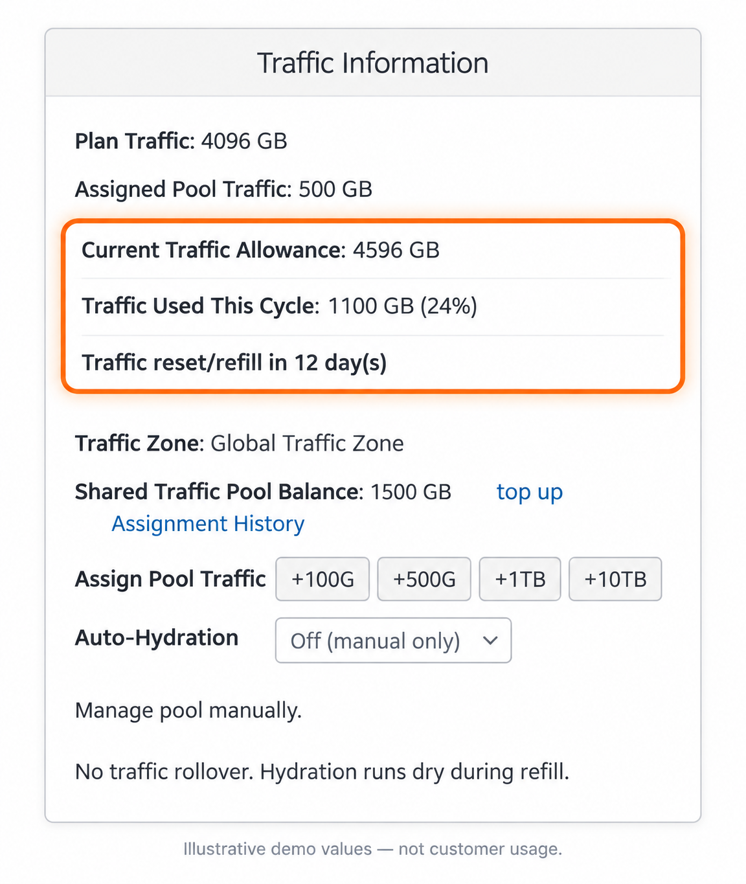
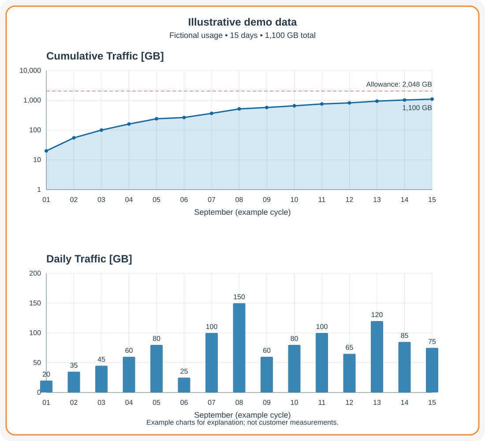

## Всё о трафике VPS, его учёте и пополнении {#all-about-vps-traffic-metering-and-refills}

Эта страница объясняет, как открыть и читать сведения о трафике VPS в портале управления. Здесь описаны использованный и доступный объём, ежемесячный сброс счётчика и пополнение лимита, накопительный график и дата следующего пополнения. Для каждого VPS также доступна ежедневная статистика.

### Откройте сведения о трафике VPS {#access-your-vps-traffic-information}

Чтобы посмотреть трафик VPS:

<Steps>
  <Step title="Войдите в портал">
    [Портал управления VPS](https://manage.edisglobal.com/clientarea.php)
  </Step>
  <Step title="Выберите VPS">
    Откройте услугу в **Services → My Services**. На вкладке **Server Information** прокрутите до панели **Traffic Information** под блоком **Information**. На узком экране панели могут располагаться друг под другом.
  </Step>
</Steps>

<Frame caption="Текущий интерфейс портала с демонстрационными значениями, а не данными клиента.">
  
</Frame>

В этом примере **4,096 GB трафика тарифа + 500 GB из пула = 4,596 GB текущего лимита**. При **расходе 1,100 GB** до следующего пополнения **остаётся 3,496 GB**. **Остаток общего пула 1,500 GB** учитывается отдельно: он ещё не назначен этому VPS.

### Общий использованный трафик {#total-traffic-used}

Суммарный трафик (в GB и процентах), израсходованный с начала текущего **ежемесячного цикла услуги**.

### Общий доступный трафик {#total-traffic-available}

Текущий общий лимит трафика VPS на месячный цикл. Он состоит из:

- ежемесячного трафика тарифа (Plan Traffic), включённого в VPS;
- трафика из пула (Pool Traffic), назначенного вручную или через Auto-Hydration в текущем цикле.

Назначение трафика из пула сразу увеличивает этот лимит.

### Ежемесячный сброс и пополнение трафика {#monthly-traffic-reset/refill}

Количество дней до начала нового месячного цикла трафика VPS. При пополнении:

- счётчик расхода сбрасывается;
- ежемесячный лимит Plan Traffic восстанавливается;
- неиспользованный Pool Traffic, уже назначенный VPS, сгорает.

Трафик, оставшийся неназначенным в общем Traffic Pool, не сгорает.

### Как EDIS Global учитывает трафик {#how-edis-global-meters-traffic}

EDIS Global измеряет трафик непосредственно на Ethernet-интерфейсах виртуальных серверов в реальном времени.

Общий трафик рассчитывается как сумма **входящего (ingress)** и **исходящего (egress)** трафика за измеряемый период.

$\text{Общий трафик} = \sum (\text{IN} + \text{OUT})$

### Что происходит по мере расходования трафика? {#what-happens-as-traffic-is-consumed}

EDIS Global отправляет информационное уведомление при **80%** и предупреждение при **90%** текущего лимита. Предупреждение о 90% не отправляется, если включена Auto-Hydration и в Traffic Pool достаточно трафика для следующего автоматического назначения.

При **99%** Auto-Hydration назначает выбранный объём — **100 GB**, **200 GB**, **300 GB** или **500 GB**, если остатка пула достаточно. Общий текущий лимит увеличивается на этот объём.

Перед ограничением скорости EDIS Global предоставляет примерно **5% дополнительного допуска**. Если трафик не пополнен, примерно при **105% расхода** скорость Ethernet-интерфейса VPS ограничивается приблизительно до **1 Mbps**. При применении ограничения EDIS Global отправляет уведомление о необходимости действий.

Автоматической платы за превышение нет; VPS остаётся онлайн. Если лимит исчерпан, ознакомьтесь со всеми [способами восстановления скорости](/ru/faq/traffic-bandwidth/exceeding-monthly-traffic-limit-edis-global).

### Накопительный и ежедневный графики трафика {#cumulative-and-daily-traffic-charts}

На вкладке **Server Information** прокрутите ниже панелей управления:

- **Cumulative Traffic** показывает суммарный расход за отображаемый цикл. Вертикальная шкала логарифмическая: одинаковые интервалы могут соответствовать 1, 10, 100 или 1,000 GB, а не одинаковому приросту расхода.
- **Daily Traffic** показывает расход за каждый день и помогает выявить дни повышенной нагрузки.
- Красная линия на накопительном графике показывает текущий лимит. При назначении Pool Traffic она поднимается.

<Frame caption="Демонстрационные данные, а не измеренный трафик клиента. В примере за 15 дней израсходовано 1,100 GB.">
  
</Frame>

Дата следующего пополнения или обратный отсчёт показаны в **Traffic Information**. По оставшемуся объёму и времени решите, нужно ли [назначить Pool Traffic](/ru/faq/traffic-bandwidth/traffic-pool), повысить тариф VPS или дождаться пополнения. Для точных значений наведите указатель на графики в портале.

### Сравните дополнительный трафик с повышением тарифа {#compare-extra-traffic-with-a-plan-upgrade}

В [калькуляторе трафика VPS](https://www.edisglobal.com/vps-traffic-calculator) укажите локацию, текущий тариф, ожидаемый расход и число дней до пополнения. Он сравнит стоимость покрытия текущего цикла через Pool Traffic и повышение тарифа, а также позволит отдельно оценить постоянную ежемесячную потребность. Прежде чем покупать трафик, проверьте остаток общего пула.
