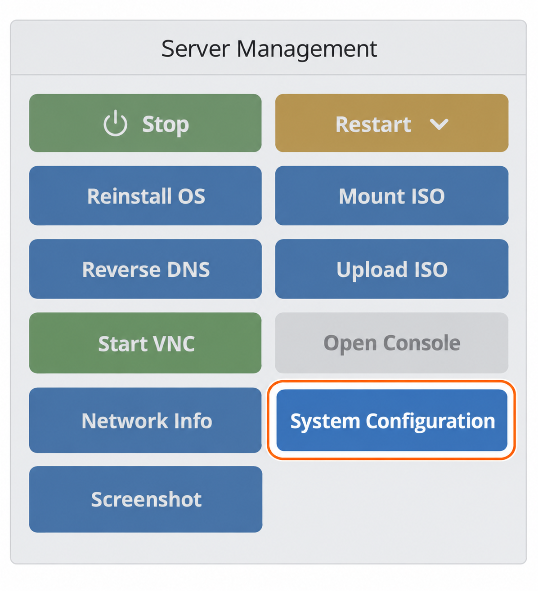
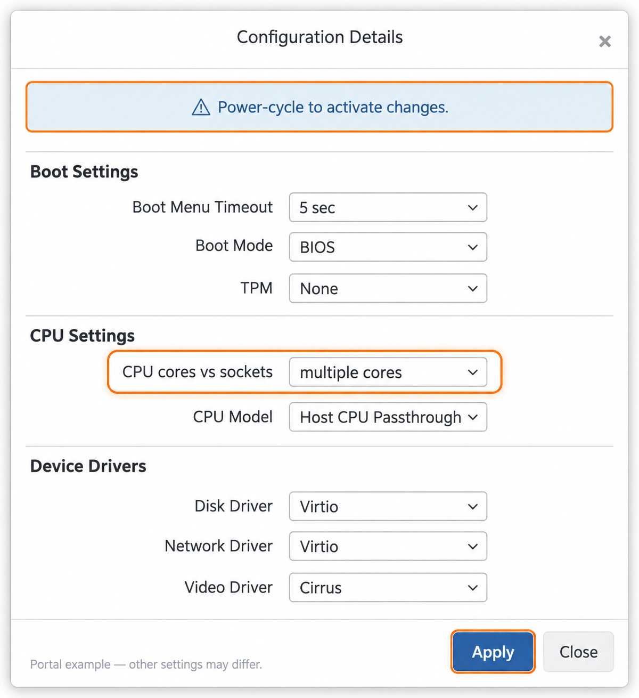

import { CtaButton } from "/snippets/cta-button.mdx";

### Ядра и сокеты CPU в среде VPS {#understanding-cpu-cores-vs-cpu-sockets-in-vps-environments}

VPS предоставляет операционной системе виртуальные процессоры. Одно и то же количество vCPU может быть представлено несколькими виртуальными сокетами или несколькими ядрами в одном сокете. В этом руководстве показано, где изменить такое представление в портале.

<CtaButton label="Перейти к инструкции" link="#3-adjusting-cpu-settings-in-vps-management-portal" />

### 1. Ядра и сокеты CPU: в чём разница? {#1-cpu-cores-vs-cpu-sockets-what’s-the-difference}

* **Ядро CPU:** независимая вычислительная единица внутри процессора. Современный CPU может содержать несколько ядер для одновременного выполнения задач. Выделение нескольких ядер VPS может улучшить многозадачность виртуальной машины.
* **Сокет CPU:** физический разъём процессора на материнской плате. В каждом сокете размещается один процессорный чип с одним или несколькими ядрами. В контексте VPS под сокетами часто понимают виртуальное представление этих физических разъёмов.

### 2. Возможности виртуализации {#2-virtualization-capabilities}

Гостевая ОС видит **виртуальную топологию CPU**, которая не раскрывает физическое расположение сокетов хоста. Например, VPS с четырьмя vCPU может быть представлен так:

| Представление | Виртуальных сокетов | Ядер на сокет | Всего vCPU |
| --- | ---: | ---: | ---: |
| Несколько сокетов | 4 | 1 | **4** |
| Несколько ядер | 1 | 4 | **4** |

В этом упрощённом примере на ядро приходится один поток. Изменение представления **не** добавляет vCPU и не повышает тариф. См. [документацию libvirt по топологии CPU](https://libvirt.org/formatdomain.html#cpu-model-and-topology).

### 3. Настройка CPU в портале управления VPS {#3-adjusting-cpu-settings-in-vps-management-portal}

<Steps>
  <Step title="Откройте VPS">
    В [портале управления VPS](https://manage.edisglobal.com/clientarea.php) перейдите в **Services → My Services** и выберите VPS.
  </Step>
  <Step title="Откройте System Configuration">
    На вкладке **Server Information** нажмите **System Configuration** в панели **Server management**.
  </Step>
</Steps>

<Frame caption="Нужная кнопка выделена в текущем интерфейсе портала.">
  
</Frame>

<Steps>
  <Step title="Выберите представление CPU">
    В **Configuration Details → CPU Settings** найдите **CPU cores vs sockets**. Выберите **multiple cores** или **multiple sockets** в соответствии с требованиями ОС и программ. Эта настройка имеет значение, когда у VPS больше одного vCPU.
  </Step>
  <Step title="Примените и выполните цикл выключения и включения">
    Нажмите **Apply**. Запланируйте перерыв, штатно завершите работу ОС, затем выключите и включите VPS по [инструкции](/ru/vps-management/power-cycle-or-reboot-a-vps). В диалоговом окне прямо указано, что для активации изменений нужен power cycle.
  </Step>
</Steps>

<Frame caption="Выделена настройка топологии CPU. Остальные параметры примера не являются рекомендацией менять режим загрузки или драйверы.">
  
</Frame>

После запуска проверьте топологию внутри гостевой системы. В Linux используйте `lscpu`. Для Windows см. руководство по ссылке ниже.

### 4. Когда менять настройки {#4-when-to-change-the-settings}

Используйте топологию, поддерживаемую ОС и приложениями. **Multiple cores** полезна, если ПО поддерживает меньше сокетов, чем иначе предоставлял бы VPS.

<Note>
  Ограничения Windows по сокетам зависят от редакции и версии. Утверждение, что все системы Windows поддерживают только два сокета, неверно. Проверьте [ограничения Windows Server от Microsoft](https://learn.microsoft.com/en-us/windows-server/get-started/locks-limits) и документацию конкретной гостевой ОС.
</Note>

Изменение виртуальной топологии не гарантирует прирост производительности. Сначала проверьте требования приложения; если не уверены в выборе, обратитесь в поддержку.

<CtaButton label="Проверить ядра CPU на Windows VPS" link="/ru/faq/upgrades-downgrades/cpu-cores-vs-cpu-sockets-in-vps-environments/how-to-check-cpu-cores-windows-vps" />
