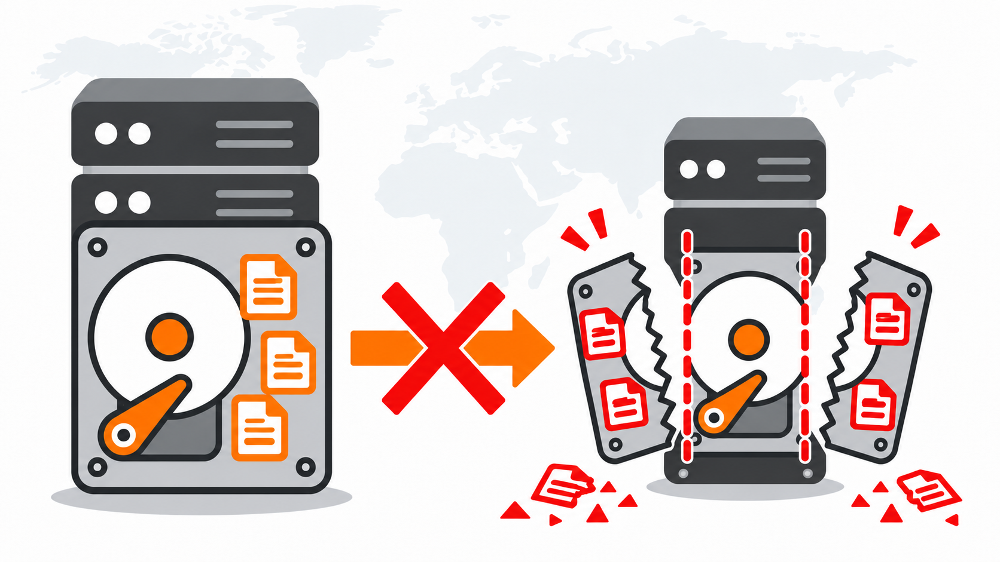

## Снижение тарифа технически недоступно {#we-only-support-upgrades-on-our-vps-plans}

**Перевести существующий VPS EDIS Global на меньший тариф нельзя.** Это техническое ограничение нашей платформы, а не вопрос согласования. Сотрудник поддержки не может сделать исключение, в том числе при продлении услуги.

## Почему большой виртуальный диск не помещается в меньший VPS

Вашему KVM VPS выделен виртуальный диск определённой ёмкости. На меньшем тарифе доступного дискового пространства может быть меньше, чем размер этого диска. Большой диск нельзя просто перенести в меньший объём. EDIS Global не предоставляет операцию уменьшения диска или снижения тарифа существующего VPS. Удаление файлов или небольшой объём занятых данных не делает снижение тарифа доступным.

_Отсечение частей виртуального диска привело бы к уничтожению данных. Отделённые края показывают этот риск; мы не выполняем такую операцию. Это условное изображение выделенной ёмкости, а не физических размеров накопителя._

## Как перейти на меньший тариф

Для этого нужен **отдельный новый VPS**, а не изменение существующего:

1. Создайте резервную копию и проверьте, что приложениям и файлам хватит ресурсов меньшего тарифа.
2. Закажите подходящий VPS на меньшем тарифе.
3. Настройте его, перенесите приложения и данные и обновите настройки, в которых используется прежний IP-адрес.
4. Проверьте работу нового VPS перед [отменой прежней услуги](/ru/faq/billing-lifecycle/cancel-a-service).

<Warning>
  **Новый VPS получает другой, случайно выбранный IP-адрес.** Отмена и повторный заказ не сохраняют и не возвращают прежний IP, даже в той же локации. Данные и приложения автоматически не переносятся.
</Warning>

Если вам необходимо сохранить текущий IP-адрес, сохраните существующий VPS. Не отменяйте его в расчёте получить тот же IP при новом заказе.

<Note>
  Запрос на снижение тарифа не меняет текущую услугу, стоимость продления или счёт. Сотрудник поддержки может разъяснить отмену и оформление отдельного нового заказа, но не может согласовать снижение тарифа существующего VPS.
</Note>
