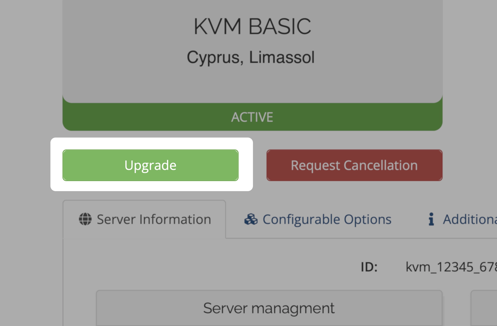

import { CtaButton } from "/snippets/cta-button.mdx";

## 🚀 Как перейти на более высокий тариф VPS {#-how-to-upgrade-your-vps-to-a-higher-tier}

Вы можете в любое время повысить тариф VPS, например с **KVM SMART** до **KVM STARTER**, прямо в портале управления.

---

## 🔄 Что означает повышение тарифа VPS? {#-what-is-a-vps-plan-upgrade}

Это переход на **более высокий готовый тариф** с увеличенными ресурсами:

- Больше RAM.
- Больше ядер vCPU.
- Больше дискового пространства.
- Больше включённого трафика.

Переустановка и перенос не нужны: расширяется существующий VPS.

Если нужно только место на диске, можно сохранить тариф и добавить до **400 GB** через [Drive Size Boost](/ru/faq/upgrades-downgrades/upgrade-disk-drive-boost). Например, тариф со 100 GB и добавление 400 GB дают виртуальный диск на 500 GB.

---

## 💶 Как рассчитывается оплата? {#-how-is-it-billed}

Вы платите только **разницу в цене** двух тарифов, **пропорционально оставшейся части платёжного периода**. Полная цена нового тарифа не начисляется: оплачивается только разница за повышение, без двойной оплаты.

---

## Повышение тарифа дешевле дополнительного трафика? {#is-an-upgrade-cheaper-than-extra-traffic}

Если причина повышения — трафик, сначала используйте [калькулятор трафика VPS](https://www.edisglobal.com/vps-traffic-calculator). Выберите локацию и текущий тариф и сравните дополнительный Pool Traffic с повышением тарифа на оставшуюся часть цикла. Если повышенный расход ожидается каждый месяц, используйте сравнение постоянной потребности.

---

## 🛠️ Как заказать повышение тарифа {#-how-to-order-a-plan-upgrade}

1. Войдите в [портал управления VPS](https://manage.edisglobal.com/clientarea.php).
2. Найдите VPS на вкладке **Services**.
3. Нажмите **Upgrade**.
4. Выберите более высокий тариф, подтвердите и оплатите счёт.
5. В течение 7 минут после подтверждения оплаты мы обработаем повышение и отправим письмо с инструкциями.

---

## ⚙️ Что произойдёт дальше? {#-what-happens-next}

- **Менять IP или переустанавливать систему не требуется.**
- **Дополнительный трафик** доступен сразу.
- **RAM и vCPU** активируются после **холодной перезагрузки**.
- **Размер виртуального диска увеличивается**, но EDIS Global не меняет размер разделов или файловой системы. Вы сами выбираете, когда расширить их.

---

<CtaButton label="Как добавить отдельные ресурсы" link="/ru/faq/upgrades-downgrades/upgrade-resources" />

## Нужно больше трафика, чем включено в тарифы? {#need-more-traffic-than-our-plans-offer}

Если у вас уже максимальный тариф, добавьте трафик из общего Traffic Pool. В портале можно вручную назначить **+100 GB**, **+500 GB**, **+1 TB** или **+10 TB**. Auto-Hydration автоматически назначает **100 GB**, **200 GB**, **300 GB** или **500 GB** при расходе 99%. Для неё нужен достаточный остаток пула; трафик автоматически не покупается. **Во всех 50 локациях EDIS действует единая цена Traffic Pool.**

<CtaButton label="Подробнее о Traffic Pool" link="/ru/faq/traffic-bandwidth/traffic-pool" />
