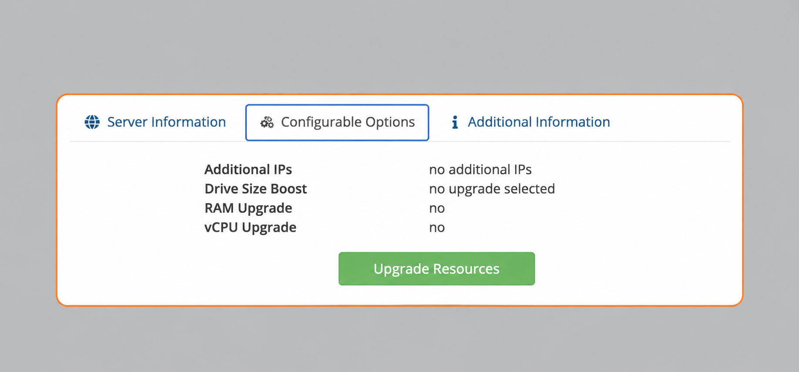

import { CtaButton } from "/snippets/cta-button.mdx";

## 🧩 Расширение ресурсов VPS: RAM, CPU, диск и IP-адреса {#-upgrade-vps-resources-ram-cpu-disk-ip-addresses}

Нужны дополнительные ресурсы без смены всего тарифа? Вы можете добавить **RAM, ядра vCPU, дисковое пространство (Drive Boost)** или **IP-адреса**.

---

## 🆚 В чём отличие? {#-what’s-the-difference}

Это **не смена тарифа**, а **расширение ресурсов** текущего VPS.

Вы можете:

- Добавить до **24 GB RAM**.
- Добавить до **8 ядер vCPU**.
- Добавить до **400 GB дискового пространства** через Drive Size Boost.
- Добавить до **10 дополнительных IPv4-адресов**.
- Сочетать любые из этих вариантов.

Сейчас доступны следующие настройки:

| Ресурс | Доступное добавление | Цена в месяц |
| --- | --- | ---: |
| RAM | От +1 до +10 GB, +16 GB или +24 GB | 5,00 EUR за GB |
| vCPU | До +8 ядер vCPU | 10,00 EUR за ядро |
| Drive Size Boost | +10, +20, +30, +40, +50, +100, +200, +300 или +400 GB | От 3,60 до 116,00 EUR |
| IPv4 | От 1 до 10 дополнительных адресов | 5,00 EUR за адрес |

Drive Size Boost добавляется к дисковому пространству тарифа. Тариф со 100 GB и максимальное добавление 400 GB дают виртуальный диск на 500 GB. См. [полные цены и инструкцию по активации Drive Size Boost](/ru/faq/upgrades-downgrades/upgrade-disk-drive-boost).

---

## 💶 Как рассчитывается оплата? {#-how-is-it-billed}

Как и при повышении тарифа, вы платите только **пропорциональную сумму** за оставшуюся часть платёжного цикла.

---

## 🛒 Как заказать дополнительные ресурсы {#-how-to-order-a-resource-upgrade}

### Вариант A — через поддержку {#option-a-–-order-via-support}

1. Обратитесь в службу поддержки.
2. Укажите IP-адрес VPS или KVM\_ID.
3. Мы сразу отправим персональную ссылку для расширения.

### Вариант B — через портал {#option-b-–-order-via-portal}

1. Войдите в [портал управления VPS](https://manage.edisglobal.com/clientarea.php).
2. Найдите VPS в **Services → My Services**.
3. Откройте **Configurable Options**.
4. Нажмите **Upgrade Resources** — вашу персональную ссылку.
5. Выберите нужные ресурсы.
6. Подтвердите и оплатите счёт.

<Frame>
  
</Frame>

---

## 🛠️ Что происходит после оплаты? {#-what-happens-after-payment}

- Мы обрабатываем расширение в течение **7 минут** после подтверждения оплаты.
- Вы получите **письмо с шагами активации**.
- Для **RAM и vCPU** нужна **холодная перезагрузка**.
- **IP-адреса** нужно настроить вручную в операционной системе.
- **Drive Size Boost** увеличивает виртуальный диск. EDIS Global не меняет размер разделов или файловой системы. После необходимого холодного запуска вы сами решаете, когда расширить существующую файловую систему или создать отдельный том.

---

<CtaButton label="Как повысить тариф" link="/ru/faq/upgrades-downgrades/upgrade-plan" />

## Нужно больше трафика, чем включено в тарифы? {#need-more-traffic-than-our-plans-offer}

Если у вас уже максимальный тариф, добавьте трафик из общего Traffic Pool. В портале можно вручную назначить **+100 GB**, **+500 GB**, **+1 TB** или **+10 TB**. Auto-Hydration автоматически назначает **100 GB**, **200 GB**, **300 GB** или **500 GB** при расходе 99%. Для неё нужен достаточный остаток пула; трафик автоматически не покупается. **Во всех 50 локациях EDIS действует единая цена Traffic Pool.**

<CtaButton label="Подробнее о Traffic Pool" link="/ru/faq/traffic-bandwidth/traffic-pool" />
