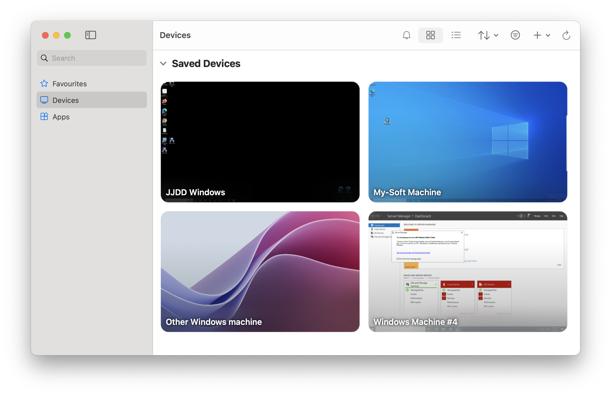

import { CtaButton } from "/snippets/cta-button.mdx";

## Предлагает ли EDIS Global Windows RDP? {#does-edis-global-offer-windows-rdp-service}

Да. EDIS Global предоставляет установку Windows RDP в 1 нажатие на нашей VPS-платформе для:

- Windows Server 2019 (пробная версия на 180 дней)
- Windows Server 2022 (пробная версия на 180 дней)
- Windows Server 2025 (пробная версия на 180 дней)
- Windows 10 (пробная версия на 90 дней)
- Windows 11 (пробная версия на 90 дней)

После установки вы получите полностью рабочую среду Windows. Мы устанавливаем систему с нуля, и **установка Windows Server занимает всего около 15 минут**.  
Можно сразу подключиться по RDP: через Microsoft Remote Desktop Protocol, Windows App или другой совместимый RDP-клиент.

Мы используем **стандартный порт Windows RDP — 3389**.

### Пробная версия и лицензирование Windows RDP {#windows-rdp-trial-and-licensing}

<Note>
  EDIS не предоставляет лицензию Windows. У вас есть 180 дней, чтобы ввести собственный лицензионный ключ и активировать пробную установку.
</Note>

<CtaButton label="Купить Windows RDP" link="https://www.edisglobal.com" openInNewTab={true} />

---

### Вопросы о Windows RDP {#windows-rdp-faq}

**Нужна ли лицензия Windows?**  
Не сразу. Мы предоставляем пробные установки. Собственный лицензионный ключ необходимо ввести в течение 180 дней.

**Как подключиться?**  
Используйте Microsoft Remote Desktop для Windows, macOS или мобильных устройств на порту 3389.

**Можно ли установить другие версии Windows?**  
Да. В панели KVM можно загрузить собственный ISO.

**Какие задачи обычно решают с помощью RDP?**  
Удалённая работа, тестирование ПО, запуск приложений только для Windows и защищённый доступ к рабочему столу Windows из любой точки мира.
