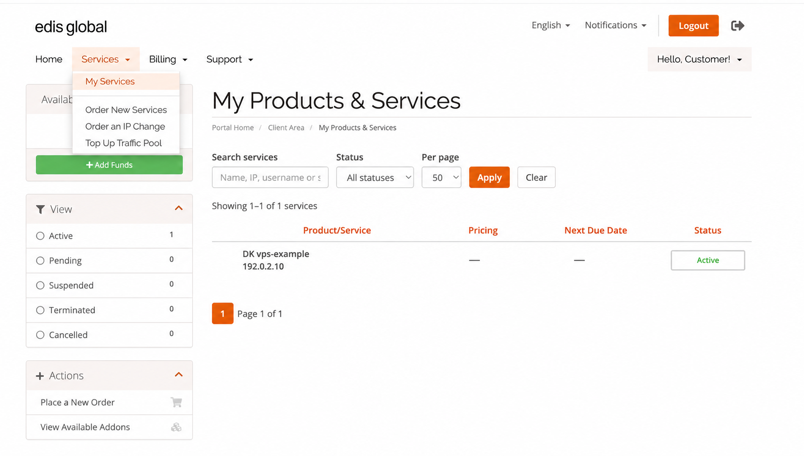

Нужна новая операционная система, дополнительные ресурсы или помощь с неоплаченным счётом? Это руководство описывает повседневные задачи управления VPS EDIS Global, последствия каждого действия и ссылки на подробные инструкции.

Откройте [портал управления VPS](https://manage.edisglobal.com/clientarea.php), перейдите в **Services → My Services** и выберите нужный VPS. Перед изменениями проверьте KVM ID, описание и IP-адрес, особенно если управляете несколькими серверами.

<Frame caption="Откройте Services → My Services и выберите нужный VPS. Данные клиента и платёжные сведения обезличены.">
  
</Frame>

<span id="find-the-task-you-need" />

## Найдите нужную задачу

| Я хочу… | С чего начать |
| --- | --- |
| Перезапустить VPS или активировать новые аппаратные ресурсы | [Перезапуск, сброс или холодная загрузка](#restart-reset-or-cold-boot) |
| Начать с чистой системы или перейти между Linux и Windows | [Переустановка или смена ОС](#reinstall-or-change-operating-system) |
| Заменить IP-адрес | [Стандартная смена IP или выбор адреса Bespoke](#choose-a-standard-or-bespoke-ip-change) |
| Разобраться в счетах, напоминаниях и последствиях неоплаты | [Оплата и продления](#manage-billing-and-renewals) |
| Защитить файлы, базы данных и настройки | [Создание пригодных для восстановления копий](#create-backups-you-can-restore) |
| Добавить RAM, vCPU, дисковое пространство или IPv4 | [Расширение ресурсов VPS](#upgrade-your-vps) |
| Добавить трафик или восстановить скорость сети | [Трафик и ежемесячное пополнение](#manage-traffic-and-monthly-refills) |
| Восстановить SSH, RDP или забытый пароль | [Восстановление доступа](#recover-access) |
| Соединить серверы частной сетью или использовать другую локацию | [Сеть и смена локации](#networking-and-location-changes) |
| Перестать платить за ненужную услугу | [Правильная отмена VPS](#cancel-a-vps-correctly) |

<Note>
  VPS EDIS Global предоставляется без администрирования: вы отвечаете за его ОС, приложения, безопасность и резервные копии. Поддержка помогает с инфраструктурой, аккаунтом и оплатой и направляет к подходящим руководствам по настройке.
</Note>

<span id="restart-reset-or-cold-boot" />

## Перезапуск, сброс или холодная загрузка

**Для обычного перезапуска используйте средства ОС, если она отвечает.** Это позволяет приложениям закрыться и завершить ожидающие операции записи.

В портале **Restart** открывает меню с двумя разными действиями:

| Действие | Что происходит | Когда использовать |
| --- | --- | --- |
| Перезапуск из Linux или Windows | ОС завершает работу и загружается снова. | Обычное обслуживание, когда ОС отвечает. |
| **Restart → Reset VPS** | Сбрасывает гостевую систему, сохраняя работающими процесс виртуальной машины и сервер VNC. | Предпочтительный перезапуск через портал, если базовый процесс отвечает. |
| **Restart → Power Cycle VPS** | Останавливает процесс виртуальной машины и запускает новый. VNC также останавливается. | Зависший процесс VM, неудачный сброс или необходимость перечитать аппаратную конфигурацию. |
| **Stop → Start** | Полностью останавливает процесс VM перед новым запуском. | Холодная загрузка, в том числе для активации аппаратных изменений. |

Сохранение доступности VNC при Reset VPS **не** означает корректное завершение работы ОС. По возможности предварительно сохраняйте работу. При перезапуске ОС соединения SSH, RDP и размещённые сервисы прерываются.

<span id="activate-hardware-changes-with-a-cold-boot" />

### Активация аппаратных изменений холодной загрузкой

Если инструкции по расширению ресурсов или настройке требуют холодной загрузки:

1. Сохраните работу и завершите работу ОС изнутри VPS.
2. Если после завершения работы ОС портал всё ещё показывает **RUNNING**, выберите **Stop**.
3. Дождитесь статуса **SHUTDOWN**, затем выберите **Start**.

Для первого шага используйте команды:

**Linux, от имени root:**

```bash
shutdown -h now
```

**Windows, в командной строке администратора:**

```powershell
shutdown /s /t 0
```

Другой вариант: после корректного завершения работы ОС **Restart → Power Cycle VPS** выполняет полную остановку и запуск. Если VPS уже остановлен, выберите **Start**.

**Reset VPS и перезагрузка средствами ОС не заменяют холодную загрузку, необходимую для этих аппаратных изменений.** Если вы использовали VNC/noVNC, после полной остановки и запуска снова включите VNC.

[Подробное руководство по перезапуску и циклу выключения и включения](/vps-management/power-cycle-or-reboot-a-vps#which-option-should-i-use)

<span id="reinstall-or-change-operating-system" />

## Переустановка или смена операционной системы

**Reinstall OS** заменяет существующую установку чистой системой. Используйте эту функцию, чтобы начать заново или выбрать другой доступный образ Linux либо Windows.

<Warning>
  Переустановка удаляет существующую систему и её данные. Перед началом скачайте и проверьте резервные копии. Не используйте переустановку как первое решение при забытом пароле или проблемах с SSH.
</Warning>

1. Проверьте [доступные ОС](/vps-management/os-availability) и требования выбранного образа.
2. Откройте VPS в портале и выберите **Reinstall OS**.
3. Выберите ОС и задайте новый пароль root или Administrator.
4. Безопасно сохраните пароль: после переустановки письмо с подтверждением не отправляется.
5. Дождитесь завершения установки, прежде чем подключаться или делать дальнейшие изменения.

Установка обычно занимает около **5 минут для Linux** или **15 минут для Windows**. Не останавливайте и не перезапускайте VPS во время установки.

Сама по себе переустановка [не изменяет назначенные IP-адреса VPS](/faq/ip-addresses/do-ip-addresses-change-during-upgrade-or-reinstall). Для замены адреса отдельно запросите смену IP.

[Пошаговая переустановка](/vps-management/autoinstall-reinstall-install-vps-linux-windows) · [Установка или восстановление с ISO](/vps-management/mount-iso-image)

<span id="choose-a-standard-or-bespoke-ip-change" />

## Стандартная смена IP или выбор адреса Bespoke

Смена IP заменяет адрес, сохраняя VPS, локацию, тариф и период оплаты.

| Вариант | Как выбирается новый адрес |
| --- | --- |
| **Одна бесплатная смена основного IPv4 в течение 24 часов после предоставления услуги** | Запросите её через значок переработки рядом с текущим IP в портале. |
| **Standard IP Change — EUR 5** | EDIS Global автоматически назначает доступный адрес; выбрать или гарантировать определённую подсеть нельзя. |
| **Bespoke IP Change — EUR 10** | Выберите из предложенных доступных адресов и префиксов. |

Бесплатный вариант относится к **основному IPv4-адресу**. Платные изменения доступны в любое время. Для Bespoke откройте [Product Addons](https://manage.edisglobal.com/cart.php?gid=addons), выберите существующий VPS в карточке **Bespoke IP Change**, нажмите **Order Now**, затем откройте **Select New IP** на странице **Review & Checkout**. Значок переработки/обновления там перезагружает список доступных адресов; это отдельный значок, не связанный с бесплатной сменой. Список можно изучить до завершения заказа. Актуальную цену проверяйте в форме заказа.

Перед изменением убедитесь, что можете использовать [VNC/noVNC](/ru/vps-management/enable-vnc-server). **Старый IP перестаёт работать сразу после назначения нового адреса EDIS Global**, поэтому существующее подключение SSH или RDP больше не будет достигать VPS.

После назначения:

1. Настройте новый IP в ОС через VNC. Следуйте инструкциям для [Ubuntu](/vps-management/manually-change-the-ip-address-in-ubuntu-versions-1804-to-2404) или [Windows Server](/vps-management/how-to-change-ip-address-in-windows-server).
2. Обновите соответствующие записи DNS, конечные точки VPN, правила межсетевого экрана и списки разрешённых адресов, использующие старый IP.
3. Проверьте доступ и приложения по новому адресу.

Переустановка — альтернативный способ настроить назначенный адрес, но она удаляет данные. Ручная настройка сети сохраняет существующую систему.

Замена IP не гарантирует доступ к определённой платформе, провайдеру или стране: фильтрация может затрагивать целые префиксы или протоколы. Выбор другого IP также не переносит VPS в другую страну.

[Полная процедура смены IP](/faq/ip-addresses/change-ip-address) · [Добавление IP вместо замены](/faq/ip-addresses/order-additional-ip-address)

<span id="manage-billing-and-renewals" />

## Оплата и продления

VPS продлевается автоматически, если вы его не отменили. **Автопродление и успешная оплата — разные вещи:** поддерживайте актуальный способ оплаты и проверяйте, оплачен ли счёт за продление.

EDIS Global отправляет счёт-проформу за продление **за семь дней до срока оплаты**. После оплаты выдаётся налоговый счёт. Также можно открыть услугу и выбрать **Create Invoice / Renew**, чтобы создать счёт за продление раньше.

<span id="when-invoices-and-reminders-are-sent" />

### Когда отправляются счета и напоминания

Ниже приведены **автоматические действия при неоплате**. День 0 — срок оплаты счёта за продление, а не дата заказа VPS.

| Относительно срока оплаты | Что происходит |
| --- | --- |
| **За 7 дней** | Создаётся и отправляется по почте счёт за продление. |
| **За 3 дня** | При наличии соответствующей настройки выполняется попытка автоматической оплаты картой. |
| **За 2 дня** | Если платёж ещё не поступил, отправляется напоминание. |
| **Срок оплаты — день 0** | Платёж должен быть внесён. |
| **Через 1 день** | Первое напоминание о просрочке. |
| **Через 2 дня** | Второе напоминание о просрочке. |
| **Через 3 дня** | Последнее напоминание о просрочке. |
| **Через 7 дней** | Неоплаченный VPS приостанавливается и выключается. |
| **Через 14 дней** | Услуга прекращается. Данные временно сохраняются. |
| **Через 20 дней** | Через шесть дней после прекращения услуги данные безвозвратно удаляются. Счёт за продление отменяется. Восстановление невозможно. |

Этот график соответствует [порядку выставления счетов за VPS](/ru/faq/billing-lifecycle/automated-vps-billing-workflow). Он не продлевает срок оплаты.

<span id="what-to-do-if-payment-is-late" />

### Что делать при просрочке оплаты

**Если VPS приостановлен:** оплатите непогашенный счёт за продление. Описанный процесс автоматически активирует приостановленную услугу после оплаты.

**Если услуга VPS уже прекращена:** незамедлительно обратитесь в поддержку с запросом восстановления или повторной активации до окончательного удаления. Не считайте, что одна лишь оплата старого счёта восстановит прекращённую услугу.

**Если данные удалены:** восстановить их с VPS невозможно. Потребуется ваша собственная резервная копия.

<Warning>
  Шестидневный период после прекращения услуги — временное хранение данных прекращённого VPS, а не услуга резервного копирования. При неоплате удаление происходит на 20-й день после срока оплаты. Отмена по запросу клиента следует другому графику, описанному ниже.
</Warning>

Чтобы сократить проблемы с оплатой, используйте поддерживаемый автоматический способ и отслеживайте статусы счетов. При использовании подписки PayPal проверяйте её после изменений: сумма и график не следуют автоматически за расширением ресурсов или отменой VPS.

[Продления](/ru/faq/billing-lifecycle/how-vps-renewals-work) · [Автоматические платежи](/ru/faq/billing-lifecycle/automated-payments) · [Поиск и скачивание счетов](/ru/faq/billing-lifecycle/find-and-download-invoices) · [Хранение данных](/ru/faq/billing-lifecycle/data-retention-period)

<span id="create-backups-you-can-restore" />

## Создание пригодных для восстановления копий

**Вы отвечаете за резервное копирование VPS.** Не считайте, что EDIS Global автоматически хранит пригодную для восстановления копию файлов или приложений.

Начните со следующего порядка:

1. **Перечислите всё, что нужно восстановить.** Включите файлы сайта, базы данных, настройки приложений, загруженные файлы и ключи, необходимые для восстановления услуги.
2. **Создайте согласованную копию.** Для работающих баз данных используйте экспорт приложения или функцию резервного копирования базы; копирование изменяющихся рабочих файлов может дать непригодный результат.
3. **Скопируйте резервную копию за пределы VPS.** Для небольшой системы скачайте экспортированные файлы на свой компьютер через SFTP. Для регулярного копирования настройте сохранение по расписанию в отдельное хранилище.
4. **Храните несколько версий с датами.** Единственная синхронизированная копия может также отразить случайное удаление или повреждение файлов.
5. **Проверяйте восстановление.** Восстановите отдельные файлы или копию приложения в отдельном тестовом месте и убедитесь в работоспособности.

Например, небольшому сайту могут потребоваться файлы **и** экспорт базы данных. Сохранение только веб-каталога может оставить вас без содержимого или настроек, нужных для восстановления.

Для скачивания данных используйте [SFTP и другие способы передачи файлов](/advanced-setup-guides/file-transfer-methods-for-linux-and-windows/file-transfer-methods), а примеры команд ищите в [руководстве по резервному копированию и восстановлению Linux](/faq/upgrades-downgrades/backup-restore-data-linux). Безопасно храните конфиденциальные копии и держите данные доступа для восстановления там, где они доступны без VPS.

<span id="can-edis-global-provide-a-complete-disk-image" />

### Может ли EDIS Global предоставить полный образ диска?

Через поддержку можно запросить скачиваемый **образ виртуального диска QCOW2**. Указанная стоимость — **EUR 25**, срок доступности скачивания — **30 дней**. Скачайте образ и сохраните собственную копию до истечения срока ссылки.

Это экспорт образа по запросу, а не автоматическое копирование по расписанию или мгновенный снимок.

[Ответственность за резервные копии](/ru/getting-started/backups) · [Запрос образа QCOW2](/faq/upgrades-downgrades/requesting-qcow2-image-backup)

<span id="upgrade-your-vps" />

## Расширение ресурсов VPS

Вы можете перейти на более высокий тариф или добавить отдельные ресурсы без переустановки ОС. Сейчас для одного VPS можно дополнительно настроить до **24 GB RAM**, **8 ядер vCPU**, **400 GB Drive Size Boost** и **10 дополнительных IPv4-адресов**.

Откройте VPS в **Services**, перейдите в **Configurable Options** и выберите **Upgrade Resources**. Drive Size Boost добавляется к дисковому пространству тарифа: тариф со 100 GB и максимальным расширением 400 GB даёт виртуальный диск на 500 GB.

Следуйте инструкциям активации в уведомлении об увеличении ресурсов:

- **Дополнительный трафик** доступен сразу.
- **Дополнительные RAM и ядра vCPU** требуют полной холодной загрузки.
- **Увеличенный виртуальный диск** требует указанной холодной загрузки, затем проверки и, при необходимости, расширения раздела и файловой системы внутри ОС.

EDIS Global увеличивает виртуальный диск, но не изменяет размеры ваших разделов или файловой системы. Перед такими изменениями создайте резервную копию.

[Выбор расширения](/faq/upgrades-downgrades/upgrades) · [Расширение хранилища Linux](/advanced-setup-guides/manually-resize-disk-after-plan-upgrade-on-live-linux-systems) · [Расширение хранилища Windows](/advanced-setup-guides/extend-hard-drive-windows-guide)

<span id="manage-traffic-and-monthly-refills" />

## Трафик и ежемесячное пополнение

Откройте **Traffic Information** для VPS, чтобы проверить расход, текущий лимит и дату следующего ежемесячного пополнения. Трафик включает входящие и исходящие данные.

Если требуется больше трафика, назначьте его из общего **Traffic Pool** или включите **Auto-Hydration** для этого VPS. При расходе 99% Auto-Hydration назначает выбранную порцию, если в пуле достаточно средств. Она не покупает трафик автоматически.

Различайте следующие остатки:

- **Неназначенный Pool Traffic** не имеет срока действия.
- **Трафик, уже назначенный VPS**, сгорает, если не использован до следующего ежемесячного пополнения этого VPS.
- **Plan Traffic** пополняется каждый месячный цикл услуги; неиспользованный остаток не переносится.

Если трафик закончился, VPS остаётся в сети, но скорость может быть ограничена. Прежде чем считать очень медленное соединение сбоем сервера, проверьте панель трафика.

[Traffic Pool и Auto-Hydration](/faq/traffic-bandwidth/traffic-pool) · [Ежемесячное пополнение трафика](/faq/traffic-bandwidth/traffic-stats-refill-explained) · [Восстановление полной скорости](/faq/traffic-bandwidth/exceeding-monthly-traffic-limit-edis-global)

<span id="recover-access" />

## Восстановление доступа

Если SSH или RDP не работает, сначала убедитесь, что VPS запущен, и проверьте соответствующие инциденты на [странице статуса](https://status.edis.global).

Затем откройте [VNC/noVNC](/ru/vps-management/enable-vnc-server). Консоль помогает увидеть, загрузилась ли ОС, даже если её собственная сетевая конфигурация или сервис удалённого доступа неисправны.

Выберите руководство по вашей проблеме:

- [Сброс пароля root в Linux](/vps-management/reset-root-password-linux).
- [Сброс пароля Administrator в Windows](/vps-management/reset-windows-admin-password).
- [Восстановление заблокированного аккаунта Windows: ошибка RDP 0xd07](/vps-management/rdp-error-0xd07-user-account-locked).
- [Средства восстановления Linux при проблемах загрузки, сети или SSH](/vps-management/linux-rescue-guide-and-troubleshoot).

Переустанавливайте систему только если намерены заменить существующую установку и сохранили всё нужное в резервной копии.

<span id="networking-and-location-changes" />

## Сеть и смена локации

**Частная сеть между VPS:** Private VLAN соединяет VPS в одной серверной локации. Назначьте её в **System Configuration → VLAN Settings**, примените настройки и выполните холодную загрузку. Затем настройте уникальные частные IP-адреса одной подсети на вторичных интерфейсах. Не изменяйте публичную сетевую конфигурацию первичных интерфейсов.

[Настройка Private VLAN](/faq/upgrades-downgrades/private-vlan-option)

**Обратный DNS:** используйте элементы управления обратным DNS в портале, чтобы задать PTR-запись адреса. PTR — отдельная запись, не связанная напрямую с прямой DNS-записью, указывающей домен на VPS.

[Инструкции по обратному DNS](/faq/ip-addresses/setting-up-reverse-pointers)

**Другая локация сервера:** смена локации — это замена VPS, а не простое редактирование IP. Допустимая бесплатная замена в течение 24 часов удаляет первоначальный VPS и его данные; сначала сделайте резервную копию. После этого срока закажите VPS в новой локации, перенесите и протестируйте сервисы, затем отмените старый VPS.

Перед запросом замены изучите [условия смены локации](/faq/server-locations/change-server-location), включая доступность и влияние на право на возврат.

<span id="cancel-a-vps-correctly" />

## Правильная отмена VPS

**Остановка VPS не отменяет услугу и не прекращает выставление счетов за продление.**

Перед отменой скачайте резервные копии и убедитесь, что услуга больше не нужна. Откройте VPS в **Services** и выберите **Request Cancellation**:

- **В конце оплаченного периода:** VPS продолжает работать до даты следующей оплаты, затем услуга прекращается.
- **Немедленная отмена:** VPS останавливается при обработке прекращения услуги.

При таких отменах по запросу клиента данные хранятся **шесть дней после фактической даты прекращения услуги**, затем безвозвратно удаляются. Период хранения начинается с прекращения, а не с подачи запроса на отмену в конце периода.

Если вы ошиблись, незамедлительно свяжитесь с поддержкой до удаления. Не используйте период хранения вместо резервного копирования перед отменой.

Сам по себе отменённый счёт не доказывает удаление данных VPS: отмена по запросу клиента и автоматические действия при неоплате по-разному обрабатывают счета.

Если вы используете подписку PayPal, [отмените её также в PayPal](/ru/faq/billing-lifecycle/how-to-locate-and-cancel-a-subscription-in-your-paypal-account).

[Инструкции по отмене](/ru/faq/billing-lifecycle/cancel-a-service) · [Правила хранения данных](/ru/faq/billing-lifecycle/data-retention-period)

<span id="get-help-with-the-right-details" />

## Передайте нужные сведения для помощи

Обратитесь в [поддержку EDIS Global](https://www.edisglobal.com/contact), указав идентификатор или IP-адрес VPS, краткое описание проблемы, время её появления и уже предпринятые действия. По вопросам оплаты укажите номер счёта.

Храните [Support PIN](/vps-management/your-support-pin) в тайне и передавайте его непосредственно поддержке EDIS Global по запросу. Не публикуйте пароли, приватные ключи или Support PIN.

Передумали после запроса отмены? [Отзовите запрос](/ru/faq/billing-lifecycle/manage-cancellation-requests), пока VPS ещё не удалён, затем проверьте повторно выставленные счета за продление.
