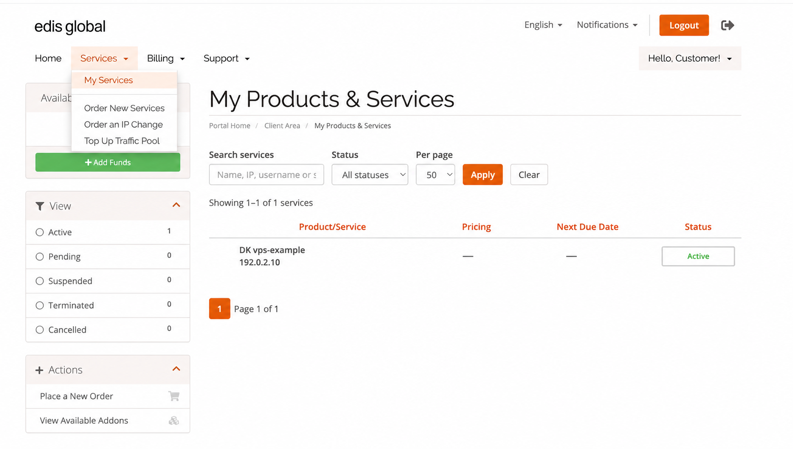

## Добро пожаловать в справку и документацию EDIS Global 🚀 {#welcome-to-edis-global-help-and-docs-}

Эти руководства помогут настроить, защитить, администрировать и масштабировать виртуальный частный сервер (VPS).

Поддержка EDIS Global помогает с вопросами инфраструктуры, аккаунта, оплаты и расширения ресурсов. Для настройки внутри VPS мы предоставляем практическую документацию и рекомендации по устранению неполадок, при этом сервер остаётся полностью под вашим контролем.

Нужна помощь прямо сейчас? Нажмите оранжевый **значок чата** внизу, чтобы связаться с нами.

## Откройте VPS в портале {#open-your-vps-in-the-portal}

1. Войдите в [портал управления VPS](https://manage.edisglobal.com/clientarea.php).
2. В главном меню откройте **Services → My Services**.
3. Выберите VPS, которым хотите управлять. Перед изменениями проверьте его описание и IP-адрес.

<Frame caption="Откройте Services → My Services, чтобы найти VPS. Данные клиента и платёжные сведения обезличены.">
  
</Frame>

На странице услуги раздел **Server Information** содержит управление питанием, установкой, сетью и консолью. В **Configurable Options** находится кнопка **Upgrade Resources**. Ссылки на каждое действие приведены в [обзоре портала](/ru/vps-management/vps-management-portal).

## Начните с основ {#start-with-the-essentials}

<Columns cols={4}>
  <Card title="Проверьте почту" icon="envelope" href="/ru/getting-started/check-your-inbox">
    Найдите данные доступа к серверу, IP-адреса и ссылку на портал управления VPS.
  </Card>

  <Card title="Подключение по SSH" icon="terminal" href="/ru/getting-started/linux-secure-shell-ssh">
    Безопасно подключитесь к Linux VPS и настройте доступ по SSH.
  </Card>

  <Card title="Подключение по RDP" icon="desktop" href="/ru/getting-started/windows-remote-desktop">
    Подключитесь к Windows VPS через удалённый рабочий стол.
  </Card>

  <Card title="Защита VPS" icon="shield-alt" href="/ru/getting-started/ssh-security-hardening-guide">
    Повысьте безопасность SSH, аутентификации и управления доступом.
  </Card>
</Columns>

## Управляйте VPS и расширяйте его возможности {#manage-and-scale-your-vps}

<Columns cols={4}>
  <Card title="Управление VPS" icon="server" href="/ru/vps-management/vps-management-portal">
    Управляйте питанием, переустанавливайте, отслеживайте и настраивайте VPS в одном портале.
  </Card>

  <Card title="Трафик и ежемесячное пополнение" icon="chart-line" href="/ru/faq/traffic-bandwidth/traffic-stats-refill-explained">
    Разберитесь в расходе трафика, месячных лимитах, предупреждениях и датах пополнения.
  </Card>

  <Card title="Traffic Pool и Auto-Hydration" icon="tint" href="/ru/faq/traffic-bandwidth/traffic-pool">
    Создайте общий резерв трафика и защитите VPS от исчерпания лимита.
  </Card>

  <Card title="Расширение и масштабирование" icon="arrow-up" href="/ru/faq/upgrades-downgrades/upgrades">
    Добавляйте ресурсы или переходите на более высокий тариф VPS по мере роста потребностей.
  </Card>
</Columns>

## Частые задачи {#common-tasks}

Практические инструкции по повседневным действиям приведены в руководстве [Частые задачи VPS: переустановка, смена IP, управление оплатой и защита данных](/ru/getting-started/common-vps-tasks).

<Columns cols={4}>
  <Card title="Переустановка VPS" icon="redo" href="/ru/vps-management/autoinstall-reinstall-install-vps-linux-windows">
    Переустанавливайте Linux или Windows в любое время.
  </Card>

  <Card title="Смена IP-адреса" icon="exchange-alt" href="/ru/faq/ip-addresses/change-ip-address">
    Бесплатная смена основного IPv4 в течение 24 часов или платная стандартная смена либо выбор адреса Bespoke позднее.
  </Card>

  <Card title="Оплата и продления" icon="file-invoice" href="/ru/faq/billing-lifecycle/automated-vps-billing-workflow">
    Узнайте, как работают счета, платежи, продления, приостановка и восстановление услуг.
  </Card>

  <Card title="Резервные копии" icon="save" href="/ru/getting-started/backups">
    Защитите важные данные и узнайте о доступных вариантах резервного копирования.
  </Card>
</Columns>
