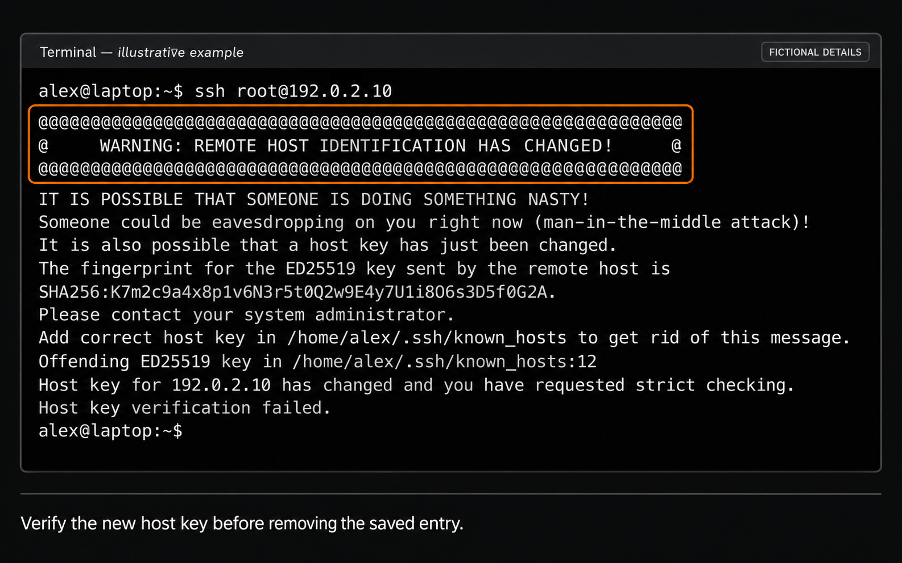

import { CtaButton } from "/snippets/cta-button.mdx";

## Что такое Secure Shell (SSH) {#what-is-a-secure-shell-ssh}

SSH, или Secure Shell, — защищённый сетевой протокол для удалённого управления компьютерами через незащищённую сеть. Он устанавливает безопасное зашифрованное соединение между клиентом и сервером для обмена данными и управления системой. Мы настоятельно рекомендуем SSH: шифрование данных и действий защищает от нежелательного доступа и утечек.

### Как подключиться к удалённому VPS по SSH {#how-to-use-ssh-to-connect-to-your-remote-vps}

Откройте терминал или командную строку на своём компьютере и введите:

```shell
ssh username@remote-host
```

Замените **username** на имя пользователя VPS — _обычно root; оно приходит по электронной почте после покупки VPS_, а **remote-host** — на публичный IPv4-адрес VPS.

При первом подключении SSH покажет отпечаток ключа хоста сервера. Проверьте его перед принятием. Соответствующий публичный ключ хоста можно проверить через [консоль VNC](/ru/vps-management/enable-vnc-server), например:

```bash
sudo ssh-keygen -lf /etc/ssh/ssh_host_ed25519_key.pub
```

Сравните тип ключа и отпечаток с показанными SSH-клиентом. После проверки введите `yes`, затем пароль VPS. При вводе пароля символы обычно не отображаются — это нормально.

При успешном подключении появится приветствие удалённого сервера и приглашение его командной оболочки. Затем можно выполнять удалённые команды и при необходимости загружать или скачивать файлы через SSH.

_Убедитесь, что доступ по SSH включён и у вас правильные учётные данные для входа на VPS._

Для нестандартного порта используйте `ssh -p 2222 username@remote-host`, заменив `2222` на настроенный порт. Если аутентификация не проходит, проверьте имя пользователя и пароль или воспользуйтесь [руководством по сбросу пароля Linux](/ru/vps-management/reset-root-password-linux). При тайм-ауте следуйте [руководству по диагностике сети](/ru/faq/ip-addresses/network-is-down).

Завершив работу на удалённом сервере, введите:

```shell
exit
```

Эта команда завершает сеанс VPS.

## Предупреждение Remote host identification has changed {#remote-host-identification-has-changed}

Предупреждение означает, что ключ хоста, предъявленный сервером, отличается от ключа, сохранённого SSH-клиентом для этого адреса. Такое бывает после переустановки VPS, но также может указывать на подключение к другому серверу или перехват соединения.

<Frame caption="Пример предупреждения OpenSSH. IP-адрес, имя пользователя, отпечаток и путь к файлу вымышлены; формулировка может различаться в разных SSH-клиентах.">
  
</Frame>

### Сначала проверьте новый ключ {#verify-the-new-key-first}

Откройте VPS через [консоль VNC](/ru/vps-management/enable-vnc-server) и выведите отпечаток ключа того типа, который указан в предупреждении. Для ED25519:

```bash
sudo ssh-keygen -lf /etc/ssh/ssh_host_ed25519_key.pub
```

Сравните полный отпечаток `SHA256:` с показанным SSH-клиентом. Для предупреждения RSA или ECDSA вместо этого проверьте соответствующий файл `ssh_host_rsa_key.pub` или `ssh_host_ecdsa_key.pub`.

<Warning>
  Если отпечатки не совпадают или изменение нельзя проверить, остановитесь и выясните причину. Не отключайте проверку ключа хоста и не удаляйте сохранённые ключи только ради устранения предупреждения.
</Warning>

### Удалите старую запись на своём компьютере {#remove-the-old-entry-on-your-computer}

**Только после проверки нового ключа хоста** выполните на компьютере, с которого подключаетесь:

```bash
ssh-keygen -R YOUR_VPS_IP
ssh root@YOUR_VPS_IP
```

Замените `YOUR_VPS_IP` на адрес VPS, а `root` — на своё имя пользователя, если оно другое. Если подключаетесь по имени хоста, используйте его. Это удаляет сохранённый ключ хоста для данного назначения, но не изменяет пароль VPS.

Для нестандартного порта, например `2222`, используйте имя хоста и порт в следующем формате:

```bash
ssh-keygen -R "[YOUR_VPS_IP]:2222"
ssh -p 2222 root@YOUR_VPS_IP
```

При следующем подключении перед принятием ключа убедитесь, что показанный отпечаток совпадает с проверенным через VNC. Если предупреждение указывает другой файл известных хостов, задайте его с помощью `ssh-keygen -f /path/to/known_hosts -R YOUR_VPS_IP`. См. [руководство OpenSSH по управлению ключами](https://man.openbsd.org/ssh-keygen).

<CtaButton
  label='Статья: действительно ли SSH-соединения безопасны?'
  link='https://www.edisglobal.com/blog/are-ssh-connections-secure'
/>
