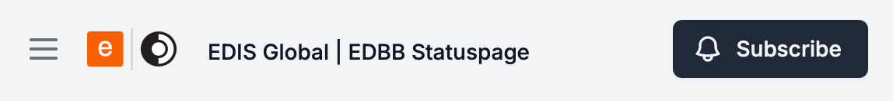
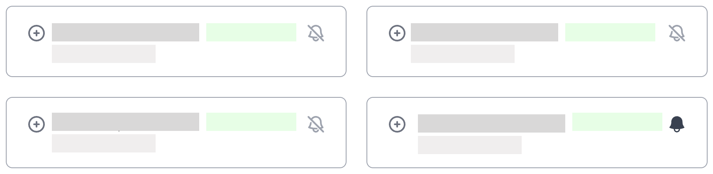
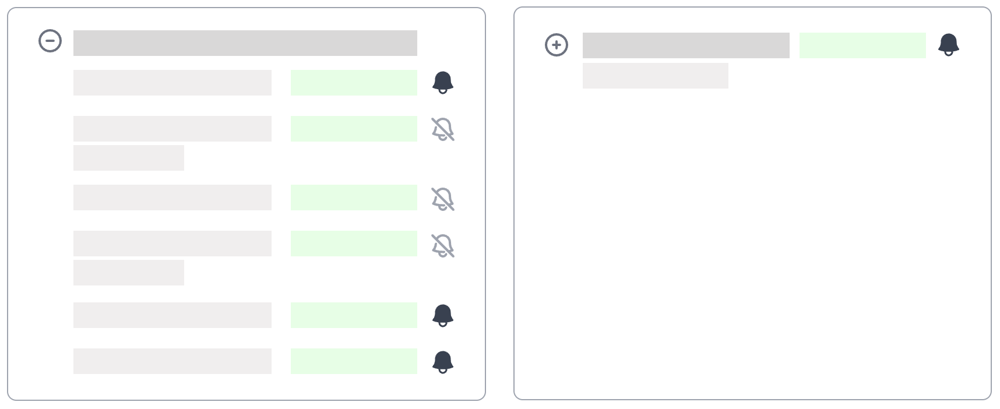
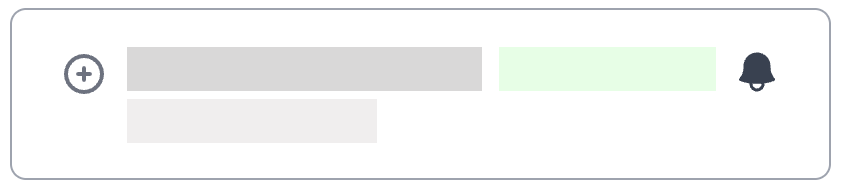
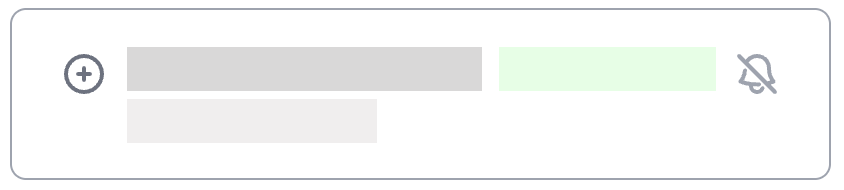

# Подписка на обновления статуса {#subscribe-to-status-updates}

Будьте в курсе **инцидентов, обслуживания и состояния услуг** в используемых локациях.

Подписаться можно через:

- Электронную почту.
- Slack.
- Microsoft Teams.
- Google Chat.

Можно выбрать **только нужные локации**, чтобы не получать сообщения о регионах, которыми вы не пользуетесь.

<Note>
  Уведомления приходят только для локаций, у которых **включён значок колокольчика**.
</Note>

---

## Краткий обзор {#quick-overview}

Подписка занимает меньше минуты.

1. **Откройте** Statuspage.
2. Нажмите **Subscribe**.
3. Введите **адрес электронной почты**.
4. Нажмите **ссылку входа** в письме.
5. Выберите **локации для отслеживания**.
6. Выберите **способ получения уведомлений**.
7. Нажмите **Save Changes**.

---

## 1. Откройте страницу статуса {#1-open-the-status-page}

Перейдите на Statuspage EDIS Global:

https://status.edis.global

На странице показаны **текущее состояние и показатели доступности** всех услуг EDIS Global.

---

## 2. Нажмите **Subscribe** {#2-click-subscribe}

В правом верхнем углу нажмите большую заметную кнопку **Subscribe**.

<Frame>
  
</Frame>

---

## 3. Введите адрес электронной почты {#3-enter-your-email-address}

Появится окно с запросом адреса электронной почты.

Введите адрес для уведомлений и нажмите:

**Start subscription**

---

## 4. Подтвердите вход по ссылке {#4-confirm-via-magic-link}

Вы получите письмо со **ссылкой для входа — Magic Link**.

Нажмите:

**Sign in to EDIS Global Status | EDBB Status**

Эта ссылка выполняет вход и открывает настройки подписки.

---

## 5. Выберите регионы {#5-select-regions}

После входа выберите **регионы** или **отдельные локации**, за которыми хотите следить.

Доступные регионы:

- **KVM Europe**
- **KVM Asia, Australia and Oceania**
- **KVM North and Latin America**
- **KVM Middle East and Africa**

Нажмите **значок колокольчика 🔔** рядом с регионом, чтобы подписаться на обновления **всех локаций серверов VPS** в нём.

<Frame>
  
</Frame>

---

## 6. Подпишитесь на отдельные локации {#6-subscribe-to-individual-server-locations}

Разверните регион, чтобы увидеть отдельные локации и уточнить выбор.

<Frame>
  
</Frame>

Нажмите **значок колокольчика 🔔** рядом с локациями, обновления которых хотите получать.

Примеры:

- Австрия, Вена **🔔**
- Германия, Франкфурт 🔕
- Франция, Париж 🔕
- Греция, Салоники 🔕

### Значения значков {#icon-meaning}

🔔 Уведомления включены — подписка активна.

<Frame>
  
</Frame>

🔕 Уведомления выключены — подписка не активна.

<Frame>
  
</Frame>

---

## 7. Выберите способ уведомления {#7-select-your-notification-method}

Вы можете выбрать, **как получать уведомления**.

В **правом верхнем углу** нажмите:

**Preferences**

Затем включите нужные способы.

Доступные варианты:

- **Email**
- **Slack**
- **Microsoft Teams**
- **Google Chat**

Можно включить **несколько способов одновременно**.

---

## 8. Сохраните изменения {#8-save-your-changes}

Выбрав локации и способы уведомления, нажмите:

**Save Changes**

Теперь ваши настройки уведомлений действуют.

---

## Отписка {#unsubscribe}

Отписаться можно в любой момент.

Вернитесь на страницу статуса и:

- Выключите **значок колокольчика** для отдельных локаций.
- Либо нажмите **Unsubscribe completely**.

---

## Status API {#status-api}

Для систем мониторинга и автоматизации **EDIS Global Status API** предоставляет программный доступ к состоянию услуг и данным об инцидентах.

Через API можно получить:

- Общее состояние услуг.
- Состояние компонентов.
- Показатели доступности.
- Историю инцидентов.
- События обслуживания.

Конечная точка API:

https://status.edis.global/api

Ограничение частоты: **10 запросов в секунду**.
