## Как подключиться к удалённой системе из Windows и macOS {#how-to-connect-to-a-remote-system-on-windows-and-macos}

Это руководство описывает подключение к серверу Windows по протоколу Remote Desktop Protocol (RDP). Основное внимание уделено Windows, но также приведены шаги для macOS. Убедитесь, что на VPS установлена Windows. Если вы заказали VPS с Linux, в любой момент можно [переустановить ОС](/ru/vps-management/autoinstall-reinstall-install-vps-linux-windows), выбрав Windows.

## Данные подключения {#connection-details}

- **Порт:** RDP на Windows VPS EDIS Global использует стандартный порт **3389**. Добавлять порт к адресу не требуется: RDP-клиенты используют 3389 по умолчанию. Чтобы указать его явно, добавьте к IP-адресу, например `192.168.10.1:3389`.
- **Имя пользователя:** `Administrator`.
- **Пароль:** пароль вашего VPS.

Если подключение не удаётся, проверьте доступность порта 3389 из вашей сети. Подробнее см. [Порты, межсетевые экраны и подключение](/faq/ip-addresses/ports-firewalls-and-connectivity).

## Для пользователей Windows {#for-windows-users}

**Откройте Remote Desktop Connection:**

Нажмите **клавишу Windows**, введите **Remote Desktop Connection** в строке поиска и откройте приложение.

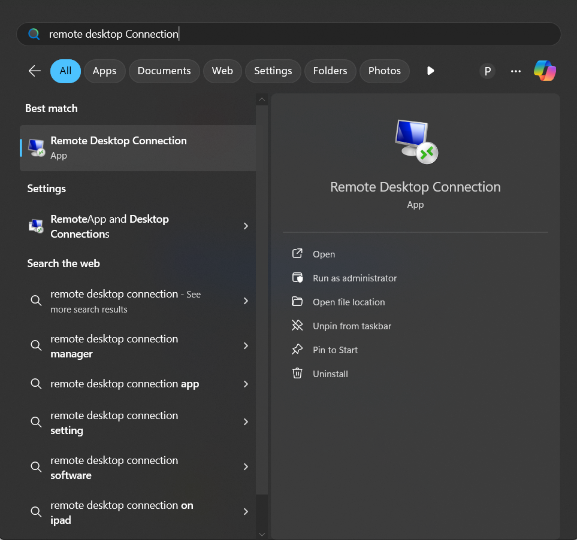

**Другой способ:** нажмите `Win + R`, введите `mstsc` в окне «Выполнить» и нажмите **Enter**.

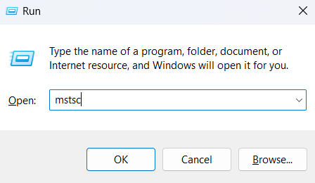

**Введите IP-адрес или имя хоста:**

В окне **Remote Desktop Connection** укажите **IP-адрес** или **имя хоста** удалённой системы.

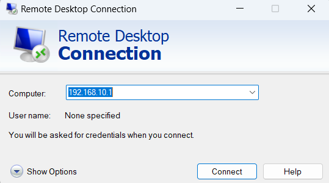

**Откройте дополнительные настройки:**

Нажмите **Show Options**, чтобы открыть расширенные параметры.

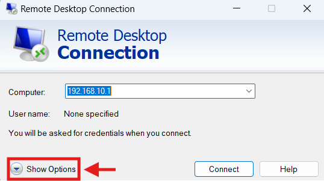

**Выберите параметры аутентификации:**

В открывшемся меню можно включить запрос новых учётных данных при каждом подключении. По умолчанию **имя пользователя** — **Administrator**.

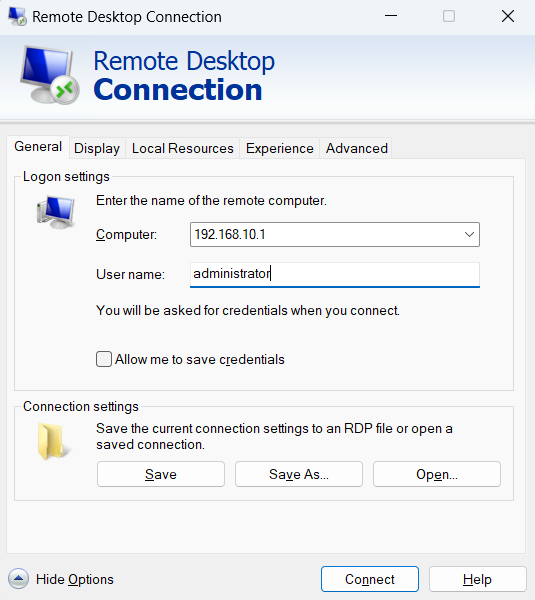

**Пройдите аутентификацию:**

Нажмите **Connect** и введите пароль сервера. Сохранять данные с помощью **Remember me** необязательно; делайте это только на доверенном компьютере под вашим контролем.

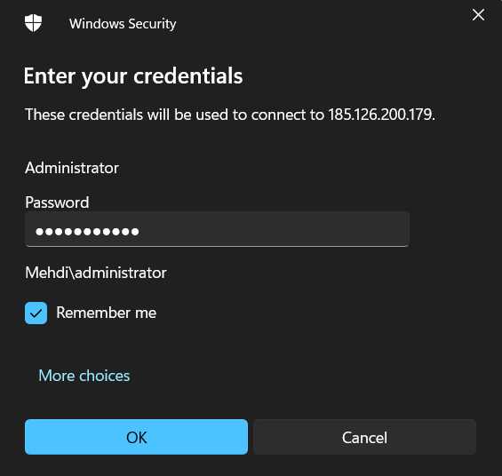

**Установите соединение:**

Если Windows показывает предупреждение о сертификате, убедитесь, что адрес назначения и сертификат принадлежат нужному VPS. Не игнорируйте неожиданную смену сертификата автоматически. Продолжайте только после проверки подлинности сервера; сохранять это решение необязательно.

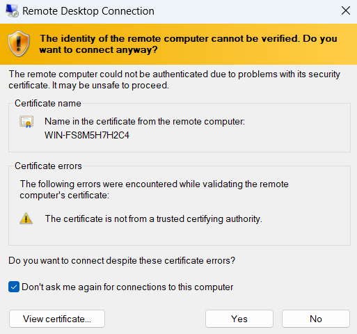

**Начало подключения:**

Начнётся процесс подключения к удалённому серверу.

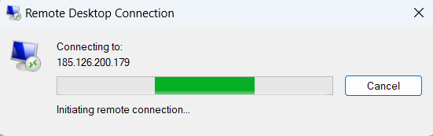

Теперь вы должны быть подключены к удалённой системе и можете управлять ею.

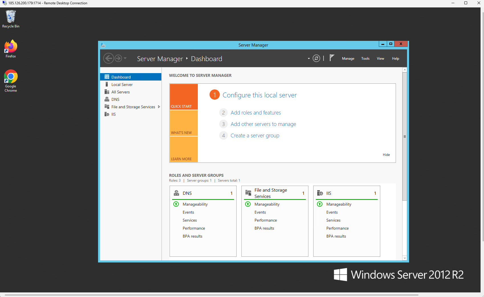

## Для пользователей macOS {#for-macos-users}

**Установите Microsoft Windows App:**

Скачайте Windows App, ранее называвшееся Remote Desktop, из [Mac App Store](https://itunes.apple.com/ru/app/microsoft-remote-desktop-10/id1295203466?mt=12).

**Откройте Windows App:** запустите приложение после установки.

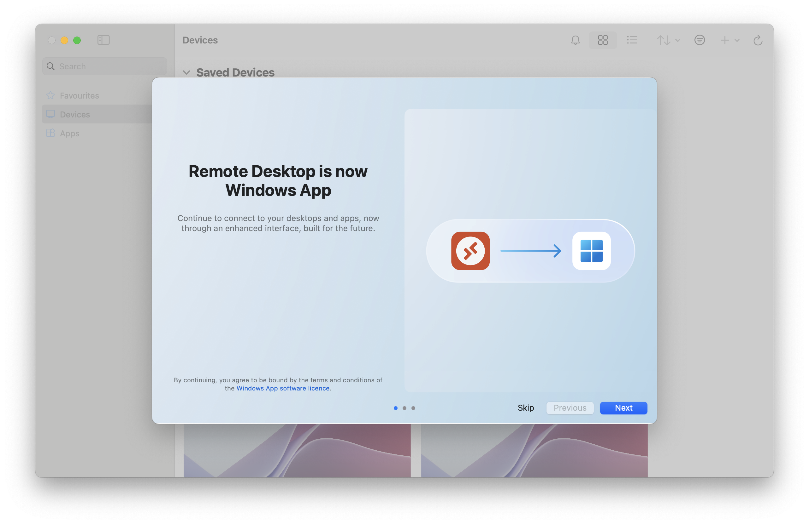

**Добавьте подключение:**

1. Нажмите **+**, чтобы добавить новое подключение.

2. Введите **IP-адрес** удалённой системы в PC name и название подключения в Friendly Name.

3. В Credentials добавьте имя пользователя VPS **Administrator** или выберите уже сохранённые данные этого аккаунта.

4. Нажмите **Add**, чтобы сохранить подключение.

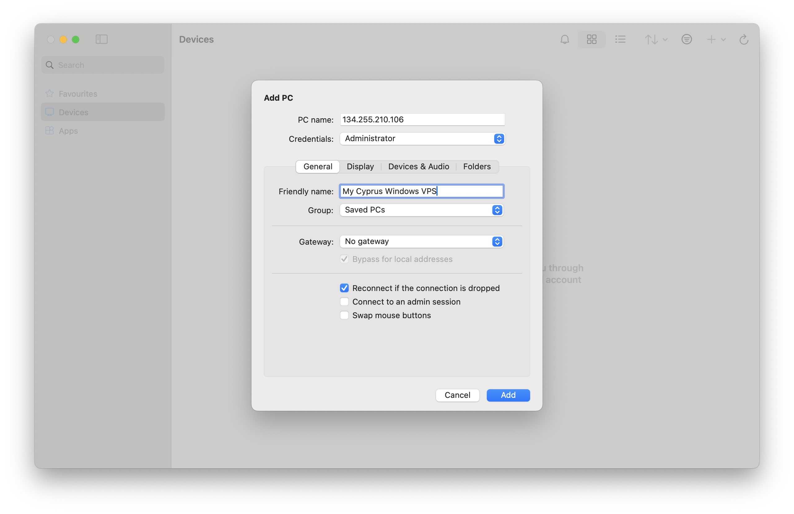

Дважды нажмите плитку подключения. Если появится предупреждение о сертификате, проверьте подлинность сервера, прежде чем нажимать **Continue**.

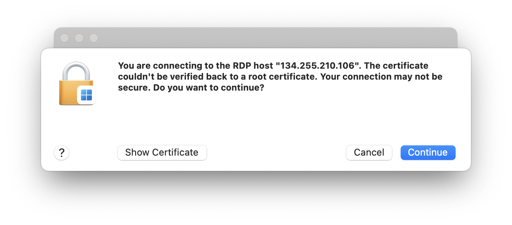

Введите пароль и нажмите **Continue**, чтобы подключиться.

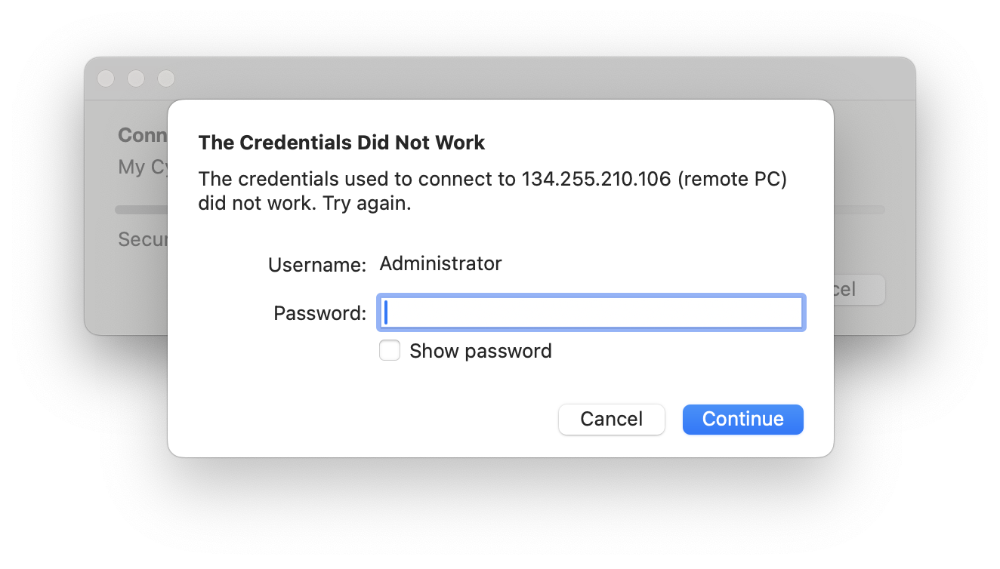

macOS может запросить доступ к Связке ключей для использования сохранённых данных. Проверьте запрашивающее приложение и элемент; разрешайте доступ только если они соответствуют подключению Windows App, которое вы начали.

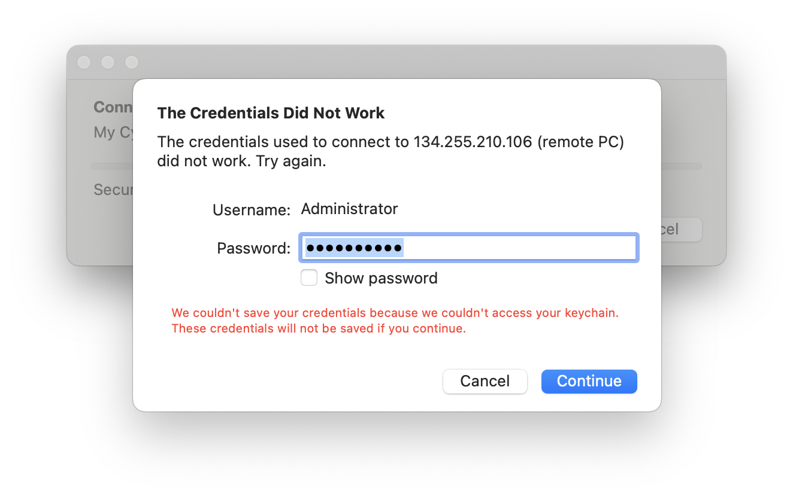

После подключения вы увидите рабочий стол Windows и сможете продолжить первоначальную настройку или работу.

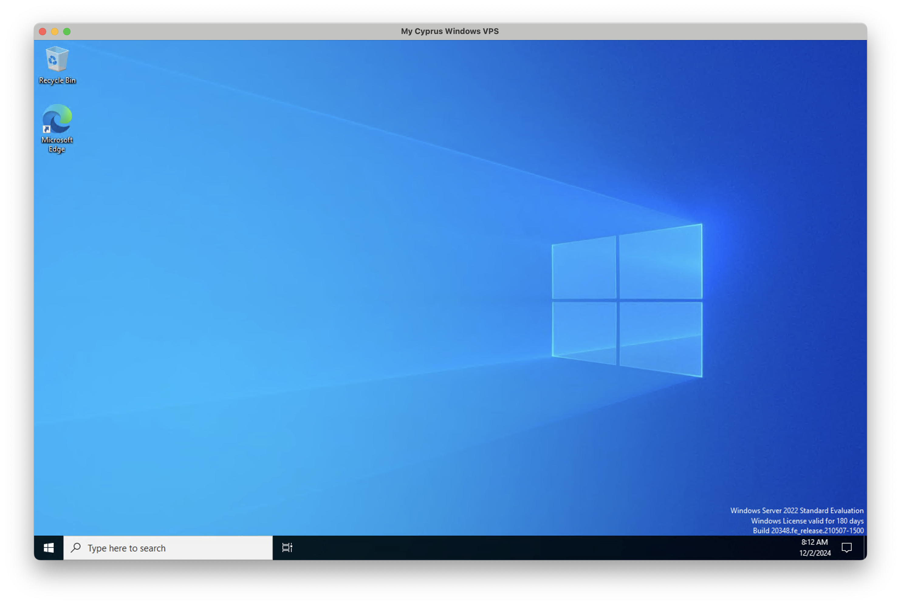

## Устранение неполадок {#troubleshooting}

- [Ошибка RDP 0xd07: аккаунт пользователя заблокирован](/ru/vps-management/rdp-error-0xd07-user-account-locked) объясняет, что делать, если Windows блокирует вход по RDP после слишком большого числа неудачных попыток.
