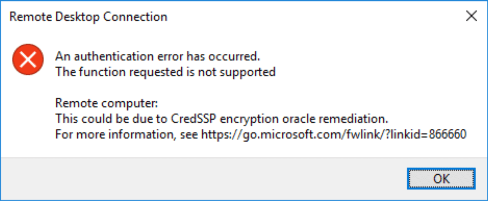

Подключение по RDP может завершиться ошибкой **«This could be due to CredSSP encryption oracle remediation»**, если обновления безопасности или настройки политик клиента и сервера несовместимы.



## Рекомендуемое исправление {#recommended-fix}

1. Установите соответствующие обновления безопасности Windows на компьютере с RDP-клиентом.
2. Откройте VPS через **Start VNC → Open Console** в [панели управления VPS](/ru/vps-management/enable-vnc-server). Это позволит работать с Windows, когда RDP недоступен.
3. Установите соответствующие обновления безопасности Windows на VPS. Используйте поддерживаемую версию Windows и перезагрузите систему, если это требуется.
4. Повторите подключение к удалённому рабочему столу после завершения обновлений на обеих системах.

Microsoft рекомендует обновить **и клиент, и сервер**, чтобы восстановить безопасное соединение. См. [руководство Microsoft по устранению ошибки CredSSP](https://learn.microsoft.com/en-us/troubleshoot/azure/virtual-machines/windows/credssp-encryption-oracle-remediation).

## Если вы раньше применяли обходное изменение реестра {#if-you-previously-applied-the-registry-workaround}

В старых инструкциях параметру `AllowEncryptionOracle` присваивали значение `2`. Оно включает политику **Vulnerable** и разрешает небезопасный режим совместимости CredSSP; это не постоянное решение.

После обновления обеих систем восстановите политику, принятую в вашей организации. На личном компьютере, не управляемом организацией, где этот параметр реестра был добавлен только для обхода ошибки, удалите его из **командной строки от имени администратора**:

```cmd
reg delete "HKLM\Software\Microsoft\Windows\CurrentVersion\Policies\System\CredSSP\Parameters" /v AllowEncryptionOracle /f
```

Если параметр не существует, удалять локальное переопределение не требуется. На корпоративном компьютере попросите администратора проверить политику. Microsoft описывает уровни защиты в разделе [Encryption Oracle Remediation](https://learn.microsoft.com/en-us/windows/client-management/mdm/policy-csp-admx-credssp).

## Подключение по-прежнему не работает? {#still-unable-to-connect}

Уточните точный текст ошибки. Превышение времени ожидания, неверный пароль или [блокировка учётной записи](/ru/vps-management/rdp-error-0xd07-user-account-locked) требуют другой диагностики. Используйте [руководство по подключению RDP](/ru/getting-started/windows-remote-desktop), а при обращении в поддержку укажите текст ошибки и версии Windows.
